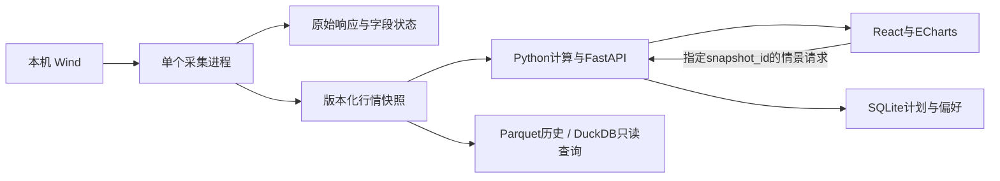

# 期权终端实施方案 v0.3

> 整合架构更新：统一入口、独立业务进程、历史/盘中时点、云发布及日常升级冲突，以[统一终端方案 v0.4](统一终端架构与冲突预案-v0.4.md)为准。本文的期权业务规格继续有效；实施时同时执行v0.4的任务映射和新增整合验收。

编制日期：2026-09-10。项目根目录：`E:\工作\期权终端`。

状态：实施前规格，不代表开发、Wind持续采集、自动任务或云部署已经启动。持仓成交、完整期权链的布局暂时通过；首页和波动率页继续沿用既定功能方向，正式接入前做真实页面验收。本文件优先于v0.1/v0.2中冲突的内容；旧文保留作为设计历史。

阅读入口：先看第1节范围、第3节架构、第8节页面、第12节实施顺序。逐项执行与签收见[实施任务与验收清单](实施任务与验收清单-v0.3.md)。

## 1. 目标、范围与完成定义

目标：盘中快速识别变化、比较合约和价差、检验提前退出情景，减少长文阅读。10秒识别、30秒比较、1分钟检验是待实测的体验目标，不作为已达成能力。

### 1.1 交付顺序

| 批次 | 交付范围 | 通过条件 |
|---|---|---|
| A：MO可用版 | IM入口；MO全部在市月份；四个主页面；手动刷新；确定性计算；单腿及同到期价差；多腿手动编辑；本地保存与历史截面 | 真实样本、数值和界面验收全部通过，无假实时、假报价、假完整覆盖 |
| B：多品种完善版 | IF/IO、IH/HO完成同等功能；AU先核实美式模型、日历和行权处理，再开放相应功能；通过测试的持续刷新 | 品种逐一签收；AU未通过时标明受限，不宣称四品种完整完成 |
| C：研究增强 | 自选品种×月份矩阵；盘中异动提醒；Greeks盈亏归因；更长历史与回放；跨期策略深化 | 每项有独立数据覆盖和模型验收，不阻挡A版使用 |
| D：可选公开 | 授权数据源、云端只读API、认证、部署、运维 | 数据再分发许可及服务器条件核实后单独实施 |

首版不做自动下单、无来源胜率、做市商持仓方向推断、完整交易回测、任意拖拽布局或复杂分布式架构。以上为范围选择，不是删除后续需求。

### 1.2 用户要求落实表

| 要求 | 实施约束 | 验收位置 |
|---|---|---|
| 红涨绿跌 | 正变化/盈利红，负变化/亏损绿，均带正负号；成本中性 | 全局颜色、图例、单元格 |
| 价格上高下低 | 执行价纵轴及情景价格纵轴降序 | 持仓图、T链、热力图 |
| 品种下拉 | 可搜索名称/代码；IM、IF、IH、AU固定入口，能力状态可见 | 顶部、切换回归 |
| 所有在市月份 | 目录全量展示，数据缺失月份不消失；年/月不写死 | 导航、期限图、完整链 |
| 月份两位着色 | 年份和前缀中性，月份按完整到期身份固定配色；跨年明确显示 | 顶栏、链组头、比较篮、策略腿 |
| 剩余时间 | 自然日和交易日并列，悬停显示精确到期时间和计数定义 | 月份标签 |
| 买方与价差共存 | 交易方向与策略范围独立；纯买方/价差/一起比较 | 首页与比较篮 |
| 最大亏损 | 与目标损益并列，资金占用和止损独立 | 候选表和多腿编辑器 |
| 提前退出 | 目标价格×退出时刻×IV变化；到期模式单列 | 情景面板 |
| 持仓叠加 | 蓝色存量、内含红色增仓、外侧绿色空心虚线减仓 | 第7节 |
| 简洁字体 | Segoe UI、Microsoft YaHei UI等本机字体回退；不冒称Codex精确字体 | 1440/1920宽屏验收 |
| 固定表头/执行价 | 双层表头固定；横滚保持执行价可辨认 | 第8.4节 |

## 2. 当前依据、缺口与设计基线

已存在：`preview/index.html`含两页纯示例交互；`docs/visuals`保存已生成图片；v0.1/v0.2保存前期分析。当前预览不是正式行情客户端，其中报价、月份比例及趋势有人工构造内容，正式版禁止直接复用为真实数据。

旧分析源目录：`C:\Users\MINGJIE\Documents\ChatGPT\期权行情分析`。已检查`collect_im.py`、`collect_extra.py`：wset抓取全目录，但后续量价查询代码只选MO2609/MO2610。因此“目录有全部月份”不代表“全部月份已有完整行情”。实施时重新核对文件、ErrorCode、合约集合、日期、空值及覆盖数量；不能直接把此前130份样本说成全市场链。

已有脚本证明曾使用wset/wss/wsq/wsd/wsi/tdays路径，未证明当前账户持续订阅、盘中OI字段、字段时间精度和全部品种权限。必须执行第12节的小范围探测，禁止以过往成功替代当日验收。

已查看相邻本地期货终端：frontend依赖中有React、Vite、ECharts。只借用成熟布局和工程做法，版本在本项目锁定；不复制它的站点发布脚本、数据库、定时任务或私有配置。早期远程网站的后台技术未由静态资源证明。

本轮浏览器检查接口曾返回`nodeRepl.fetch request failed`，截图视觉验收未完成。两页暂时通过是用户认可布局；不等于对浏览器兼容、滚动固定、无障碍和真实行情正确性的最终签收。

## 3. 最小可用技术路线



### 3.1 运行方式

1. 前端生产构建由本地FastAPI提供，同源访问；开发期可用Vite代理。仅绑定127.0.0.1。
2. Wind在一个明确解释器的独立采集进程运行，避免阻塞Web请求；若Wind依赖必须复用既有Python，只调用该解释器，不升级既有环境。后端使用本项目独立虚拟环境。
3. 采集进程按批形成快照，写临时文件、校验后在同卷原子替换latest指针。API把完整快照加载到内存；一个计算请求绑定一个不可变版本。
4. 首版前端每2秒询问版本是否变化，数据未变化不重新绘图。Wind查询周期独立配置，初始候选5—10秒，须以账户限额和探测结果为准；前端轮询频率不等于源更新频率。
5. 首版不需要WebSocket、Redis、Celery或多后端worker。实测不足再做局部优化。
6. 多标签页共享同一个采集进程，不能每开一个页面增加一份Wind订阅。

### 3.2 建议文件结构（实施时按需建立）

```text
期权终端/
  README.md                         启动、使用、数据范围与限制
  start.ps1 / stop.ps1               本项目进程启动和停止
  config.example.toml               非敏感配置模板
  backend/
    app.py                          路由、静态文件、生命周期
    collect.py                      Wind调用、批次、重连、快照发布
    contracts.py                    品种映射、合约、日历
    normalize.py                    字段与质量检查
    pricing.py                      定价、IV、Greeks
    analytics.py                    曲线、量仓、期限、历史指标
    scenarios.py                    多腿成本、情景、最大损益
    storage.py                      快照和SQLite读写
  frontend/src/
    App.tsx / api.ts / types.ts / styles.css
    components/ContractLabel.tsx     多处共用的合约显示
    components/ExpiryBar.tsx         四页共用的月份导航
    pages/Workspace.tsx / Volatility.tsx / Interest.tsx / Chain.tsx
  data/raw/                         原始响应与采集证据
  data/contracts/                   合约元数据和日历版本
  data/snapshots/                    按交易日归档的快照
  data/history/                      日线、分钟Parquet
  runtime/                          本地配置、SQLite、日志、进程记录
  reports/                          报告与验收输出
  docs/                             规格、字段字典、验收记录
  preview/                          已通过布局的静态原型
  tests/                            数据、数值、接口、关键界面测试
```

不预建通用Manager/Factory等类层；共用组件只在真实重复位置提取。锁文件、计算配置版本随发布保存；本地数据、Wind登录状态及密钥不入代码仓库。

## 4. 数据接入：从合约目录到完整截面

### 4.1 品种身份

建立显式产品表：`product_id / option_root / exchange / spot_code / futures_root / exercise_style / settlement_type / calendar_id / enabled_capabilities`。

IM→MO、IF→IO、IH→HO；AU映射至黄金期货期权的实际合约。Wind完整代码从目录返回值获得，不只凭字符串拼装。期权到期月、标的期货月、年份分别保存；没有同到期IM合约时不虚构一份IM代码。

指数期权的经济标的是指数，界面品种入口IM不改变这一事实。黄金期权采用其对应期货作标的；不能把指数现金结算和现货目标逻辑原样迁移。

### 4.2 最少字段与来源路径

| 数据 | 规范字段 | 当前线索/实施动作 |
|---|---|---|
| 合约目录 | instrument_id、wind_code、product_id、C/P、K、到期日、上市日、乘数、tick、标的代码、行权/结算类型 | 已用wset optionchain；逐字段映射并补权威元数据，不从名字推导全部属性 |
| 买卖盘口 | bid、ask、bid_size、ask_size、last | 已用wsq rt_bid1/rt_ask1/rt_bsize1/rt_asize1/rt_last；验证缺值、单位、时间戳 |
| 时间 | quote_time、received_at、trade_date、field_asof | 已用rt_date/rt_time；核实这是哪种时间，不能当作所有字段的独立更新时间 |
| 日线量仓 | close、pre_close、volume、oi、amount、settle | 已用wss同名字段；确认当日值是否最终及成交/持仓单双边统计口径 |
| 历史 | code、trade_date/bar_time、OHLC、volume、oi及其状态 | 已用wsd/wsi；每批校验起止时间、权限、缺口和返回频率 |
| 日历 | exchange、trade_date、session_start/end、expiry_timestamp | tdays及交易所日历；夜盘映射单独核对 |
| 利率/费用 | 年化利率、来源日期；开平仓费用、手续费单位 | 初版允许有来源的手工配置；未配置不得伪装为已扣费净收益 |

未经实测的实时OI、实时成交字段不预填Wind字段名。`docs/数据字段字典.md`记录规范名、源API、源字段、参数、单位、时效、错误码、样例与验证日期，D02完成后才定稿。

### 4.3 查询步骤与覆盖

1. 启动检查Wind可连、解释器路径、授权状态；只记录结果，日志不输出账号凭据。
2. 取当前品种全部挂牌目录；检查代码唯一、到期合法、乘数/tick非空。目录刷新失败使用上次有效版本并显示目录日期。
3. 依目录分批取报价；批量上限由实测确定，记录总合约数、成功数、无报价数、失败数。
4. 初始补全部在市月份的前一交易日收盘OI和收盘价，作为日变化基准；日终状态与盘中状态分开。
5. 再补选中月份、自选和策略腿的历史；从近20交易日开始，扩展窗口按用户查询和权限执行，不能一次启动全市场多年回补。
6. 全目录常驻；活跃月/持仓腿优先更新，其余月份较慢更新也必须标各自时间。需要严格跨月比较时重新形成满足时间差阈值的截面，不把旧远月与新近月标成同步。
7. 新挂牌合约当日进入目录；历史上不存在不能当作缺失错误。到期合约退出当前导航，保留历史和已存计划。

### 4.4 质量状态

逐字段状态：`valid / missing / stale / crossed / invalid / unsupported`。此外保存合约交易状态；整体状态不覆盖字段状态。

初始可配置阈值：活跃交易时段盘口超过30秒未获得可靠更新证据标stale；严格比较腿间时间差目标≤10秒。它们是首轮测试阈值，不是对Wind刷新能力的断言。对源时间含义不明确的字段显示“源时间未确认”，仅有接收时间不标严格同步。

| 情况 | 显示/计算行为 |
|---|---|
| bid>ask、非有限值、负价格 | 保留原始证据；中价/IV不可用 |
| bid=0或单边报价 | 原始值可见；不默认有效双边；禁用依赖可退出价格的排名 |
| last旧而bid/ask新 | 分别标时效；允许合格盘口估值，不能因last旧全行弃用 |
| OI缺基准 | 画当前蓝柱，增减显示“—”；不补0、不画红绿段 |
| 涨跌停、停牌、临近到期 | 显示交易状态；价格存在不等于可成交 |
| 闭市或午休 | 显示闭市/休市；保留源时间，不持续闪烁“更新” |
| 部分批次失败 | 发布完整结构及缺失标记，保留各字段原时刻；不能让旧值冒充本批新值 |
| 目录或元数据不可信 | 原始报价可查看；受影响合约不输出精确模型结果 |

## 5. 数据保存、版本与接口契约

### 5.1 快照和历史

每个快照至少包含：`schema_version、snapshot_id、product_id、trade_date、captured_at、contract_version、calendar_version、collection_window、coverage、rows`。行内保存源字段时间/状态、原始报价；计算结果另带`calc_version、config_hash、snapshot_id`。

同一snapshot_id表示一个冻结采集批次，不保证交易所逐笔同步；`collection_window`和各行时间差同时存在。情景结果还绑定输入hash，防止旧请求覆盖新输入。

内存保留最近20个发布截面供短时请求引用；用户冻结/保存计划/导出时将原始输入截面持久化，不受内存淘汰影响。不存在的snapshot_id返回明确错误，不能静默改用最新行情。

原始证据按API/批次存档；历史按交易日分区Parquet。日线键为(code,trade_date)，分钟键为(code,bar_end,frequency)，逐键比对和替换，不只检查行数。DuckDB只读查询Parquet，SQLite由后端单写计划与偏好。

分钟快照是本终端采样，不冒称交易所逐笔数据。保存频率、容量、原始响应保留天数在试运行测量后确定；首版不自动删除历史，磁盘不足停止新增归档并提示，不覆盖有效文件。

### 5.2 API最小集合（计划接口）

| 接口 | 输入 | 主要输出 |
|---|---|---|
| GET /api/status | 无 | 模式、连接状态、数据时间、能力状态、错误摘要 |
| GET /api/products | 无 | 产品映射和enabled_capabilities |
| GET /api/contracts | product_id、可选asof | 全月份目录、到期时间、自然/交易日、覆盖 |
| GET /api/snapshot | product_id、可选snapshot_id | 全链原始报价与状态；最新版本查询支持ETag |
| GET /api/analytics | snapshot_id、months | 微笑、期限、量仓及指标定义；计算缓存 |
| GET /api/history | code、start、end、frequency、fields | 历史序列、实际覆盖和缺口 |
| POST /api/scenarios | snapshot_id、legs、entry、targets、exit_times、iv_shift、basis、fees | 情景矩阵、成本、风险、不可计算原因 |
| GET/POST /api/plans | 列表查询/计划内容 | SQLite保存的观察计划或实际持仓 |
| PUT /api/plans/{id} | version及修改字段 | 版本检查后更新；冲突返回409 |
| POST /api/refresh | product_id | 请求标识及采集状态；复用进行中的批次 |

成功响应统一`data、snapshot_id、asof、quality、definitions_version`；错误含`code、message、affected_codes`。无效参数422、未知快照404、快照过期/版本冲突409、源不可用503。浏览器显示可理解的原因。

POST /scenarios默认最多8条腿、50个价格×30个时刻×5个IV情景，超限明确拒绝或让用户缩小；输入去抖200ms、取消旧请求、以输入hash核对返回。读取接口不触发Wind查询。刷新/保存等写接口只接受本地同源请求和JSON，开发代理同样限制允许来源。

## 6. 计算口径与情景引擎

### 6.1 时间和价格

自然日标签：交易所本地日期的到期日减当前日期，最低为0；到期当天显示“今日到期”，精确剩余小时悬停展示。交易日标签：不含当前交易日、含到期交易日的剩余交易日数，并在提示中写明；这与“今天是否仍可交易”分别显示。

估值T按`max(expiry_timestamp-asof_timestamp,0)/(365×24×3600)`计算，ACT/365F。午休、周末和节假日不会从定价时间中删除。剩余交易日仅辅助阅读，不直接替代T。AU夜盘先映射交易日，再判断交易时段；自然时间仍正常流逝。

历史走势默认收盘价，结算价单列。IV基准用有效双边中价。入场买取ask、卖取bid；持仓退出多头用bid、空头用ask。用户实际成本优先，不被新行情覆盖。

### 6.2 指数期权定价

MO/IO/HO采用明确F、贴现因子D和期限T的欧式远期公式：

`C=D[F*N(d1)-K*N(d2)]`，`P=D[K*N(-d2)-F*N(-d1)]`；`d1=[ln(F/K)+0.5σ²T]/(σ√T)`，`d2=d1-σ√T`，`D=exp(-rT)`。

F优先由同到期、同执行价、合格同步C/P平价`F=K+(C-P)/D`估计。平值附近至少3组有效配对取稳健中位数，剔除宽价差和明显离群点，记录配对列表与F分散度。配对不足时允许已核验的同到期期货作为替代，醒目标记来源差异；不同月份期货不得直接顶替。无可信F时不输出IV。

利率显式输入并带日期；默认值只能标假设。到期价按交易所规定的结算机制处理，不把盘中目标触价当成交割结算价。到期T=0走支付函数，不继续求IV。

IV以价格边界检查后作有界数值求根；内部用小数，界面用%。低Vega/贴近边界标不稳定；扩大求根上界必须记录，失败保留原因。真实报价IV与拟合结果分别保存。

### 6.3 Greeks、偏度和历史波动

| 指标 | 定义/单位 |
|---|---|
| Delta_F | 对F每变化1点的期权点价敏感度；金额Delta=Delta_F×乘数×手数×方向 |
| Gamma_F | 对F二阶敏感度；以0.5×Gamma_F×ΔF²×乘数×手数估算二阶损益 |
| Vega | σ变化0.01（1个百分点）的金额影响，禁止把1%相对变化混入 |
| Theta | 固定F/r/σ，下移1自然日剩余期限后的价格差×乘数×手数；临到期不足1日另标实际步长 |
| 25Δ偏度 | IV_put(abs Delta_F=0.25)−IV_call(Delta_F=0.25)，单位百分点 |
| 蝶式曲率代理 | 0.5×(IV_25P+IV_25C)−IV_ATM；标签写代理，不冒称完整曲面曲率 |
| ATM IV | K/F=1附近合格OTM点插值；取点/插值规则版本固定 |
| 总方差 | σ²T；跨月比较同时显示T，不把不同期限IV直接解释成套利 |
| 日线RV | 对同一标的收盘对数收益作样本标准差×sqrt(252)；显示窗口和有效样本数 |

Delta采用含贴现的远期导数，全产品/跨月统一；如另加未贴现Delta必须独立命名。25Δ不能覆盖或缺两侧时返回空，不外推制造偏度。默认用合格OTM点在log(K/F)上作简单插值，报价范围外不延长；暂不引入复杂SVI校准。

IV分位基于同定义固定期限序列或明确的滚动规则，不能把到期变化的单个合约直接拼接成恒定期限历史。首版先显示有真实覆盖的历史；固定30日IV分位等需数据满足插值条件后才开放。分钟RV需另定义采样、隔夜和缺分钟规则，放到历史验证任务。

### 6.4 候选策略与最大损失

基础模板：看多单买Call、看空单买Put、同到期牛市/熊市垂直价差；纯买方也可含跨式/宽跨式。中性卖方或跨期结构由显式模板/手动编辑进入，不因选择“价差”自动加入裸卖腿。

搜索范围默认全部在市月；按计划退出日、预算、可报价状态、买卖价差过滤。过滤原因可查看。自动候选只选有限的平值附近或Delta档位以控制组合数量；完整链手动选腿仍覆盖全部执行价。退出日在合约到期之后的候选不能按未到期期权估值。

每手对比、同权利金预算和同最大损失预算分开。已知风险上限的结构才能进入同风险预算自动配手；整数手向下取整并显示剩余预算。空头保证金不等于最大亏损；未接入准确保证金公式时标“待计算”，不让该策略进入自动资金占用排名。

目标损益`Σ(direction×qty×multiplier×(exit_price-entry_price))-fees`；买卖腿的entry/exit方向分别处理。费用未配时显示“未扣费用”，不能称净损益。

同到期欧式组合最大损益：在标的域[0,+∞)按执行价断点、S=0及尾部斜率分析分段线性支付，再扣净成本和费用；无界风险明确标无上限，不以有限绘图区极值代替。纯买期权最大损失为已付权利金加费用。

跨期组合：首版要求退出不晚于最近到期；显示该窗口的情景/压力损失，全生命周期最大亏损标“依赖到期后处置”。要支持跨越首个到期，必须补现金结算/行权、剩余腿、保证金及现金账户路径，再开放该输入。

### 6.5 提前退出和基差

首页明确“现在入场”与“突破后入场”两种模式。后者需要假定入场时刻、价格、IV，重新估值成本，不沿用现在的便宜报价。

输入目标先选择“指数现货”或“指定期货”。现货目标映射每个到期F：默认保持当前`F-S`不变；其他基差情景按到期输入。该假设在结果旁显示。期货目标只对匹配关系成立的期权计算。

情景使用各腿自身当前IV，并作固定执行价IV平移；不得把所有腿替换成ATM IV。预测退出价默认理论中价减/加当前半价差；显示“沿用当前价差假设”，提供扩大价差压力情景，不能标保证可成交。

热力图纵轴目标价格降序、横轴退出时刻升序，IV作为切换项；同一结果绑定snapshot_id、输入hash和模型版本。到期模式另画到期支付，和提前退出明确分开。止盈/止损是计划条件，不承诺触发时成交，也不降低结构性最大亏损。

### 6.6 AU开放条件

黄金期权为美式，行权后可能形成期货头寸，不能套欧式指数模型。采用经过独立验证的美式期货期权数值模型；检查时间步收敛、提前行权处理和到期支付，结果通过参考定价对照后才开放IV/Greeks/策略情景。实际费用、保证金及夜盘日历分别测试。未通过时最多展示已核验的原始报价，不伪造全功能状态。[上期所交易说明](https://www.shfe.cn/specialtopic/investor/trade/)

## 7. 持仓量与增减仓叠加的最终规格

设当前持仓`O`，比较基准持仓`B`，`Δ=O-B`，要求同一实际合约、同一统计口径。默认基准为前一交易日最终OI；可切前5交易日/指定历史截面，图标题和全部侧栏同步注明。数据源只能提供日终OI时显示“日终比较”，不写实时增仓。

| 条件 | 蓝色实心 | 红色实心 | 绿色空心虚线 | 实心总长 | 图形外缘 |
|---|---:|---:|---:|---:|---:|
| Δ>0 | B=O−Δ | Δ，位于外侧且包含在O内 | 0 | O | O |
| Δ<0 | O | 0 | −Δ，接在O外侧 | O | B |
| Δ=0 | O | 0 | 0 | O | O |
| B缺失 | O | 不画 | 不画 | O | O |

实例：O=10000、Δ=1000→蓝9000+红1000；O=9000、Δ=-1000→蓝9000+绿框1000。O=0、B>0可整条为空心绿框；O=B=0显示0。推得负B或O为负则判无效，不能截断后伪装正常。

Call向左、Put向右，均由执行价中心向外；红段/绿框位于远离中心的一端。Call/Put用分区文字区分，存量统一蓝色。成交量独立视图，不与持仓相加。

坐标尺度取所有可见有效行的`max(O,B)`，左右共用同一尺度；标签显示O和带符号Δ，悬停显示O、B、Δ、基准日期、字段时间及来源。微小变化不得强行放大柱宽，可加细标记和精确数值。刷新不使尺度频繁跳动，提供锁定尺度，缩放变化要明确。

侧栏重点档位和历史图必须取同一选中月份、合约、基准与snapshot；现在原型的固定示意趋势需被真实历史替换。单击柱或行选择，双边区分C/P；加入比较篮保留实际合约代码，不只保存K。

## 8. 四页交互实施规格

### 8.1 全局状态和导航

全局共享`product_id、data_mode、snapshot_id、selected_expiry、overlay_expiries、selected_contract、basket、plan_id`。路由保存页面和品种；偏好保存于本地，实时价格不写偏好。

切品种：取消旧请求→加载目录/能力→选择该品种此前月份或最近有效月→拉取快照→统一计算→一次替换页面。旧请求若后到必须丢弃；未完成前显示新产品加载态，不能新标题配旧数据。各品种比较篮分别保存；目标点位不跨品种静默迁移。

月份颜色由完整到期身份映射并持久化，不按当前列表索引重排。合约标签组件统一实现，比较篮也复用；颜色只辅助，月份/年份和到期日文字始终可读。

冻结模式保存当时snapshot，所有页面同一冻结状态。解除后主动换新版本，切页不能偷偷解冻。实时更新不自动移动排序行、滚动位置或选中合约。

### 8.2 交易工作台

1. 顶部现货/期货与数据时点；全月份摘要。
2. 意图条：方向、策略范围、预算、现在/条件入场。
3. 候选表：合约/结构、成本、目标损益、最大亏损、价差、时间/波动敏感性；默认最多突出4—6个候选，其余可展开。
4. 情景区：目标价格、退出时刻、IV变动；高级项基差、费用、退出价差。
5. 结果：热力图、关键压力情景、最多3条有数值来源的观察。
6. 观察计划与实际建仓分开保存；修改实际成本需显式编辑，刷新不覆盖。

排名不输出无依据“最佳”；允许按目标损益、风险预算、价差排序，展示具体排序依据和过滤数量。比较按钮计算整组结构，篮中合约不自动视为买入或已持仓。

### 8.3 波动率

首层为全期限ATM IV/偏度摘要，次层为选中月份微笑。默认叠加2—3月，也可小多图看全部月份。横轴K、K/F、Delta可切换；切换时不改点对应的实际合约。

图层：中价IV、bid/ask点或带、昨日曲线、持仓分布可独立开关。缺双边点保留原始报价标记但不进入有效拟合；真实点与拟合线图例不同。昨日与今日使用相同坐标/定义，避免尺度变化制造“微笑消失”。

期限图按实际到期时间排序，显示IV与总方差的独立单位。偏度统一Put−Call。点击点定位完整链；过滤后的有效点数和时间差在图下注明。历史分位不满足覆盖时显示空及原因。

### 8.4 完整期权链

顶部全月份保持；按月T链默认展开一个月，点击其他组头切到该月。若实现多组展开，选择焦点月与展开集合必须分开，不能用当前单月原型冒充同时展开。

双层固定表头，C/P分区头在上、字段名在下；报价区独立滚动。窄屏横滚时采用固定中间执行价轨道、左右报价同步纵滚的布局，或证明sticky中心列确实可用后使用更简单实现；验收必须测试左右最远滚动位置，不能仅添加CSS sticky就通过。

默认列保留持仓、Delta、IV、涨跌、买价、卖价、执行价和加篮按钮；扩展列可选盘口量、成交量、价差、Theta/Vega、更新时间。报价涨跌字段明确相对昨收；结算价变化独立选择。字体不因列多无限缩小。

排序默认K降序；缺Call或Put的一侧保留空格和原因，不能错位配对。主键(code)和配对键(product,expiry,K)明确。平值区间以所选参考标的标线，并标出现货/远期身份。

跨月矩阵默认“同执行价Call买/卖”，可切Put、IV、Delta、OI；另一模式才是“同Delta”，注明插值且不可把插值结果加入真实合约篮。跨月无同K时显示空，不用邻K顶替。

比较篮同一合约去重；移除键盘可操作；选中合约所在月切换不会清空。点击查看比较进入多腿编辑，让用户指定买卖方向与数量；实际交易功能不存在。

### 8.5 页面状态与可读性

每页都有加载、空目录、部分数据、断源冻结、历史、功能未开放六种状态。错误不遮盖仍有效的数据。最后成功更新时间与当前电脑时钟分开。

目标桌面：1440×900、1920×1080；另验1280宽、125%/150%缩放，窄屏允许横滚。正文14—16px，密集表格最低12px且用户可调密度。按钮/图标含可读标签、键盘焦点；对比度用工具实测，不凭肉眼宣称符合标准。

红绿变化带符号，减仓另有虚线，月份有文字；色觉差异不妨碍理解。长合约截断时可复制全码；数字右对齐、千分位、单位明确。表格导航、月份、弹窗关闭均可键盘完成。

## 9. 历史、保存与研究增强

保存观察计划：名称、品种、legs、snapshot_id、输入、版本、创建时间；保存实际持仓额外记录真实成交时间/成本/费用。两者类型不得混用。

首版历史回放是选择已保存截面并重算，不把缺少盘口的日线历史包装成完整盘口回放。缺历史只展示覆盖范围。导出CSV包含完整代码、单位、asof、snapshot_id及模型版本；图像导出保留示例/历史/实时状态。

后续矩阵只扫描已支持的自选品种和月份；ΔIV按统一绝对百分点、OI按手，不同指标独立色阶。触发阈值提醒前先通过持续数据测试；事件记录数值、基准、时间，冷却去重，断源不触发伪信号。

Greeks归因采用区间起点风险和实际变化作近似，方向、Gamma、Vega、Theta、费用、残差并列；日内路径、交叉项及模型误差留在残差，不能强行归满100%。交易回测需独立处理可成交性、时间顺序、幸存偏差和到期事件，不与情景分析混称。

## 10. 运行、故障与恢复

`start.ps1 -Mode demo|replay|live`是计划接口。默认demo/replay，不因打开页面启动实时采集；live在用户授权的开发阶段显式开启。保存本项目PID/解释器/端口，重复启动复用或清晰报错；停止只停止本项目进程及订阅，不全局w.stop、不终止其他Python。

启动顺序：配置校验→目录可写→端口检查→数据库版本→元数据→API健康→前端→按模式启采集。任一步失败保留日志与已有数据，可回退replay。

断线后按有上限的退避重试，显示最后成功时刻；恢复先取目录/基准/完整截面再恢复更新，不沿用断线前的“当日变化”跨交易日比较。重连不能叠加重复订阅。

HTTP请求失败保留旧图并标冻结；原子发布失败不更新latest；归档失败不伪称历史已保存。日线源修订形成修订记录，复算受影响指标，已保存研究快照保持可追溯。

本地SQLite修改前备份，升级记录schema_version；回滚恢复上一发布和对应数据库备份，原始行情不随应用回滚删除。定时任务、开机启动和自动清理均不在本次默认启用范围。

## 11. 测试与签收标准

### 11.1 数据与模型

- 从旧样本迁移时逐文件SHA-256和规范键核对；字段缺失、重复、时间异常必须列出。
- 原始目录与全月规范链逐合约对账；有多少目录、有多少有效盘口、有多少可计算IV分别报告。
- 使用独立可信数值参照/独立实现验证欧式价格和Greeks，不用同一函数自算自证。一般价格误差目标≤1e-6点；IV往返定价残差≤max(1e-6点,0.01×tick)。临到期/低Vega用状态标记，不强求不稳定IV小数位。
- Greeks与中心有限差分校验；按量纲设绝对和相对容差，先记录再执行，不能失败后放宽而不说明。
- 多腿支付覆盖买Call、买Put、借记/贷记垂直、零成本边界、无界结构；跨期超出窗口明确阻止。
- 所有计费、预算向下取整、不同乘数、零手、缺腿和无退出买价有案例。
- 时间覆盖周末、长假、到期当天、夜盘跨午夜、年末；倒计时定义与估值T分别断言。
- OI覆盖用户两例、零变化、全平仓、基准缺失、字段延迟、Call/Put镜像、左右同尺度及侧栏一致。

### 11.2 交互和视觉

真实浏览器逐一验证：切品种→切全月份→看量仓→选行→加入篮→编辑策略→修改目标→冻结→切页→解除→保存→重开恢复。至少保留四页和异常状态截图；截图文件与测试日志一并归档。

专项测试：链表表头/中央执行价固定；横向两端滚动；月份颜色和比较篮一致；异步旧响应不覆盖新产品；红绿段含义不反转；图例与成交量视图一致；字号及高DPI无重叠。

性能目标（待实测）：缓存页切换≤300ms；输入后常用情景结果≤1秒；初次本地数据页≤2秒；单次常规批计算在源刷新周期内完成。记录样本规模、硬件、p50/p95，超标先定位瓶颈，不直接增加服务层。

持续模式至少完成一个完整交易日的连接/午休/收盘测试，AU另测夜盘；期间记录错误率、时效分布、覆盖和重复订阅。未完成不能标持续盘中版本通过。

### 11.3 交付签收

构建通过≠数据正确≠界面通过。每个任务分别记录实现、自动检查、真实数据验证、浏览器验证。任何缺项写“未验证”及影响，不填“通过”。A版可先在replay模式验收界面，live另有独立签收结果。

## 12. 实施步骤与依赖

| 阶段 | 输入与操作 | 交付物 | 退出条件 |
|---|---|---|---|
| 0 基线 | 盘点现有文件→复制旧分析→哈希核对→保留原件→锁定需求 | 迁移清单、需求表 | 不丢旧成果，示例/历史/真数据分开 |
| 1 探测 | Wind小批查询→字段字典→四产品目录/规则→时间/盘口/量仓验证 | 探测记录、能力矩阵 | 已知字段能用，不支持字段有回退 |
| 2 数据骨架 | 规范合约→全月快照→质量状态→原子发布→存档→版本接口 | 可回放的一致截面 | 原始/规范键和值可对账 |
| 3 计算 | 时间/F/IV→Greeks→曲线→量仓→情景/风险→独立数值验证 | 统一计算模块与报告 | 数值测试和异常路径通过 |
| 4 页面 | 全局状态→已通过两页→波动率→首页→多腿与保存 | 四页本地应用 | 同snapshot联动、无假数据混入 |
| 5 MO验收 | 真实全月→模型对账→浏览器→故障恢复→性能 | A版验收记录 | 核心操作可用且限制明确 |
| 6 多品种 | IO→HO→AU规则/模型分别实现 | B版能力矩阵 | 每品种独立通过，无静默套模 |
| 7 盘中/增强 | 持续采集测试→提醒→矩阵→归因→历史扩展 | C版逐项交付 | 每项与数据覆盖匹配 |
| 8 可选云端 | 授权/源→只读部署→访问控制→恢复演练 | 独立部署方案 | 本地管理入口和私人计划不公开 |

每阶段结束只报告可核验结果、剩余缺口及下一阶段，不以代码行数或文件数作为完成指标。一个阶段未通过不要求丢弃已通过部分，允许明确降级到手动刷新/回放。

## 13. 首次开发前待实测项与默认选择

| 项目 | 默认安排 | 解锁动作 |
|---|---|---|
| Wind解释器和限额 | 使用已验证环境，单采集进程 | 小批字段/时间/权限探测 |
| 盘中OI | 未证实时按日终数据展示 | 同合约多时刻与终端核对 |
| 全月份历史 | 不预设已齐全 | 合约×字段×日期覆盖矩阵 |
| IO/HO/AU规则 | 目录存在不等于模型开放 | 当前规则、乘数、日历实测 |
| 手续费和保证金 | 未设则标未扣费/待计算 | 用户实际账户费率或明确手工假设 |
| 长假日历与到期时刻 | 不用普通工作日近似 | 交易所规则与Wind逐日期对账 |
| 浏览器验收 | 目前未完成 | 恢复可截图的浏览器后验收 |
| 云端公开 | 保持本地 | 确认授权、源和部署范围 |

以上技术未知项由实施探测解决，不让用户选择技术框架。只有真实预算、费率或交易偏好无法推断时再集中询问；其余采用本文明确默认值。

## 14. 依据与维护

- 本地事实：2026-09-10读取旧collect脚本、当前静态原型、期货终端frontend/package.json，以及引用任务《分析网站架构与技术栈》。本方案不把相邻项目当前版本当作永久固定依赖。
- [Wind Client API](https://www.wind.com.cn/portal/zh/ClientApi/index.html)：官方入口本轮可达但正文未返回；字段参数以本机函数文档、实际响应和探测记录为最终实施依据。
- [中金所股指期权交易细则入口PDF](https://www.cffex.com.cn/u/cms/www/202207/1820311129r5.pdf)：检索可见，本轮正文抓取超时；D03必须取得当前有效规则，不以本文替代规则原文。
- [上期所合约规则](https://www.shfe.com.cn/services/indexopt/contractrules/)与[交易时间](https://www.shfe.cn/services/calenderandholidays/tradinghours/)：用于按品种核对，实施时保存有效日期和实际合约到期日，避免采用标“修订前”的旧合约文本。
- [OpenVLab教学中心](https://www.openvlab.cn/teaching)：参考功能和视觉层次；算法、源字段和授权不直接继承。先前研究证据见v0.2。

需求变更按“日期、原因、受影响任务、计算/接口版本、回归测试”记录。细化方案不意味着重做已通过布局；必要修正优先局部完成。

## 15. 可直接用于编码的数据约定

本节是待实现契约，不代表对应接口已经存在。D02/D03若发现源字段差异，调整映射，不随意改变页面经济含义。

### 15.1 核心记录

| 对象 | 必需字段与类型 | 约束 |
|---|---|---|
| Contract | instrument_id:string、wind_code:string、product_id:string、option_type:C/P、strike:number、expiry_timestamp:ISO8601、expiry_month:YYYY-MM、multiplier:number、tick_size:number、underlying_id:string、exercise_style:string、settlement_type:string | 主键为完整code；乘数/tick正数；到期身份不依赖显示色 |
| Quote | instrument_id、bid/ask/last:number或null、bid_size/ask_size:int或null、oi/volume:int或null、amount:number或null、quote_time/received_at:ISO8601、trade_date:YYYY-MM-DD、field_asof:object、field_quality:object | 原始缺失保留null；成交/持仓量单位在字典确认；日期必须带交易所口径 |
| Derived | instrument_id、snapshot_id、calc_version、config_hash、forward、iv_bid/iv_mid/iv_ask、delta_f、gamma_f、vega_cash_1pp、theta_cash_1d、quality | 失败值为null并附原因；不把0作为失败标识 |
| OIComparison | instrument_id、current、baseline、delta、baseline_date、baseline_kind、base_segment、added_segment、removed_segment、extent、field_asof | current/baseline的单位和口径一致；只由一个函数生成所有图表数据 |
| StrategyLeg | instrument_id、side:buy/sell、quantity:正整数、actual_entry_price:number或null、entry_timestamp或null | 不用负数量与side叠加表达方向；禁用腿不参与求和 |
| Plan | id、version、kind:watch/position、product_id、name、legs、entry_mode、scenario_inputs、snapshot_id、calc_version、created_at、updated_at | 只由后端保存；position必须具有真实成本来源；watch不能冒充真实持仓 |

所有价格计算保留双精度，中间值不按界面小数位四舍五入；显示价格按tick合理位数，金额显示元、百分率保留适当小数。实际模拟成交价如需取tick，买方向上、卖方向下保守取整并记录该假设，原始市场价不被改写。

### 15.2 情景请求示例

以下ID/价格仅为接口示例，不代表真实snapshot或当前交易建议。

```json
{
  "snapshot_id": "example-frozen-snapshot",
  "product_id": "IM",
  "legs": [
    {"instrument_id": "MO2609-C-7600.CFE", "side": "buy", "quantity": 1},
    {"instrument_id": "MO2609-C-8000.CFE", "side": "sell", "quantity": 1}
  ],
  "entry": {"mode": "now", "pricing": "bid_ask"},
  "target": {"reference": "spot", "instrument_id": "000852.SH", "prices": [7800, 7750, 7700, 7650]},
  "exit_times": ["2026-09-10T14:00:00+08:00"],
  "iv_shift_pp": [-2, 0, 2],
  "basis": {"mode": "constant_points"},
  "exit_spread": {"mode": "current_half_spread", "scale": 1},
  "fees": {"mode": "unconfigured"}
}
```

响应包含：成本、费用状态、最大损失及是否有界、保证金是否可用、按价格/时刻/IV定位的单元格、每腿贡献、模型假设、质量状态、snapshot_id/config_hash/input_hash。某个单元格无效只返回该格原因；整组缺关键腿时整组不可计算。返回金额不夹带货币符号，单位单独字段；前端只负责格式化，不另写一套定价。

### 15.3 最少运行配置

```toml
[app]
host = "127.0.0.1"
port = 8794 # 正式版候选端口；8793保留给现有预览，启动时检查冲突
mode = "replay"

[collection]
enabled = false
poll_seconds = 10 # 待Wind探测调整
stale_seconds = 30
max_leg_time_skew_seconds = 10

[valuation]
day_count = "ACT/365F"
skew_convention = "put_minus_call"
iv_dynamics = "sticky_strike_parallel_shift"
fees_configured = false
```

解释器路径、账户费率和利率配置由安装时填写，未配置项直接暴露在状态页。前端2秒版本轮询写入应用配置但不提高Wind频率。场景IV使用“百分点”输入，后端除以100；结果σ≤0的格子标无效，不能静默截为小正数。

### 15.4 完成一个任务的实际流程

先读对应规格及前置任务证据→只建立当前任务需要的文件/函数→用保存fixture验证→如涉及行情再执行已授权的最小真实查询→核对实际输出→如涉及页面保存当前截图并检查→写验收记录→再解锁后续任务。遇到与方案不同的源行为，先更新字段/能力状态与受影响用例，不靠前端掩盖。
