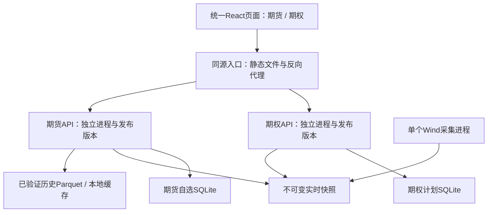
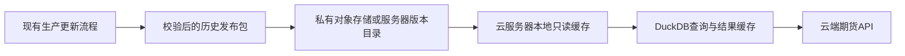

# 统一终端架构与冲突预案 v0.4

日期：2026-09-10。状态：方案修订，未执行合并、数据上传、采集或部署。

本文件覆盖v0.3中“期权单独网页服务”和“统一时点”的工程安排；期权业务公式、已通过页面及大部分验收要求继续有效。实施需联合阅读[期权业务规格](期权终端实施方案-v0.3.md)和[原56项任务](实施任务与验收清单-v0.3.md)，新增整合任务见第11节。

## 1. 复审结论与关键修订

建议统一产品入口、前端导航和使用流程；期货、期权后端分别运行和发布，Wind采集独立于二者。用户仍只启动一次、访问一个网址，后台进程由启动器管理。

这是对上一轮“初期共用一个FastAPI业务进程”的修正：期货会持续更新，且历史大查询与期权实时估值负载不同，独立进程的维护成本现在已有实际理由。它降低模块崩溃、重启和依赖变化的影响，但不能消除同机CPU/内存、统一前端或入口代理的共同故障。

不追求一次性统一全部数据库和计算库。共用的是明确的小型数据契约、品种身份及展示规范；两个模块不互相导入内部Python文件、不直接写对方数据库、不跟随对方开发目录热更新。

### 当前核验事实

- 期货`start.py`运行FastAPI并提供前端；`backend/api.py`有现成/api/contracts、/api/products等路由。
- 多个期货前端文件直接fetch('/api/...')，样式存在全局选择器；接统一入口需处理路径和CSS作用域，不是新增一个菜单即可完成。
- 日线默认读本地Parquet；当前基本面代码仍有隔离审阅入口。旧ARCHITECTURE.md还保留“尚未实现”等过时描述，因此以当前代码、验收记录和明确发布版本为基准，不能把旧文全部视为当前能力。
- v0.3期权目前仅有规格和静态原型，没有待保护的正式行情服务；适合在正式开发前明确整合边界。
- 当前时效和跨模块并发性能尚未测量，本方案的预算均是验收目标，不宣称已经达到。

## 2. 历史与盘中的解决办法：两条时间线，三种使用方式

### 2.1 数据分层

| 数据层 | 内容 | 更新与用途 |
|---|---|---|
| 已确认历史 | 交易日完整的OHLC、成交、持仓、收盘/结算等 | 版本化批次；用于历史统计与复盘 |
| 当日进行中 | 期货和期权盘口、盘中量仓及衍生指标 | 独立实时快照；不覆盖历史日线 |
| 分析上下文 | 本次研究引用的历史版本、实时截面和模型配置 | 用户冻结或保存时固定版本组合，不捏造统一时点 |

盘中期权所需的指数/对应期货报价由同一Wind采集进程按需求获取。因此期货终端可以保留历史研究，同时新增所选合约的盘中报价区；无需先把所有期货历史功能改造成实时，才能使用期权。

### 2.2 三种界面模式

| 模式 | 展示 | 允许的运算 |
|---|---|---|
| 历史研究 | 指定完整交易日及数据版本 | 两腿同日、同价格口径；期权无对应历史截面则明确无数据 |
| 盘中监测 | 当前期货/期权报价与时效；昨日历史可作背景 | 满足时间/身份/报价质量条件的盘中比较 |
| 历史背景＋盘中情景 | 历史截至日期与实时盘口时间分别显示 | 当前值相对既定历史分布的位置、当前场景估值；不冒称所有输入同一时刻 |

例：顶部显示“历史截至09/09｜盘口09/10 10:30:05｜期权盘口最大相差3秒”。历史期货曲线依然截止昨日；当日未结束的数据用独立点/虚线显示，不接成一根已完成日线。

历史模式切换不静默使全终端降到旧日；盘中模式也不把历史截止日自动改成今日。产品选择可共用，各模块时间模式保留；仅“同步研究时点”动作显式对齐。数据日期不足时显示各品种水位，禁止用全库最大日期代表所有品种。

### 2.3 统一数据时间契约

每份输入至少保存：

- `event_time`：报价/观测所代表的时间，源未给出则null。
- `trade_date`：交易所交易日；夜盘不直接用电脑自然日期。
- `received_at`：本系统接收时间；不能替代event_time。
- `published_at / available_at`：本版本对终端可用的时间；无历史首次可得时间时明确未知。
- `dataset_version / quote_snapshot_id / schema_version`：数据、报价及结构版本。
- `finality`：provisional（进行中）/final（源确认）/revised（修订）/unknown。
- `price_basis`：close/settle/bid/ask/mid；`quality`及实际覆盖。

只依赖收盘源确认标final，不能以电脑到了15:00就把盘中last改叫close。历史研究可使用目前已知的修订数据；历史时点回测还需available_at，不得因记录了交易日就声称无前视。

### 2.4 跨模块计算门槛

1. 先核验同一经济标的、实际合约、乘数、价格口径和有效时间，避免MO与同名IM期货被当作同一对象。
2. 纯盘中运算：所需报价都未过期，腿间时间差在已配置阈值内；任一缺失则不出“可交易比较”。刷新目标5—10秒、初始最大腿间偏差10秒只是待验证配置。
3. 历史统计＋实时当前值：固定历史版本，历史样本不含正在形成的今日，实时值单独标当前；字段不能同口径时禁止输出混合分位。
4. 原始价格比较与期权估值分开判断：估值可采用经核验的平价隐含F，并注明来源；不要求必须存在同月期货，也不能伪造同月期货代码。
5. 基本面频率/身份不合格时不加入跨模块计算，展示入口存在不等于数据生产就绪。

冻结上下文样例：`analysis_context_id → {futures_daily_version, futures_quote_id, options_quote_id, contract_version, calendar_version, model_version}`。两种quote_id若来自同一采集批可关联batch_id，但仍检查事件时间。先获取不可变ID，再逐ID读取，缺一个就报告无法完整冻结，不顺手替换成新版本。

这个上下文是快照清单，不另建“统一时点数据库”。可由期权分析接口在真正跨模块计算时生成；其余页面保留原模块快照。

### 2.5 收盘交接与修订

盘中快照持续保留自己的身份。上游日线发布后：检查批次完成和覆盖→规范键和值对账→保存新历史版本→公布各品种完整日→新请求引用新版本。盘中已保存计划仍引用原快照。

last与最终close/settle不同按正常口径差异处理；异常差异列出，不直接覆盖历史。若日线缺腿/部分品种晚到，只推进已合格范围；未合格部分保持前一完整日。源历史修订生成新版本及更正说明，旧研究可重现。

## 3. 统一入口与独立运行

统一入口建议用成熟反向代理，例如Caddy；它只处理静态文件、路径转发和健康检查，不承担计算或Wind调用。支持这些职责的依据见[Caddy官方文档](https://caddyserver.com/docs/caddyfile/directives/reverse_proxy)。选定后只保留一种代理，不同时维护自写Python代理与第二套网关。

默认本地运行组成：入口进程、期货API、期权API、按模式开启的Wind采集。用户一个启动命令即可；不承诺只有一个后台进程。内部端口仅loopback；云端仅代理暴露外部端口，业务进程处于内网。

开发用的期货目录可继续日常更新；日常使用的统一终端运行经过验收的构建版本，不能import正在编辑的目录。旧独立期货入口暂时保留为回退入口，不立即删除。

### 路由与前端集成

- 页面路由：`/futures/...`与`/options/...`；一次React构建，按模块加载。
- 对外API命名空间：`/api/futures/v1/...`与`/api/options/v1/...`。
- 期货已有内部`/api/...`先保持：代理按显式白名单映射，例如`/api/futures/v1/products → /api/products`。期权可直接实现版本前缀。未知API返回JSON 404，不能掉入SPA index.html。
- 期货前端只需把分散fetch收口到可配置apiBase；保留独立模式默认值。修改前建立请求路径清单，验收全部原入口，防止遗漏某个面板。
- 期货页面导出模块入口，独立main.jsx和统一Shell各自挂载一次React根；统一入口不嵌套第二个完整App导航。
- CSS限定`.futures-module`/`.options-module`，只共用色彩、间距、字体及已重复组件；期货全局table/button规则不能溢出影响期权。
- 不为整合把已有JSX整体迁到TypeScript。React运行时由统一构建提供一份，模块声明兼容范围并锁定版本；新增类型边界可局部使用。
- 各模块有错误边界和独立加载状态。模块渲染失败只显示该模块错误；Shell本身失败仍是共同故障，必须有整体上一版本回退。

前端共同构建意味着前端发布需要联合冒烟；后端可以分别发布。首版不引入运行时远程模块/微前端联邦，不承诺完全独立的前端热更新。

## 4. 云端的历史数据：继续保留Parquet

Parquet是数据格式，不限定电脑或操作系统。推荐云端路径：

### 4.1 两个可实施档位

| 方案 | 使用方式 | 选择依据 |
|---|---|---|
| 单云服务器起步 | 验证过的Parquet发布包上传至服务器暂存目录，验收后切当前指针 | 步骤少，适合初期；另有异机/对象存储备份，不能只保留这一份 |
| 推荐长期路径 | 对象存储保存版本，服务器按清单下载本地缓存后查询 | 便于回滚、换机与多副本，避免每次交互远程扫描大文件 |

DuckDB官方支持经httpfs读取S3 Parquet，但本方案优先本地缓存，以控制网络抖动和重复下载；对象存储采用OSS时使用其SDK下载即可，不假设所有S3接口行为完全一致。[DuckDB官方说明](https://duckdb.org/docs/current/guides/network_cloud_storage/s3_import)

因此首版上云可以继续沿用现有日线字段与DuckDB查询。云端路径通过配置注入，不残留E盘绝对路径。无需先把全部历史改写成SQL表。

### 4.2 发布协议：不直接同步正在写的生产目录

1. **取得完整源批次。** 优先使用上游完成标记/清单；若没有，只读复制并检查前后指纹只能防止部分并发变化，不能证明完整业务批次。生产发布前补齐完成信号或明确的人工签收，不能把“文件几分钟没变”当作final。
2. **生成发布包。** 列出dataset、version、schema、每文件相对路径/字节数/SHA-256/行数/日期范围、每品种水位、主键去重结果及父版本。
3. **上传变动文件。** 原始分区修订上传新对象名，沿用未变化文件的引用；不能只按max(trade_date)追加而漏掉历史修订。失败重试按内容hash去重。
4. **服务端校验。** 校验清单、文件hash、schema、主键、必要字段、样本值以及完整覆盖；两份数据“行数一样”不是通过条件。
5. **预热。** 至少查询首页默认品种和一组历史合约；失败不晋升。云端缺少的文件下载到temp再校验，不边写边被DuckDB读取。
6. **发布。** 所有对象完整后发布manifest，最后更新active指针。对象存储无目录rename假设；使用已验证的条件写/CAS或单发布者，避免两个发布抢占指针。服务器本地指针通过同卷原子替换。
7. **请求固定版本。** 一次查询读指针一次，随后只用manifest内的文件列表，不扫描“最新目录”拼混版本。旧查询完成前保留旧文件引用。
8. **回执与保留。** 上传成功与激活成功分开回报；保留当前、上一有效版及被研究引用的版本。默认不自动清理，后续按引用计数和保留策略执行。

清单路径禁止绝对路径、`..`及越界目标；源和缓存均设只读权限给业务查询进程。云对象存储不把桶设为公开供浏览器下载，浏览器只调业务API。

### 4.3 现有RDS如何使用

RDS可作为另一路服务端数据来源或核验来源，但需重新验证具体表、权限、主键、精度、覆盖和修订状态；“已有RDS”不代表当前可无条件上线。

若选择RDS：以只读账号/只读副本或受控导出快照供分析；大历史查询同样要范围限制和缓存，避免把用户页面请求压到生产写库。不在Parquet缺一行时悄悄补RDS一行；源切换以完整请求/快照为单位并重新校验。

市场历史与用户状态分别处理：市场历史继续Parquet；云端多用户的计划、自选、权限改用具备事务与租户隔离的关系数据库。单机SQLite不通过共享网盘变成多机写库。DuckDB本地嵌入式文件也不按普通多进程共享写数据库使用。[DuckDB并发说明](https://duckdb.org/docs/current/connect/concurrency)

## 5. 云端的盘中数据与可用性边界

网页/API上云和实时采集上云是两件事。分两阶段：

**过渡方式：** 本机已授权Wind采集→按许可通过出站加密连接推送版本化快照→云端接收与校验→实时缓存→API。云端不反向访问你的E盘或远程控制桌面。

每份推送带`collector_id、session_id、sequence、event_time、received_at、contract_version、payload_hash`。先采用完整快照：重连后发全量最新状态，忽略旧session/乱序序号和重复hash。心跳只表示进程存活，不刷新数据时间。实时未送达立即标stale；严谨逐笔回放是后续独立能力。

**稳定公开方式：** 使用获授权的常在线采集主机或服务端行情接口，按产品实际支持方式部署。不能假定桌面WindPy可以直接放Linux服务器，也不能假定本机个人授权允许公开转发。

本机离线时，云端历史研究仍可用，实时模块冻结；若本地源不持续在线，就不能承诺云端全天实时。公开许可不足时只开放允许的数据范围/延迟版或保持私有；技术通道不替代数据授权。

共享Wind采集有一个明确发布者和订阅计划：期货与期权提供所需合约清单，采集端去重，控制配额；页面挂载不直接申请永久订阅。临时蓝绿切换API不得再启动一份采集。若两个开发任务各自已有采集器，先建立唯一运行归属，再接统一发布，不能直接相互取消订阅。

## 6. 期货经常更新时，如何降低代码冲突

### 6.1 所有权与发布版本

| 内容 | 维护边界 | 其他模块如何使用 |
|---|---|---|
| 期货业务代码、查询、基本面审阅 | 期货项目 | 通过版本化API和经过构建的页面模块 |
| 期权定价、量仓、情景、计划 | 期权项目 | 通过版本化API |
| Shell、导航、共用ContractLabel、设计变量 | 集成部分 | 共同锁定版本，变更联合冒烟 |
| 合约与日历规范、时点契约 | 小型JSON schema/类型与版本文档 | 读取声明的版本，不互相引用内部实现 |
| 行情发布 | 既有上游/明确采集进程 | 只读已发布版本，不触发生产作业 |

开发代码与运行版本分开：每次集成指定期货提交/构建hash、期权hash、Shell构建、API主版本和数据schema范围，写入release.json。没有Git基线时先制作可追溯构建包及文件hash；不从不断变化的目录任意拷贝几份文件。

当前目录不强行搬迁：期货仍在`E:\工作\期货终端`，期权方案/业务仍在`E:\工作\期权终端`。整合开发阶段可在期权根下建立`integration`目录，仅放统一Shell、代理配置和发布清单，不复制第二套业务源；运行制品可放`runtime/releases/<release_id>`。最终统一命名与根目录迁移另作可回滚操作。

### 6.2 日常更新流程

1. 在原项目正常修改；日常使用版运行已验收制品，不开自动reload。
2. 本模块单测/数据回归→生成候选构建及API契约→在候选端口运行。
3. 执行本模块测试＋共同冒烟：导航、API路由、数据时点、比较篮、对方模块健康、CSS和资源加载。
4. 兼容性检查：只新增可选字段的兼容更新保留v1；删除/改单位/改含义走新主版本，不让客户端猜字段。
5. 验收通过后切对应后端路由；前端改动则发布整份前端制品并保留旧hash资源一段兼容期。两后端健康后才能将新Shell设为默认。
6. 观察失败率与时效；问题只回退受影响后端。若是Shell/共用组件问题则整体前端回退，保留兼容后端组合。

后端独立不等于所有发布独立：共享前端需要联合构建；涉及跨模块契约/共享元数据的变化须共同签收。期权开发不能为了自己方便顺手重构期货历史计算。

### 6.3 数据库迁移与回滚

单机每模块SQLite由自己单写。蓝绿候选若要写状态，使用测试副本；正式切换时停止旧写入、备份、迁移、启动新写者，不让新旧进程同时写同一计划库。

优先新增兼容字段，破坏性迁移单独停写窗口。回滚应用前核对数据库兼容范围；若不兼容，先保全升级后新增记录再恢复旧备份，不能用旧备份直接抹掉用户新计划。未建立迁移恢复证据不得以“随时可回滚”签收。

## 7. 性能预算与隔离

独立进程只隔离地址空间；CPU、磁盘和内存仍共享。设置受控查询范围、并发和内存预算，避免DuckDB历史扫描与情景计算同时吃满机器。

| 工作 | 首轮候选预算 | 超限行为 |
|---|---|---|
| 健康/版本查询 | 不进入大计算队列；快速返回缓存状态 | 不因日线扫描卡住 |
| 历史大查询 | 默认并发1，队列最多2；范围和行数沿现有保护；线程数/内存按机器留足余量配置 | 排队/429；超时取消实际查询，不能仅HTTP超时后仍无限运行 |
| 常用期权情景 | 输入去抖200ms；同输入同快照合并请求；常规并发1 | 新输入取消旧结果展示；执行端有超时和受控取消 |
| 实时刷新 | 以最新快照为准，未变化不重算；慢客户端只保留最新待处理版本 | 丢弃过时展示任务，不丢已承诺持久化的研究证据 |
| 历史回补/导出 | 不在交互关键路径；设置低并发、可取消 | 不占满实时计算资源 |

缓存key包含模块、产品、日期范围、实际合约、数据版本、模型/参数版本及价格口径。不能用“IM”一个key缓存不同页面结果。前端图形按模块加载，切页释放无用图实例/轮询；用户冻结、持仓监控等明确需求保留采集，不随页面离开误停。

首轮性能目标：缓存切页p95≤300ms、常用情景p95≤1秒、盘口展示额外延迟≤2秒（源到本机时间另报）。混合压力场景下仍应达到预算；若未达，先限制大查询和优化热点，再将重任务移出业务进程或增加云资源。

主机保留给Wind/系统的内存与CPU余量在实施时测量，不写死所有机器同一GB值。API多worker不是默认优化：会增加内存副本并可能重复初始化采集；采集始终在业务worker外独立启动。[FastAPI进程部署说明](https://fastapi.tiangolo.com/deployment/server-workers/)

云端用户增加后，先扩大只读API副本及预热缓存；达到单机可测瓶颈再引入共享缓存/任务队列。当前不预建Kafka、Kubernetes和通用插件总线。

## 8. 冲突与故障预案

| 编号 | 冲突/故障 | 检测 | 应对及恢复 |
|---|---|---|---|
| F01 | 期货历史D日、期权D+1盘中混算 | 时间契约/计算条件检查 | 历史作背景单列；需同步时阻止结果，补合格盘中期货报价 |
| F02 | 旧报价被接收时间包装为实时 | event_time/field_asof及源状态 | stale/unknown；不提高更新时间、不触发交易提示 |
| F03 | 夜盘跨日导致OI基准错日 | trade_date/session核验 | 按交易日找已确认前值；缺基准不画增减 |
| F04 | 历史源正在写或仅部分分区完成 | 发布标记、前后指纹、覆盖 | 不晋升；继续上个完整版本；保留失败证据 |
| F05 | 上传中断/只传一半 | manifest与hash/文件数 | 暂存不激活；按hash续传，旧版继续服务 |
| F06 | 两发布者争抢active指针 | parent_version/CAS或单写锁 | 拒绝过期发布，人工/受控重评；不以最后到达者覆盖 |
| F07 | 相同截止日历史被修订 | 内容hash、版本变化 | 新版本重算缓存，旧分析仍可复现 |
| F08 | 本机关闭、云端实时断流 | 心跳与数据年龄分别监测 | 实时冻结；历史独立可用；重连先完整快照 |
| F09 | 乱序/重复推送、采集重启 | session_id+sequence+hash | 去重，拒绝旧session；记录间隙，不伪造连续历史 |
| F10 | 开多个页面/候选服务重复订阅Wind | 采集归属锁/订阅清单 | 只有唯一采集者；消费者只读，停止仅取消自身ID |
| F11 | 期货升级改字段/单位 | schema契约与版本测试 | v1兼容保留或v2并行；不兼容客户端受限，回滚单模块 |
| F12 | '/api/contracts'冲突或SPA吞错误 | 路由清单/接口冒烟 | 命名空间映射；未知API返回JSON 404 |
| F13 | 新端口被既有Origin/Host策略拒绝 | 经过代理的GET与写操作测试 | 更新显式允许来源，校验转发头信任边界；不全量关闭校验 |
| F14 | 全局CSS/重复React影响另一模块 | 集成构建和双页截图 | 作用域CSS、单React运行时；共用样式变更联合回归 |
| F15 | 期货历史大查询拖慢期权 | 独立p95/CPU/内存/队列监测 | 限流、取消、缓存、资源预算；必要时受控重启该工作进程 |
| F16 | 期权渲染或API崩溃 | 模块错误边界与独立健康 | 期权受限，期货继续；单模块恢复，入口不无条件重启全部 |
| F17 | 同机内存耗尽/入口故障 | 系统资源/入口健康 | 共同故障仍可能存在；保留资源，停重任务，恢复入口/上一制品 |
| F18 | 新旧SQLite写者/不兼容迁移 | 进程写锁/schema版本 | 候选用副本；切换单写；备份并保全新记录后回滚 |
| F19 | 运行版加载正在编辑的期货代码 | release清单与文件hash | 运行制品不可变；开发与使用版路径隔离 |
| F20 | 旧浏览器页面请求新API或旧chunk失效 | 客户端构建版本/资源404 | 兼容API与保留旧静态资源；提示刷新，不丢未保存输入 |
| F21 | 跨模块选品种残留旧响应/状态 | request_id与context产品核对 | 丢弃旧响应；状态命名空间；目标价格不自动跨品种迁移 |
| F22 | Parquet/RDS各一半拼接成“完整”结果 | source/version元数据检查 | 整请求选源并复核；禁止静默逐行补齐 |
| F23 | 共享基本面审阅值误入机会排名 | capability/production_ready检查 | 未通过身份和生产验收数据仅审阅；显示UI不自动改变资格 |
| F24 | 云盘/对象存储不可用或磁盘满 | 读取/写入检查和容量水位 | 使用已验证本地缓存；停止新发布/归档并提示，禁止删研究引用文件 |
| F25 | 私人计划被放入公共缓存/导出 | 路由、缓存key、租户测试 | 公开读市场数据与私人状态隔离；公共缓存不存用户计划 |

只对幂等GET采用有限重试；保存计划等写请求有请求唯一键/版本检查，代理不盲目自动重放POST。取消浏览器请求不等于后台运算已经停止，须测试实际中断机制。

## 9. 高性能、高扩展、高稳健、低耦合的验收表达

| 目标 | 可核验标准 |
|---|---|
| 高性能 | 混合负载测试报告p50/p95、资源占用、实际数据规模；重查询期间时效目标仍成立 |
| 高扩展 | 新增IO/HO/AU主要变动在期权模块/能力表，不要求修改期货历史计算；加数据源需保持契约 |
| 高稳健 | 停掉任一业务API，另一个可继续查询；上传断一半不改变active；回滚后计划与数据完整 |
| 低耦合 | 无对方内部源码import、无跨模块数据库写入、无依赖“最新开发目录”；共用部分有明确版本 |

必须承认的边界：统一前端/代理和单机基础设施仍是共同故障域；前端共同发布需要联合验证。公开多机部署可提高可用性，但不在本地首版先行搭建复杂集群。

## 10. 对v0.3的修改清单

| 原任务/安排 | 修订 |
|---|---|
| E01工程初始化 | 独立后端环境保持；前端增加集成构建约定，不建立两套长期独立导航 |
| E04单采集进程 | 保留，增加期货/期权请求去重、明确发布者、session/sequence和云推送边界 |
| E05冻结snapshot | 模块内继续；跨模块新增analysis_context清单，不能用单ID掩盖不同源时间 |
| E07/E10接口与来源 | 增加API命名空间、代理映射和Origin/Host联合验收 |
| E06归档 | 增加发布manifest、修订版本、云缓存晋升；不修改上游调度作为隐含前提 |
| U01/U02/U12 | 增加Shell/模块边界、请求隔离、样式作用域、共享组件联合测试 |
| R01/R08单项目启动 | 改为一个启动器管理独立制品和进程；启动/停止仅限自身；蓝绿/数据库迁移分别处理 |
| R02/R04验收 | 增加混合压力、另一模块存活、前后端版本兼容及日常升级回归 |
| X06云端公开 | 先完成历史发布链；盘中源与授权另过门槛，不把网页上云当实时已上线 |
| v0.3第3/10/15节单API/端口 | 被本文替代；端口通过集成配置决定，现有8766/8793不直接占用或关闭 |

## 11. 新增整合任务（I01—I16）

这些任务是原56项的增量与替换条件，不能因原任务已勾选就跳过；所有任务当前为待实施。

| ID | 前置 | 实施动作 | 验收证据 |
|---|---|---|---|
| I01 | 无 | 冻结期货当前已验收构建/接口/文件清单；记录未提交状态，不替别人提交或丢弃更改 | 基线hash、现有测试记录、可恢复制品 |
| I02 | I01 | 定义代码身份、数据时间、finality、schema及能力契约 | 正反样例、混合时点拒绝测试 |
| I03 | I01 | 显式API映射、apiBase、路径404及Origin/Host策略 | 全旧接口及代理写入测试 |
| I04 | I03 | 统一Shell、模块入口、CSS作用域、单React；锁定依赖，不重写期货逻辑 | 双模块构建、截图、旧独立入口回归 |
| I05 | I01 | 独立业务制品和环境、同源代理、启动器、模块健康 | 停一个API另一个存活；不停止现有开发服务 |
| I06 | I02、v0.3 D02/D07 | 采集归属、共享行情、源时效、重连完整快照 | 多标签/双模块只一份订阅、乱序/跨日测试 |
| I07 | I02、I06 | 历史/盘中/混合视图、冻结上下文、日终交接 | 时点可追溯、缺腿不混算、历史版本复现 |
| I08 | v0.3 E06 | 历史发布manifest、源完成条件、主键/hash验证 | 中途改源/半批源均不能晋升 |
| I09 | I08 | 先在本地隔离目录演练“上传暂存→校验→激活→回滚”，再接指定云存储 | 断传/重复发布/并发指针/缺文件案例 |
| I10 | I09、未来云授权 | 云端只读缓存、配置路径、历史API预热；私有凭据与发布权限 | 电脑离线历史仍可读；版本与本地同键同值 |
| I11 | I06、I10、行情授权 | 盘中推送和常在线源评估，接收去重/断流状态 | 心跳新但数据旧仍stale；无授权不开公开实时 |
| I12 | I04、I05 | 制品版本清单、API兼容、候选端口、共享前端发布流程 | F11/F19/F20演练；旧浏览器与新API兼容 |
| I13 | I05 | 分模块状态库、备份、迁移单写及回滚新记录保全 | F18恢复演练，无用户记录丢失 |
| I14 | I05、I07 | 并发/线程/内存/队列/取消配置，混合性能压测 | 历史大查询与期权刷新同时p95及系统资源报告 |
| I15 | I07、I09、I12—I14 | 执行F01—F25故障与冲突回归，分模块签收 | 每场景有检测、实际结果、恢复日志和限制 |
| I16 | I15 | 联合交付说明、值守/回滚操作、版本状态页与阶段边界 | 一个入口可启动；模块受限可见；下一次期货升级能按流程完成 |

先完成本地统一入口与时点规则，再做历史云发布演练，最后处理公开实时源。I10/I11依赖外部条件，不阻止本地版；I09可完全在本地验证发布协议，不提前联网上传真实数据。

## 12. 本轮结果与未执行项

本轮仅只读检查两个项目当前代码/文档，并新增本方案、更新期权侧文档入口。未修改期货工程、未发送指令给其正在进行的任务、未合并代码、未安装代理、未启动Wind、未写生产Parquet/RDS、未上传数据。

最终选用哪个云存储/服务器、常在线行情授权和费用，留到部署阶段按已有账户与负载确定；这些不影响现在先把模块、时间、版本和故障边界设计正确。
