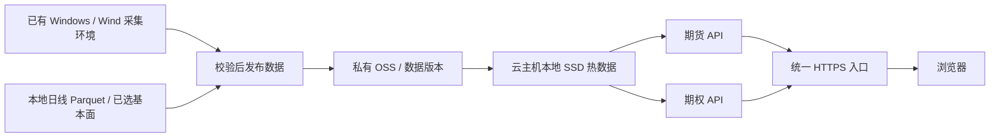

# 统一维护与云部署评估

保存与接续说明（2026-09-19）：本文完整保留9月14日的评估、测量和来源，下面的“当前”均指原核验日。最新实施状态、统一启动与更新命令见 [部署与统一维护入口](部署与统一维护入口.md)。服务器价格、地域可用性和备案要求在实际采购/上线前再次核实。

核验日期：2026-09-14。性质：方案与只读评估；未执行项目合并、服务切换、采集调度、云部署或采购。仅在本项目保存评估和隔离测试输出。

## 建议

逐步采用一个 Git 仓库、一套前端入口、两个业务模块；期货与期权 API 保留独立进程及清晰的数据边界。日常分别开发，经过统一验收后发布。当前固定副本方式保留作过渡，不再把长期人工同步两份可编辑源码作为目标。

自用云部署以阿里云 ECS u1、4 vCPU / 8 GiB 起步；准备小范围公开时，选择 4 vCPU / 16 GiB。先完成慢查询缓存、压缩与数据发布，再做真实云端并发测试。当前数据规模不要求大数据库或多台服务器。

## 1. 本次核验发现

### 1.1 已统一入口，源码仍有两套版本

- 活跃期货源项目：E:\工作\期货终端。
- 统一终端根目录：E:\工作\期权终端。
- 统一入口 8790；期权 API 8794；期货 API 8795。统一入口下的期货读取本项目 runtime/releases 内的固定代码版本，并非直接运行期货主项目的最新代码。
- 固定期货后端版本为 futures-f4748b5bb8f16104；活跃源项目中的 analytics.py、api.py、data.py 的哈希均已不同。
- 前端来源清单中，App.jsx、MarketPanels.jsx、SpreadPanel.jsx、styles.css 已与活跃源项目不同；另三项来源文件一致。这里比较的是来源哈希，未把生成时的路径改写误当作业务差异。
- tools/freeze_backend.py 只在目标不存在时复制 fundamental_lab、ceic_lab 和 workbench.sqlite。后续更新代码不会自动带入最新基本面发布数据。这是数据发布与用户状态需要分开的实际原因，不能通过整目录强制覆盖解决。
- 两个目录当前均未建立 Git 仓库。合并前应先保存可恢复基线。

固定版本是已有的隔离机制，版本不同本身不代表故障；问题是后续如何可靠地把已经验收的变化带入统一终端。目前尚缺一条清晰、日常可重复的统一发布流程。

代码依据：start.py、runtime/futures-release.json、frontend/src/futures/manifest.json、tools/freeze_backend.py；期货当前状态参考主项目 HANDOFF.md。已读取用户引用的“分析网站架构与技术栈”任务信息，但工具未返回具体消息正文，因此实际结论以当前代码和交接文档为准。

### 1.2 实际数据量

容量使用十进制 MB；目录统计不等于唯一有效市场数据量。

| 对象 | 实测 | 含义 |
|---|---:|---|
| 日线 Parquet | 261 文件，55.32 MB，2,384,347 行 | 当前期货日线查询的主要原始数据 |
| 日线全库日期范围 | 2005-01-04 至 2026-09-14 | 全库最大日期不代表所有品种完整到该日 |
| 期货 runtime | 约 590 MB，476 文件 | 包括审计原件、历史版本、JSON 缓存和用户状态，不能整体作为公开数据目录 |
| 期权 data | 约 2.28 MB，97 文件 | 包含研究材料和不同快照，不能全视为当前行情 |
| 一个期权标准化快照样本 | 180,523 字节 | 09-11 样本，290 个合约、288 个有报价；不是全市场全品种体量 |
| 统一终端 runtime | 约 19.79 MB | 含期货固定版本及其运行数据；与主项目存在重复 |

没有把虚拟环境、node_modules 或其他未接入的分钟线数据库计入业务数据需求。当前日线库可以继续使用 Parquet + DuckDB，没有必要为上线而先搬进 RDS。

未来磁盘增长主要取决于采集频率与保存范围。例如按这个约 0.18 MB 的完整快照样本、每天 240 分钟、每年 250 个交易日估算：每分钟保存一份约 10.8 GB/年，每 5 秒保存一份约 130 GB/年。均未压缩，只是一种样本规模的估算；增加品种、原始盘口、夜盘和历史版本会增加体量。初期宜只保留最新热数据，历史按日压缩归档，不直接假定需要秒级全量留存。

### 1.3 性能实测与边界

在本机 i5-10505、约 32 GiB 内存环境，用期货活跃源项目、隔离 runtime 和 FastAPI TestClient 测试。统一以 2026-09-11 为查询截止日，单客户端、每种请求各测一次首次和重复请求。没有启动 Wind 或访问生产数据库。

| 请求 | 首次 / 重复 | 未压缩 / 离线 gzip 后 |
|---|---:|---:|
| IM 仪表盘，2025-09-01 起 | 0.293 / 0.135 秒 | 102 KB / 23 KB |
| RB 十年合约历史 | 4.830 / 3.236 秒 | 2.117 MB / 0.375 MB |
| 全市场雷达 | 2.889 / 0.053 秒 | 248 KB / 20 KB |

首次只表示进程缓存为空，未清空操作系统磁盘缓存；gzip 是对响应做离线压缩的结果，不代表当前服务已经启用压缩。这不是云服务器性能或并发容量承诺。

测试明细：../runtime/deployment-assessment-20260914/benchmark.json。接口分别为 /api/dashboard、/api/contract-history、/api/radar。

主要判断：普通查询轻，长历史计算与输出较重，缓存能显著改善可复用查询。先优化重算和传输，比单纯增加磁盘或换数据库更有针对性。5 Mbps 公网带宽传输 2.117 MB 理想情况下约 3.4 秒，压缩到 0.375 MB 后约 0.6 秒；实际还包含网络和计算耗时。

现有 DailyStore 有读缓存和锁，DuckDB 单次连接限制 2 线程、512 MB，但该限制不涵盖 Python 对象、整个 API 进程或所有并发连接。增加 Web worker 还会增加缓存副本，不能简单按 CPU 核数启动大量进程。

## 2. 如何统一维护

### 2.1 目标边界

| 统一管理 | 按业务模块保留 |
|---|---|
| 源码仓库、前端入口、构建与发布清单 | 期货、期权 API 进程及业务计算 |
| 登录、权限、基础样式、导航和通用 API 调用 | 日线/基本面发布与盘中报价发布节奏 |
| 明确的品种身份、日期/时效展示规范 | 缓存、用户业务状态、各自测试 |
| 公共配置约定、日志与版本查看 | 必要时各自 Python 依赖环境 |

共享只覆盖已经重复、含义相同的部分，不把期权 Greeks、期货季节性或不同时间口径硬抽象成一个框架。同一仓库不要求同一 Python 环境或同一 API 进程。当前两边都叫 backend，迁移时应使用明确的包路径或继续独立工作目录，避免导入冲突。

建议继续以 E:\工作\期权终端 为统一工程根目录，保留用户指定的期权分析材料位置。产品可以显示“统一研究终端”，无需现在重命名磁盘目录。

目录目标只表达模块归属，实施时尽量复用现有文件：

```text
期权终端/
  frontend/src/          统一入口、期货模块、期权模块
  backend/              现有期权 API，先保留
  futures/              迁入的期货业务源码与对应测试
  tools/                已有构建工具、后续数据发布命令
  docs/                 方案、研究和交接
  deploy/               实际上云时再增加部署配置
  data/、runtime/       不进入 Git；业务状态与可重建缓存分清
```

### 2.2 最小迁移顺序

1. **保存基线。** 两边代码和依赖建立 Git 基线；忽略真实数据、缓存、虚拟环境、密钥和用户数据库。记录当前已验收前端、两套 API 版本、数据选择指针，备份用户状态。
2. **选定唯一来源。** 对照固定版与期货主项目的变化，迁入已经验收的最新期货源码。复制不等于验收：期货数据尚缺失或用途未核准的内容，继续保留原标识与限制。
3. **接入统一构建。** 让统一前端直接编译本仓库内的期货模块；保留已有 API 前缀和页面地址。两个 API 仍独立启动，先不合并环境或计算入口。
4. **分清数据与状态。** 历史行情、已选择基本面数据走独立数据发布；自选、篮子、研究计划保留各自用户状态，不能被升级脚本覆盖。原始研究/审计材料不默认上传为公共资源。
5. **做同数据版本回归。** 对照日线、十年历史、雷达、基本面，以及期权链、微笑、量仓、策略和退出分析；既测接口数值，也检查页面。验证一次模块重启不会使另一模块报错，并试一次回滚。
6. **切换开发来源。** 验收后旧期货目录保留只读归档与来源说明，停止两边同时改同一份业务功能。现有两个对话仍可分别负责期货和期权，但后续都指向统一工程中的模块；并行工作采用 Git 分支/工作树，公共文件集中合入。

发布以已验收的提交构建，运行环境不跟随开发目录热更新。每次发布记录前端、期货 API、期权 API 和数据版本；没有改动的 API 可继续运行原版本。公共入口改动需回归两个模块，业务内部修改以本模块验证加入口冒烟为主。

迁移完成之前，沿用现有 AGENTS.md 对固定副本的限制：明确刷新、验证、再切换。新维护规则需与目录切换同一批更新，避免文档与实际相反。本评估未修改这些规则。

## 3. 云端数据怎样读取



- **历史数据：** 上游完成后，只发布发生变化的月分区与已确认基本面版本。云端下载到本地 SSD，由现有 DuckDB 查询；不要让每次网页请求跨公网扫 OSS。
- **期权盘中：** 保留当前已可用的 Windows/Wind 环境，采集一次形成共享快照。需要自动刷新时，单独确定频率、权限和授权；所有网页用户读取同一批快照，访问人数不直接乘上 Wind 请求量。
- **云端运行：** 普通 Linux ECS 承担展示、API 和计算；现有 WindPy 登录与依赖不能假定直接搬到 Linux。未来如果拿到云端专用 DataFeed 授权，再替换采集环节。
- **发布步骤：** 上传版本文件 → 检查结构、日期、必要字段、重复键与文件完整性 → 切换当前版本指针。失败继续服务上一版并显示真实时效，不能把接收时间写成行情时间。
- **独立日期：** 日线截止日与盘中盘口时间分别显示；全库最新日期不替代每个品种的实际覆盖。
- **状态保存：** 单实例自用可继续 SQLite；多用户至少增加所属用户和权限隔离。出现实际并发写入或多实例需求后再评估托管数据库，不为存这批 Parquet 而提前上 RDS。

Windows 端停机时，云网页仍可展示已有历史和旧快照，但不再有新盘中行情。要持续更新，需要采集端在交易时段稳定在线，并符合数据供应商的使用范围。

## 4. 云服务与规格

首选阿里云 ECS + 私有 OSS，面向内地用户优先上海或杭州。如果还要访问已有云数据库，先确认数据库地域与网络，再尽量同地域部署。选择阿里云是减少域名、备案、计算与数据存储的管理分散，不是技术上的唯一选择。

| 阶段 | 建议实例 | 存储与网络 | 假设 |
|---|---|---|---|
| 自用 / 少量固定使用者 | ECS u1，ecs.u1-c1m2.xlarge，4 vCPU / 8 GiB | 60 GB 系统盘 + 40 GB 数据盘；公网方式部署时 5 Mbps 起 | 日线研究、少数期权品种、有限同时计算 |
| 小范围公开试运行 | ECS u1，ecs.u1-c1m4.xlarge，4 vCPU / 16 GiB | 60 GB 系统盘 + 100 GB 数据盘；5 Mbps 起，较多图表访问考虑 10 Mbps | 已做缓存、压缩、权限与重查询并发控制 |
| 更大公开流量 | 压测后决定 8 核、更多内存或分离计算 | 按流量、快照频率、保留天数扩容 | 不能由当前单客户端测试推断容量 |

建议 Ubuntu 24.04 LTS；在测试环境验证并锁定 Python/前端依赖及 Linux 路径。数据盘可选 ESSD Entry 或 ESSD PL0，购买时核对所选地域和实例的支持情况。表中磁盘留有运行日志与归档空间，并非当前数据本身已需要这么多。

u1 官方规格确认上述两个实例分别为 4 核 8 GiB、4 核 16 GiB；规格表的内部网络带宽不是购买的公网带宽。[阿里云 U 实例规格](https://help.aliyun.com/zh/ecs/user-guide/general-work-force)

腾讯云 CVM 同档标准型也是可行替代；若已有腾讯云账户与运维习惯，没有为本项目强行换云的必要。当前不建议为了便宜先购买长期套餐，先用短期测试核对 Linux 兼容与性能，再按购买页核对地域、实例、云盘、公网带宽、备份和续费价格。此次未取得所选地域的实时结算报价，不把活动广告价写作预算依据。

费用要分别看服务器、磁盘、外网流量/带宽、备份存储、域名续费，以及 Wind/CEIC 数据展示授权。服务器报价不包含数据许可。初期无需 GPU、Kubernetes、消息队列；Redis 或托管数据库在出现共享缓存/多实例需求时再引入。

一台 ECS 可以运行统一入口和两个 API，不需要因为存在两个模块就购买两台机器。它是单机方案，仍有整机故障停服的边界；当前可以通过备份和可重建部署控制恢复成本，不冒充高可用集群。

## 5. 上线前必须准备什么

### 5.1 先明确使用范围与数据权限

自用远程访问可先做私有网络访问和账户保护，减少公开暴露；公开网站按公开部署准备。仅加登录密码不能当然替代依法应履行的备案要求。

公开显示 Wind、交易所或 CEIC 数据前，应向供应商确认并取得适用的书面授权，覆盖原始报价、历史数据、衍生指标、图表展示、下载/API 及商业用途。终端账号能取数不等于拥有公开再分发权。CEIC 公布的条款明确限制向未授权用户提供内容与衍生分析；具体仍以实际签署合同为准。[CEIC 使用条款](https://www.ceicdata.com/en/terms-and-conditions)

普通研究看板、收费信息服务和期货投资咨询的合规范围不同。若后续做收费荐策、个性化投资咨询或交易相关业务，需另行核实业务资质；不能用普通 ICP 备案代替期货咨询许可。[证监会关于证券期货投资咨询业务许可的说明](https://www.csrc.gov.cn/csrc/c100210/c1498853/content.shtml)

### 5.2 域名与备案顺序

1. 确定个人或企业作为网站主体，再注册并实名域名，域名持有人与备案主体按所在地要求匹配。普通网页看板一个主域名即可，期货/期权沿用不同路径。
2. 选择实际接入服务商、地域和符合备案资格的云产品，购买前核对时长、公网地址等要求。使用中国内地服务器对外提供网站，先完成 ICP 备案再公开访问。[阿里云备案场景说明](https://help.aliyun.com/zh/icp-filing/what-scenarios-need-to-be-filed-in-aliyun)
3. 配置 DNS、HTTPS 和证书自动续期，页脚按要求显示 ICP 备案号和链接。
4. 网站开通后按规定在 30 日内办理公安联网备案，按要求展示备案信息；这与工信部 ICP 备案是两项手续。[公安联网备案指引](https://help.aliyun.com/zh/icp-filing/basic-icp-service/the-public-security-network-for-the-record-information-fill-in-the-guide)
5. 如涉及经营性服务，另核对增值电信及业务资质要求。主体所在地要求可能不同，最终以接入商和主管机关审核为准。

香港/境外节点通常不走内地服务器的 ICP 接入备案流程，但要另评估内地访问质量、数据授权及适用要求，不能理解为所有合规义务都消失。当前主要面向内地交易时段使用，正式公开版本优先考虑内地节点。[阿里云备案流程](https://help.aliyun.com/zh/icp-filing/basic-icp-service/user-guide/icp-filing-application-overview)

### 5.3 当前代码需要补的发布能力

| 工作 | 最小完成标准 |
|---|---|
| 配置与启动 | 路径、端口、数据根目录、可信域名来自配置；Linux 上两个 API 能独立启动和重启 |
| 入口 | 前端构建产物与 API 由一个 HTTPS 入口提供；最终只保留一种负责对外的反向代理，业务端口不直接暴露公网 |
| 账户权限 | 普通用户只读研究；采集/发布/管理接口仅管理员或采集身份使用；自选与策略按用户隔离 |
| 前端公开边界 | 只发布构建产物；不公开 runtime、原始数据、审计原件、密钥、配置和数据库文件 |
| 查询性能 | 长历史结果按参数和数据版本缓存；行情共享快照；大 JSON 压缩；对昂贵查询限制范围和并发 |
| 数据更新 | 单独发布已校验数据；失败保持上一版并显示过期状态；不由每个用户访问直接触发 Wind |
| 备份恢复 | 数据发布版本、用户数据库与必要配置有异机备份；SQLite 用一致性备份方法；实际恢复一次 |
| 日常运行 | 自动重启、健康检查、数据时效、错误与慢查询日志、磁盘和流量告警、证书续期 |
| 版本回退 | 保存上一份应用发布及数据版本，回退代码不覆盖用户状态；兼容性变更记录迁移办法 |
| 公共说明 | 数据来源与更新时间、使用范围；收集用户信息时提供相应隐私与账户说明 |

现有 TrustedHost 仅允许本地地址；同源检查不是身份认证。现有期货 watchlists 表没有用户所属字段。因此当前端口直接对公网开放并不足以形成可供多用户使用的正式服务。

## 6. 落地顺序与验收

1. **本地统一维护。** 完成唯一源码来源和发布基线，页面地址及已验收业务行为保持一致。
2. **建立数据发布闭环。** 先以已有历史文件/快照验证发布、云端读取、旧版本保留与失效显示，不先扩大采集范围。
3. **短期云端试部署。** 在选定配置上检查 Linux 依赖、权限、缓存和实际网页；不以本机 TestClient 代替公网页面验收。
4. **测真实常用并发。** 用少量同时用户混合访问仪表盘、长历史、雷达和期权场景，记录 P50/P95、CPU、内存、网络与错误；比较有无数据更新时的情况，再决定扩容。
5. **确认公开条件。** 数据授权、主体/备案、用户隔离、备份恢复就绪后再公开。期货当前交接明确尚非全品种数据齐全，公开页面继续展示真实覆盖与用途限制。

不在本阶段为未知的大流量设计多机架构。若单机常态内存接近上限、查询排队明显或重计算影响盘中页，再按观测结果扩内存、优化算法或把计算进程移开。

本轮交付到评估为止；上述步骤均为后续实施计划。
