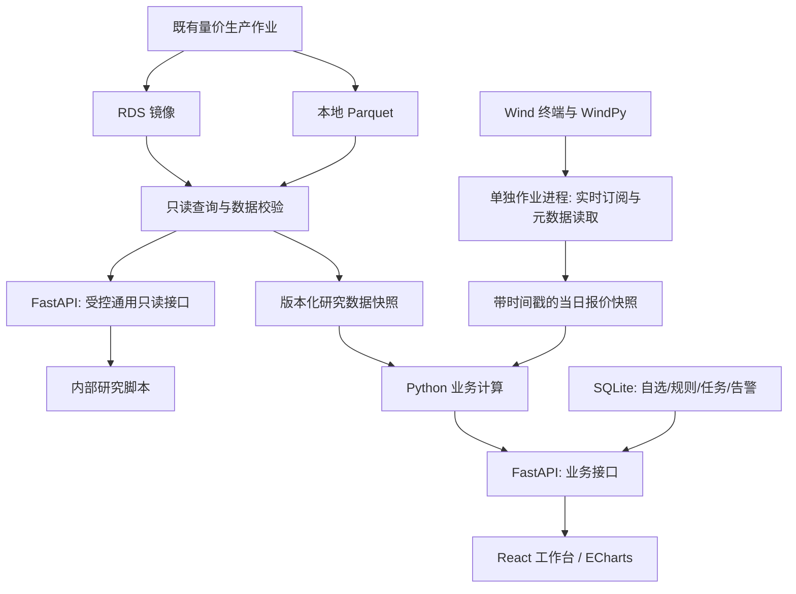

# 期货套利监测工作台：总体设计

版本：2026-09-07 v2。状态：设计交付，尚未实现业务系统。实施入口见 [HANDOFF.md](HANDOFF.md)。

本次复审：基本面明确由既有 `E:\阿里云数据库\wind更新\fundamental` 链路补齐与修正，不另起采集系统。完整审计、F00—F09实施任务及发布契约见 [FUNDAMENTAL_PLAN.md](FUNDAMENTAL_PLAN.md)，问询文本见 [ALICE_PROMPTS.md](ALICE_PROMPTS.md)。此项现在独立推进，不再仅笼统列为将来工作；未核验数据仍禁用，量价交付不等待其全部完成。下文原型技术选择保留，细化文件与本段冲突时以细化文件为准。

用户最新确认：RDS 与本地 fundamental 均为半成品，现阶段没有任何可靠基本面数据。本设计以“可靠量价数据可用、可靠基本面数据为零”为实施基线；基本面能力均为后续条件阶段，不代表现有数据已获认可。

## 1. 产品目标与范围

面向个人日常交易研究与监测，围绕具体期货合约对形成“筛选机会 → 判断结构与驱动 → 核算成本及约束 → 加入监测 → 复盘”的闭环。保留参考网站的品种选择、模块导航、图表与表格组合，增加可交易性、资金占用、时间一致性和历史可复现性。

首版覆盖国内商品期货的同品种跨期、期限结构、持仓换月；基差另列后续条件阶段。以 RB、CU、M 三种不同合约结构作验收样例，之后由配置扩展品种；这只是工程验收样本，不是交易推荐。金融期货保留日行情浏览能力，但国债期货需要 CTD、转换因子、应计利息、交割选择权、融资及 DV01 专项模型，股指需要分红及资金成本模型，不能套用商品持有成本规则。

实际交易支持的含义是：给出方向明确、时间明确、成本明确的候选和风险依据；首版不接经纪商账户、不自动下单。真实仓位未导入前，只显示自选组合与假设手数，不标成账户实际盈亏。

## 2. 已核验的基础与边界

2026-09-07 对现有工程做了只读检查，未触发采集、修补或改写源库。

| 对象 | 本次证据 | 对设计的影响 |
|---|---|---|
| 当前项目 | `E:\工作\期货终端` 原为空目录 | 从规划开始，不存在需迁移的看板代码 |
| 现有生产管线 | `E:\阿里云数据库\wind更新` | 保留职责；基本面需修复raw跳过、同键更新和对账，不能直接按已有代码视作稳定 |
| 日线源 | `E:\交易数据\本地表\futureshistoryprices1d\year_month=*\*.parquet`；RDS 同名表存在 | 看板读取既有日表，不从分钟线重算日线 |
| 日线字段 | exchange, symbol, trade_datetime, trade_date, open/high/low/close, volume, amount, position, settle_price, pre_settle_price 等 | `position` 对外语义映射为 open_interest；amount 已是元 |
| 日线样本 | 2026-09-01—04，本地/RDS 各 4,016 行；所检查业务键无重复、无缺失或额外键；OHLC、量、额、持仓一致 | 验证了近期样本，不能推广为全历史一致 |
| 精度差异 | settle_price 136 项、pre_settle_price 129 项差异，均来自 8888；RDS 为 DECIMAL(10,4)，本地 DOUBLE；最大绝对差约 0.0000499742 | 业务键和字段精度分开验收；月合约本次窗口未见字段差异 |
| 日线索引 | `(symbol, trade_date)`；唯一索引 `(trade_date,exchange,symbol,trade_datetime)`，不是单一 id | 通用 API 必须支持复合键和稳定分页 |
| 连续序列 | 9999 主力、9998 次主力、8888 持仓加权指数；由现有 `fetch_1d_wind.py` 确认 | 不作为可买卖的腿；价差回测只用实际月合约 |
| 源过滤 | 月合约日线经过 OHLC、close>0、volume>0 等过滤 | 合约目录独立于行情记录；零成交缺行不能当退市或零价格 |
| 基本面 | `futuresfundamentals` 本地/RDS 存在，键为 `(indicator,trade_date)`；用户确认均为半成品 | 表存在不代表数据可靠；整体禁用，不进入计算、API 白名单或告警 |
| EDB 注册 | `fundamental/indicators.json` 共 45 项，44 项名称含“疑似”，45 项单位为空 | 候选编码必须逐项核验，不能自动升级为可交易现货 |
| 基本面全表复审 | 本地/RDS各129,706行、45指标；键与数值一致，元数据4,029行差异；最大观测日期2026-08-13 | 一致性不等于指标身份可靠；全表细分覆盖见基本面专项方案 |
| 现有 EDB 作业 | `run_fundamental.py`：fetch → apply → rds → check；`fetch_edb.py` 按指标水位线取数 | 仅为后续可评估复用的代码，不代表已验收的生产数据能力；当前不调度 |
| Python | `C:\pythonvenv\Scripts\python.exe` 可用，发现 WindPy、DuckDB、PyArrow、PyMySQL、pandas；未发现 FastAPI | Wind 保留该环境；Web 后端使用项目独立环境 |

本次没有测试 Wind 实时订阅权限、bid/ask 时间戳和配额，没有审计全历史数据，也未取得现货交割匹配、经纪商收费及保证金确认材料。

更正前次站点分析的证据强度：公开 app.js 可确认原生 JS/ECharts、静态数据加载和 Python 服务文件名线索；没有服务端源码，不能确认其实际定时作业、数据库和完整服务端实现。2026-09-07 浏览器已经成功打开参考页面和截图，页面显示 2026-09-04 更新时间。

## 3. 技术选择：一个应用、一个受控作业进程

建议 React + TypeScript + Vite + ECharts，FastAPI + Pydantic，DuckDB 读取 Parquet，SQLAlchemy Core + PyMySQL 只读 RDS，SQLite 保存本工作台自己的自选、参数、任务状态和告警。React 是本次设计建议，不是原网站框架；实施视觉模板阶段检查 Product Design 模板，保持一套前端，不同时引入 Vue。

选择 React/TypeScript 是为了让合约选择、统一价格口径、表格与图表联动在模块增加后仍容易维护。初期业务逻辑放在少量函数和模块，不做通用插件系统、微服务、Kafka、Redis 或 Celery。



部署形态：FastAPI 一个 worker 绑定 `127.0.0.1`；打包后的前端由同一进程提供，日常使用一个启动入口。开发时才单独运行 Vite。一个后台作业进程以既有 Wind 环境启动，串行执行 Wind 调用，通过本地 SQLite 作业状态和原子发布的小型报价 JSON 与后端交互。SQLite 采用 WAL、短事务、busy timeout；报价不逐 tick 写 SQLite。采集回调只更新线程安全的内存快照，不计算模型。

看板启动器管理自己启动的进程和 PID；停止时只停止自身作业，不终止用户 Wind 终端或既有生产更新任务。异常重连仅取消本进程持有的订阅 ID，不能调用“取消全部订阅”。实际 Wind 会话隔离行为在接入验收时确认。

## 4. 数据访问与统一调度

### 4.1 三类数据各自负责什么

| 数据 | 主读取方式 | 更新方式 | 失效处理 |
|---|---|---|---|
| 历史日 OHLC、成交量、持仓、结算 | 本地日 Parquet | 观察既有上游更新完成后，构建研究快照 | 使用上次完整快照并显示日期；可受控切换 RDS |
| 当日盘中报价 | Wind 实际月合约订阅/批量快照 | 只订阅自选和当前分析所需合约 | 保留最后报价并标 stale，关闭可执行判断 |
| 现货、库存等（后续阶段） | 当前无可靠来源，默认禁用 | H08 重新建立可信指标并验收采集链后，才启用增量更新 | 明确显示“未接入可靠基本面”，不显示现有半成品曲线，不阻塞量价模块 |
| 合约、交易日历、规则 | Wind 元数据 + 交易所来源 + 本地核验配置 | 新合约/规则生效时更新 | 缺失乘数、交割限制时相应成本判断不可用 |
| 手续费、保证金、资金/仓储成本 | 带生效日期的本地配置 | 根据经纪商/交割业务实际口径维护 | 缺失时显示未知或明确假设，不能按零处理 |

本地/RDS 是同一逻辑数据集的两份物理实现，不是两个同时累加的来源。默认 `source=parquet`；RDS 用于复核、缺失分区的备选快照和未来远程部署。不能发现某行缺失就逐行静默拼接 RDS。备用策略以完整数据请求/完整快照为单位，校验通过后切换，并返回来源及差异信息。

一次合约对分析必须在同一 `snapshot_id` 内读取两条腿。日终必须同一交易日、同一 close/settle 口径；合约 A 新、B 旧时不得组合出“最新价差”。各品种可有各自最后完整日，总览明确显示日期，不能用全库最大日期代表全市场完整性。

### 4.2 快照与更正

现有 Parquet 单文件使用 tmp + os.replace 原子替换；这不能保证多个分区同时读取时属于同一批次。工作台盘后先读取上游完成状态及文件清单，再按配置品种/年份抽取必要日数据到自己的版本目录，检查前后文件指纹是否变化，全部通过才更新 `current.json` 指针。既有源目录只读。

长期运行至少保留当前和上一个完整快照，以及参与回测/已触发告警的快照。mtime/大小用于发现变化，内容哈希用于所纳入快照的审计；同一最新日期的历史修订也会生成新版本，不能只按 max(date) 缓存。历史修订只重算所依赖的区间和统计窗口。

日终数据、实时数据和发布时间分开：

- `trade_date`：交易所交易日，夜盘按交易日历映射，不能用机器自然日期截断。
- `observed_at`：行情时间或指标观测日期；`received_at`：本机收到的时间。
- `published_at`：已知原始发布时间；未知时为空，不能伪造精确发布时刻。
- `available_at`：本系统可使用该版本的时间；首批历史导入只能标“当前版本历史数据”，不声称历史时点已经可知。
- `snapshot_id / quote_snapshot_id / rule_version`：同一次计算的输入版本。
- `quality_flags`：缺失、陈旧、口径未核验、来源不一致、样本不足等。

盘中报价是独立 overlay，不能把 last 写回正式历史 close/settle，也不能把累计日成交量按采样次数相加。收盘后等待既有日表更新和校验，再以正式版本替换当日展示。

### 4.3 调度策略

| 事件 | 工作台动作 | 初期规则 |
|---|---|---|
| 启动 | 检查最后完整快照、自选、终端可用性；先展示日终视图 | 外部源异常也能查看已有数据 |
| 上游日表完成 | 校验相关分区 → 快照 → 批量计算 → 发布 → 日终告警 | 通过水位/作业证据触发，不把固定 16:00 等同完成 |
| 盘中 | Wind 维护一个合约订阅集合；短周期发布自选快照 | 页面每 2 秒读取轻量快照，前台刷新不增加 Wind 请求 |
| 切换品种/自选 | 合并去重订阅需求，延迟移除不再需要的合约 | 有上限，超额优先自选及当前页，后台列表显示日终状态 |
| EDB 到期更新（后续阶段） | 当前关闭；H08 验收后才配置低优先级更新 | 评估复用既有作业；不得双重调度同一作业 |
| 手动刷新 | 返回 job_id，页面展示状态与结果版本 | 不在 HTTP 请求中运行长时间抓取；同类任务合并 |
| 失败/重启 | 有限重试、退避、任务标 interrupted，保留旧快照 | 区分空结果与失败；不能因失败清空历史数据 |

Wind 网络调用与 DuckDB 扫描不能直接阻塞 FastAPI 的 async 事件循环；短同步查询使用受限线程执行。Wind 重工作由专用进程完成。日终统计批处理可在作业进程中串行执行，避免过早增加工作进程。

初始性能预算（待实测，不是已达成）：自选列表热响应 P95 ≤500ms，单合约对 5 年图 P95 ≤1.5s，选择 3 品种的日终预计算 ≤60s，接口与数据处理常驻内存合计目标 ≤1GB（不含 Wind、浏览器）。默认 DuckDB 2 线程/512MB，RDS 连接池 2、额外连接 1，单查询超时 5s；超预算先用 EXPLAIN/剖析定位。Parquet 过滤必须包含相关 year_month 文件选择和字段投影。

## 5. 如何采用通用数据 API

用户提供的“两层接口”思路有用。采用其中的元数据发现、白名单、统一筛选与文档；首版不建设“所有 RDS 表自动 CRUD 平台”。这两层是同一 FastAPI 应用的两组路由，业务计算直接调用 Python 取数函数，不通过 HTTP 再绕通用接口一遍。

### 5.1 通用层

对外采用逻辑数据集别名，屏蔽物理库名和文件目录：

```text
GET /api/v1/data/catalog
GET /api/v1/data/{dataset}/schema
GET /api/v1/data/{dataset}/rows
```

示例（设计接口，尚未实现）：

```text
/api/v1/data/futures_daily/rows?fields=exchange,symbol,trade_date,close,position&filter[trade_date][gte]=2026-01-01&filter[trade_date][lte]=2026-09-04&filter[symbol][eq]=RB2610&sort=trade_date,exchange,symbol,trade_datetime&limit=1000
```

首版只批准 `futures_daily`；`futures_fundamentals` 不加入白名单，后续只能开放 H08 已核验的指标子集，不能整表放行。`product` 不在真实日表中：原始接口不得凭示例允许该字段；业务接口用合约目录把 RB 解析成实际合约列表。用户示例中的 `testmm/futuresseatraw` 是示例，不代表本次确认了该库表。

限制：只读；字段、过滤字段、排序字段均为允许集合；eq/in/gte/lte/isnull 足够；拒绝未知参数、任意 SQL、任意 join 和表达式；时间范围必填或使用明确的小范围默认值；limit 默认 200、最大 1000，限制列数和响应字节；in 列表最大 100；普通明细最长一年，单合约经配置可更长。多年图走业务聚合接口。

标识符不能用值参数化替代校验：库/表/列只从可信映射和反射结果中取；SQL 值全部绑定参数。分页用有稳定复合排序键的游标，绑定过滤条件及快照版本；最后页后返回 next_cursor=null。不默认全表 COUNT(*)。如果底层表无稳定唯一键，则只允许有界首次读取或先物化版本快照，不许伪造主键。

示例配置意图：

```yaml
datasets:
  futures_daily:
    source: parquet
    parquet_table: futureshistoryprices1d
    rds_table: futureshistoryprices1d
    operations: [read]
    date_field: trade_date
    stable_key: [trade_date, exchange, symbol, trade_datetime]
    max_rows: 1000
    fields: [exchange, symbol, trade_datetime, trade_date, open, high, low, close, volume, amount, position, settle_price, pre_settle_price]
```

这只是局部配置示例；路径/连接单独配置，真实 RDS 凭据不写入仓库或前端。元数据只反射已配置表，启动时缓存，schema 变化时显式重载；反射不能自动推导单位、时区、可交易性和金融意义。

当前仅监听本机、同源访问；修改自选或启动作业仍检查 Origin/Host，拒绝任意跨域调用。以后在公网启用账号鉴权及数据权限，通用层默认关闭，对外只开放业务层；不需要现在构建 JWT 用户体系。行情生产库始终使用 SELECT-only 账号（当前旧配置账号的权限尚未审计）。写自选/监测规则属于本地工作台 SQLite，不是开放 RDS 写接口。

### 5.2 业务层

| 接口 | 返回内容 |
|---|---|
| GET `/api/v1/products`、`/contracts?product=RB&as_of=...` | 合约有效期、交易状态、乘数/tick、数据覆盖 |
| GET `/api/v1/opportunities?mode=eod` | 候选合约对、异常程度、成本状态、流动性、排除原因 |
| GET `/api/v1/spreads?near=RB2610&far=RB2701&price=settle` | 同日价差、历史分位、季节性样本及元数据 |
| GET `/api/v1/curve?product=RB&as_of=...` | 实际到期日曲线、斜率、局部残差、缺失节点 |
| GET `/api/v1/rollover?product=RB&from=RB2610&to=RB2701` | 成交/持仓份额迁移、滚动窗口、换月方向成本 |
| GET `/api/v1/basis?contract=RB2610&spot_id=...` | 原始/可比基差、现货口径、成本拆解、可用性 |
| POST `/api/v1/scenarios` | 输入方向、手数、退出价差、成本假设，返回情景 P&L |
| GET `/api/v1/quotes?contracts=...` | 已缓存报价，读接口不能自动扩大订阅 |
| GET/POST/PATCH `/api/v1/watchlists`、`/alerts/rules` | 本地自选组合、阈值、监测状态 |
| GET `/api/v1/alerts/events`、`/health/data` | 历史信号证据、各数据源状态 |
| POST `/api/v1/jobs`、GET `/api/v1/jobs/{id}` | 白名单作业入队、状态、完成快照；不接受脚本路径 |

图表接口返回计算结果和单位，不返回 ECharts 配置；前端只负责展示，避免两端分别维护金融公式。统一响应 `data/meta`；meta 含 snapshot_id、as_of、price_basis、source、quality_flags、config_version、样本量及时间语义。空图返回可读原因，不能用空数组掩盖异常。

## 6. 分析模块与交易口径

### 6.1 机会总览

默认按品种列出有效月合约对，先做数据/流动性/到期/报价门槛筛选，再按用户选择的分位偏离或情景风险收益排序。避免把不同商品的绝对价差直接横比，也不首创难解释的“综合胜率评分”。

表格字段：品种、近/远合约、方向、价格口径、价差、变动、分位和样本数、双腿持仓/成交、距到期、估计费用、盈亏平衡退出价差、行情时间、状态、主要排除原因。可用性拆成数据已核验/报价新鲜/成本完整/交割资格/深度满足，不因一个 z-score 极端就标“可套利”。

### 6.2 跨期价差

同品种统一 S=F_near−F_far。买价差=买近卖远，卖价差=卖近买远；每页展示方向，禁止随页面翻转符号。

- 日终只使用两腿同交易日的 close 或 settle。默认 settle 用于稳定跨期比较，close 可切换；日终估值不是成交价。
- 买价差指示性入场价 `S_buy=ask_near−bid_far`；卖价差 `S_sell=bid_near−ask_far`。缺任一腿 bid/ask、报价时间未知、休市、价差两腿时间差超过配置阈值时不输出可执行标记。
- 默认拟定单腿最大行情年龄 10s、双腿时间差 3s，仅是监测起点，按实际 Wind 字段、交易时段和权限实测调整。只有接收时间而没有行情更新时间时，不能用接收新鲜伪装盘口新鲜。
- 五档/一档深度按权限使用。初期最多给出一档对应的组合量上界，不推算不存在的深度；即使盘口满足，也明确双腿非原子成交风险。
- 历史统计用此前已知数据，rolling 分位/z-score 排除当前观测；回看描述统计可包含当前但须另标。季节性按交割月组合+相对到期天数比较，可切自然月日；跨年组合固定身份。
- 5 年历史不等于 5×250 个独立季节样本：同时给出历史组合年度数和有效观察数。低样本、结构变更、标准差为零时不生成统计信号。
- 价差波动使用绝对变动 ΔS；S 可为零/负，不计算 log(S) 或以 S 为分母的“收益率”。日线不能通过两腿最高/最低价相减构造真实价差最高/最低。

同乘数 M、每腿 q 手，买价差的情景净盈亏：`q×M×(S_exit−S_entry)−C_total`；卖价差反向。C_total 包含两腿开平手续费、未纳入成交价的滑点、资金及保证金占用成本。使用 bid/ask 入场和退出时已含买卖价差，不能再重复收一遍 spread。异乘数/权重组合用逐腿现金 P&L 通式。

两腿保证金先保守相加；组合优惠只在当前交易所/经纪商/账户规则已确认并带有效期时应用。显示峰值资金需求、追加保证金压力和价格跳变情景；展示资金收益率时明确分母和假设持有期，不把静态价差年化叫锁定收益。

### 6.3 期限结构

按实际最后交易日/交割锚点排序，不按主力代码或月份编号线性画轴。显示所有有效合约（含无价节点）、close/settle 曲线、双腿报价可用性、成交和持仓。

提供相邻价差、固定月组合价差、价格对时间斜率；商品“近强远弱”与“近弱远强”使用明确标签。为了保留前站点方向，可定义 backwardation 指示值 `ln(F_near/F_far)×365/Δcalendar_days`，只在两价均正且间隔有效时计算，名称为“年化价格斜率”，不是交易收益。

三点结构用实际到期日权重的中间节点插值残差；1:-2:1 仅适用于等间隔、同乘数近似。资金、仓储、交割区域和货源季节性解释应并列，不能用一条通用拟合曲线强行消除真实季节性。

### 6.4 持仓换月与换月交易

区分“持有单边头寸需要换月的时机/成本”和“押注换月期间价差变化的双腿交易”。前者优化必须完成的移仓，后者承担价差风险。

显示旧/新合约 OI 份额、成交份额、变化速度、成交重心超过持仓重心的先后、价差与剩余期限；份额分母明确是所选两腿还是全品种有效月合约。持仓数据反映聚合变化，不能断言具体投资者把仓位从 A 搬到 B。

长仓旧→新换月的报价成本 `ask_new−bid_old`；短仓旧→新成本 `ask_old−bid_new`，再按各腿乘数/手数计算现金。给出必需完成日期、旧腿流动性衰减、持仓限额/交割月风险。不是主力一变化就强制换月，也不能事后用最终主力归属预测历史换月。

### 6.5 基差与基本面

每条现货必须对应：商品/品级/品牌、地区及仓库、含税口径、计价单位、币种、出厂/到库/到岸、付款和提货条件、交割可接受性、发布时间、数据授权。选择基准现货后，不自动混用全国均价和交割库报价。

- 原始基差 `B_raw=P_spot−F_contract`，是相对价格。
- 可比基差使用经明确运费/品质/税费转换后的现货；转换逐项列出，不用回归“剔除结构性残差”代替经济解释。
- 现金套利候选以同一交割口径计算 `F_bid−S_ask−C_funding−C_storage−C_transport−C_delivery−C_fees`；EDB 通常是评估/统计价，无 S_ask 时只能输出估值基差或情景毛空间，不能输出可成交净套利收益。
- 反向套利另外要求可借到/可卖出的现货、补货路径及相应成本，不能简单把上一公式反号。
- 库存/仓单作为结构驱动，区分社会库存、厂库、港口、注册仓单；换算到同一实物单位后才比较，仓单数量不等于可自由交割货源。
- 周/月数据仅向后 as-of 对齐到已知发布时间，限制最长沿用期限并显示实际年龄；不向前填充、不把修订后的历史值宣称为当时可交易的信息。

### 6.6 监测与复盘

每条规则保存合约腿、方向、阈值、价格口径、有效期、冷却时间、手数假设和数据条件。告警在穿越阈值且质量门槛满足时发出，状态机为正常→待确认→触发→恢复；使用滞回避免边界抖动。陈旧、断线和无权限单独作为数据事件，不反复生成价格告警。

事件记录输入快照、模型/规则版本、原因、可执行性条件、当时双腿价格和时间；允许加入笔记。首版通知在站内完成，未授权不发送微信/邮件等外部消息。

日线回测以 t 日收盘产生信号、最早 t+1 可取得的价格作假设成交，并计入费用。不能用 t 日收盘选腿又声称 t 日收盘成交。没有历史 bid/ask 时只做日频估算，不能验证盘中可成交性。记录逐腿收益、成本、最大回撤、资金需求和样本外表现。

## 7. EDB 编码方案

本节为后续阶段设计，当前不运行。既有 Excel/JSON 仅作为候选线索；现有记录、名称、编码和值均不继承可信状态。先从业务口径建立最小可信指标集，再验收取数及发布链路；若旧链路可复用，保留 Excel 为唯一编码编辑入口，工作台只维护分析用途与核验状态，不双重维护编码。修复上游另行处理，不属于首版量价交付的前置条件。

编码发现流程：定义所需现货/库存的经济口径 → 在 Wind EDB 搜索或用内置 Agent 找候选 → 打开正式元数据核对名称/单位/频率/地区 → 小范围取数和日期/数量级核验 → 匹配交割标准 → 标记 verified 才进入对应模型。Agent 只辅助发现，不作为指标身份依据，不猜代码或根据曲线形状盲认。

本地映射最小字段：series_id、wind_code、用途、product、source_name、unit/currency、location、grade、tax_basis、price_type、delivery_match、frequency、发布时间规则、max_age、verified_at、证据来源、状态。现货评估价和实盘报价的 price_type 不能混淆。

按用途解锁：口径已核验即可做历史相对分析；具备交割匹配及可成交报价后才做现金套利。没有这些条件仍可独立完成跨期、期限结构、持仓换月。

## 8. 页面与视觉设计 brief

默认桌面 1440×1024；专业蓝白、清晰分隔线、轻量导航和等宽数字，中文正文 14–16px；符号、文字同时表达方向与状态，不能只靠红绿。保留参考的克制风格，减少满屏多年度曲线和装饰性卡片。

顶栏始终显示交易日、日终/盘中模式和整体数据状态；导航为机会总览、跨期、期限结构、持仓换月、基差/基本面、自选监测、数据与设置。不同页面复用当前品种及合约对，价格口径清晰可见。

| 页面区域 | 交互与内容 |
|---|---|
| 总览主区 | 可排序筛选表格；选中一行联动详情；表格首列固定，支持键盘操作 |
| 详情主区 | 当前价差/结构图及可选季节历史；报价和统计样本并列 |
| 详情侧区 | 明确双腿方向、成本分解、资金压力、数据条件，主要操作为加入监测 |
| 图表下方 | 输入数据日期、样本数量、单位、方法说明，按需展开 |
| 数据页 | 分源覆盖、质量、上次成功任务及失效原因；普通业务页不暴露代码路径 |

URL 保存品种、合约对、模式、日期和价格口径，可深链恢复；自选与规则存 SQLite。实时刷新不重置缩放、排序、滚动或选中行。缺数据时保留布局，显示原因和上次有效时间；加载状态与真实零值不同。

Product Design 本轮完成参考截图与 brief，视觉草图为独立设计候选，不是已经接入真实数据的网站。后续确认视觉目标后实施页面；不将生成图片里的示意价格用于业务计算。

## 9. 实施边界与后续扩展

第一阶段独立交付：真实月合约日终跨期、期限结构、持仓换月、自选、数据健康、成本情景、告警与复盘；Wind 权限验证后接入盘中双腿监测。第二阶段条件交付：从零建立可靠基本面后再接入基差。两阶段都提供完整 handoff，但第二阶段不阻塞第一阶段验收；不得为等待基本面而延后量价工作台可用性。

通用 API 与业务 API 同进程；只有独立研究消费者增加后，才考虑把通用网关单独部署。只有查询/并发实测超出本地方案，再增加缓存服务或共享数据库。实际账户、自动交易、全市场 tick 存储、高频执行均另立需求。

未来对外发布：沿用业务 API 和数据契约；替换存储配置或发布经授权的数据快照，将 Wind 采集保留在可运行终端的 Windows 主机，通过受控单向发布连接服务器。增加登录权限、HTTPS、限流和审计，评估数据展示/转授权范围；通用数据接口不随看板默认公开。无需为后续可能发布现在部署云服务。

## 10. 外部依据

- [DuckDB Parquet 文档](https://duckdb.org/docs/current/data/parquet/overview)：支持列裁剪和过滤下推；实际性能依赖文件布局、筛选和查询方式。
- [SQLAlchemy 2.0 元数据反射](https://docs.sqlalchemy.org/en/20/core/reflection.html)：Inspector 支持列、主键和索引发现；业务语义仍需配置。
- [FastAPI 并发说明](https://fastapi.tiangolo.com/async/)及[后台任务说明](https://fastapi.tiangolo.com/tutorial/background-tasks/)：阻塞调用与重计算需正确隔离；本项目初期采用受控本地作业进程。
- [Wind 官方金融终端说明](https://www.wind.com.cn/portal/zh/WFT/index.html)：确认 Client API 和商品分析产品能力；不代表本账号已经获得所有字段/指标权限。

交易所及经纪商具体收费、组合优惠和交割规则在实施任务 H02/H07 中逐品种核验，本文不提供未经核验的当前费率或保证金数值。
