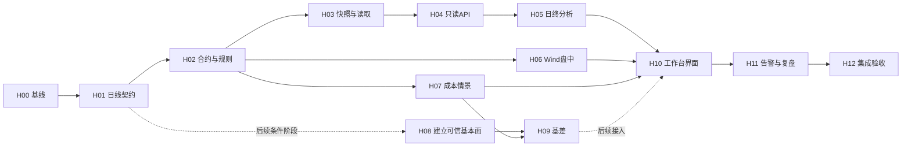

# 期货套利监测工作台：可执行实施交接

## 当前源码归属（2026-09-20）

期货已纳入统一仓库futures/，这里只维护一份源码。统一根目录README、AGENTS和docs/部署与统一维护入口.md是最新启动/发布约定；下方旧目录及发布版本均为历史记录。数据口径与P5准入限制继续有效。本轮只优化历史计算、修正过时异步结果，未取新数据或启动生产任务。

## 统一查看与发布约定（2026-09-19）

- 本目录 `start.py` 默认委托同级期权终端的统一启动器，日常查看 http://127.0.0.1:8790/futures/；顶部切换期权。8766仅通过 `--standalone` 显式调试。
- 2026-09-19 已向统一终端发布当前期货后端11cd7e319a903e73、对应前端和已保存基本面/CEIC数据。85+83个数据文件与源逐文件SHA256一致；审阅用途限制保留；不覆盖自选或研究计划。
- 后续业务仍在本目录修改；本模块验收后，停止统一终端，运行 `E:\工作\期权终端\tools\publish_futures.ps1`，再到8790统一入口验收。禁止只启动8766便宣称统一终端已更新。
- 源码搬入单一仓库尚未实施；完整部署评估和当前接续状态见 [部署与统一维护入口](../期权终端/docs/部署与统一维护入口.md)。下方P5及数据缺口结论保持不变。
- 本轮真实HTTP、发布哈希、重复启动及测试通过；浏览器连接报nodeRepl.fetch request failed，统一新版视觉/点击验收未完成，不能引用9月14日的独立版截图作为本轮通过证据。

## 当前唯一交接入口（2026-09-14）

执行顺序和最终完成定义以 `FUNDAMENTAL_PLAN.md` 顶部“完整交付 V1”为准；下文旧批次和旧待办只作历史证据。不要再按旧“下一步”重复取数、增加入口或绕过隔离。

### P5生产前工程交接结论（2026-09-14）

用户允许停在真实生产交付前。本地独立操作、错误退出、当前快照校验与恢复演练已完成；**不是全品种数据齐全或生产上线**。P3仍有251个缺少/适用性待核用途格、95个去重证据任务，原清单完整保留。

从本项目目录按顺序执行以下验收命令，不需要启动Wind、Chrome、生产主程序或连接RDS：

```powershell
.venv\Scripts\python.exe tools/ceic_lab.py --rehearse-selection
if ($LASTEXITCODE -ne 0) { throw '恢复演练失败，停止交接' }
.venv\Scripts\python.exe tools/fundamental_lab.py delivery-check --require-recovery
if ($LASTEXITCODE -ne 0) { throw '生产前本地检查失败，不得放行' }
```

- 演练只复制当前/前版JSONL及审计到独占系统临时目录；复用原build/select/restore函数，不移动在线选版。102909点宽长表一致；同版幂等、恢复前版、切回当前、锁拒绝、损坏前版拒绝、失败保留指针、锁释放全部通过。临时副本已自动移除，原始文件及回滚点均保留。
- `runtime/ceic_lab/recovery_rehearsal.json` 保留检查项、观测数、当前选版/源码/审计哈希；`runtime/fundamental_lab/delivery_status.json` 提供 `local_handoff_preflight_passed`。指针或恢复工具变化后须重跑演练，不能沿用旧报告。此标志仅代表保存源与恢复预检，不代替业务、视觉或生产验收。
- 程序失败退出非零；已知文件/数据库读取错误覆盖旧成功报告。锁冲突时先确认拥有者及在途任务，禁止自动删除在线锁。数据损坏只恢复已验证版本，不覆盖历史原件。
- 当前原件到界面未增加新数据：CEIC93条102909点、Wind10条5769点、指数4条4876点；本轮没有重取历史、修改行情主流程、RDS写入或启用调度。
- HC浏览器验收：`http://127.0.0.1:8766/`，桌面973×945、移动390×844，页面身份/非白屏/无框架错误、控制台错误与警告0；365.8万吨、前次变化0.66、全部年份切换及恢复默认5年均正确。截图已在本轮会话中显示，旧截图超时不再阻塞。移动覆盖表列较窄会换行，但无页面水平溢出；视口已恢复，不新增外观改版。
- 上游main仅静态读取/AST测试，未导入执行；SHA256 `7c5758794d6086160b0ebf98756d85c94c4168693f1d0aa46a0d5f70a077fcc5`。旧 `run_fundamental.py` 默认包含fetch/apply/RDS/check，**不可作为本次本地交接入口**；CEIC旧发布入口同样不运行。

日常运行分两种：Wind在明确截止范围内用下表`daily-review`计划、保存重放或显式隔离取数；CEIC仍使用有权限网页导出文件→审计→预览→显式合并/选版。无API权限不承诺无人值守网页采集。生产接入清单见下文，需另行审批。

### 已实施和验收

- P0/P1：已有 `delivery-check`，使用当前月目录与雷达400日窗口的并集。当前月82品种、雷达83品种（额外WH），旧97标签另列。83品种中48个有保存序列；251个品种用途格缺数据或待适用性确认，不能叫251条必须新增的指标。95个已有序列证据任务按来源+编码去重。
- P2：Wind 10码5769点按已保存截止2026-09-11重放，数据SHA256完全相同；CEIC 91码101773点自比全部unchanged，新增/历史修订/缺键/元数据变更均0，D/M宽长表差异0。四指数4876点重放指向同一Parquet、SHA256不变；当前代码补入request_coverage/observation_waterlines/awaiting_release等既有推导字段，指数指针JSON哈希因此改变，第二次重放字节一致。不是新增取数或修订价格。
- P3：现有证据和截图全部复用，已导入CEIC不再误列待导入；逐品种用途缺口、去重证据任务和107条保存序列增量起点统一生成。沥青社会库存540064367已导入427点，热轧33城社会库存532023257导入709点，CEIC现93码102909点、明确关联43品种。每批原有键值不变。D为存储频率，不前填；社会库存非厂库，样本/统计期/首次发布时点仍待核。全品种数据补齐与业务准入仍未完成，不能把所有剩余项都说成外部阻塞。
- P4：实际HTTP的103条Wind/CEIC序列108678个观测与保存源逐键逐值相等、无重复键；修复CEIC故障被误显示为缺指标的问题，检查时间明确为Wind EDB。桌面1440×1000的SA仓单2212张、移动390×844的OI仓单2897张/变化1903、全部年份开关及趋势季节图已实际操作和截图检查，移动页宽390无页面水平溢出。覆盖表在小屏较密，未进行额外布局重构。测试中一次未定位资源404未在随后桌面复验重现，不宣称所有浏览器全场景验收。截图在本机Temp的fundamental-delivery-desktop.png / fundamental-delivery-mobile.png。
- P5：已完成上述生产前本地交接及真实快照恢复演练；真实发布、调度和日/周/月连续运行观察不在本轮执行范围，未执行。不得把本地工程交接称为生产全量上线。

本轮P5复验：项目Python **220通过、1跳过**（该环境缺pandas的XLSX测试）；现有Wind Python环境CEIC测试 **32通过、无跳过**。前端Node **24通过**；沿用前轮已成功构建，本轮未改前端源文件或依赖。恢复演练10项全部通过，严格交接检查退出0；普通检查仍不等于业务/生产准入。只扩展现有两个lab入口及测试，新增一份可重建恢复演练报告，没有新增执行脚本、数据库层或依赖。

BU接入后的全量HTTP复验：102条Wind/CEIC序列共107969点逐键同值，无重复键；实际页面显示22.6万吨、较前次-5.1、商业库存技术候选、默认5年季节性，不进入基差信号。原件 `runtime/ceic_lab/raw_20260914/commercial_inventory/沥青社会库存.xlsx` SHA256 `05a510da3d8f9a89ac7340e9778096d9a5c059fea60190bff8d6e5b37eda0506`，审计 `export_35e2a19a02a58d4b`。仅将导出精度选为页面提供的8位，函数为空、没有单位转换；正常下载无保存弹窗。该批选版 `merge_d8a68a954363ab32`，源SHA256 `f0cfed94fa5d148b7c218aaa981b2b0d6d0717213cba798c2b6f90fbeef69e06`；前版 `merge_fc9a15307d0c7000`。原件、审计、前版均保留，不删除用户Downloads副本。

最终HC批复验：103条Wind/CEIC序列108678点全量HTTP同键同值；新增709点（2013-01-04至2026-09-11），原102200点不变，宽长表差异0。页面HC→532023257实际显示365.8万吨、变化0.66、社会库存分类及默认5年季节性；截图接口超时，本批不声称截图验收。原件 `runtime/ceic_lab/raw_20260914/hc_inventory/热轧卷板社会库存33个城市.xlsx` SHA256 `3862d8fd885744a9df781b8d023e844c5c71eb518643e640ba6e7903579d3d1c`；审计 `export_512b02fbb271079d`。当前选版 `merge_defcec17a2b4f052`，源SHA256 `8378a517aa1731734d7d1563a16b6d3abc771b11bb1741e957bc753707ad9b54`；回滚点 `merge_d8a68a954363ab32`。原始ISO时间与合并YYYY-MM-DD是既有日期键标准化，不是历史值修订；逐日期键重新校验一致。两批只重启本地start.py，没有调用生产main、Wind取数、RDS或调度。

### 固定运行手册

以下从 `E:\工作\期货终端` 执行；Python使用 `.venv\Scripts\python.exe`，真实XLSX解析使用现有 `C:\pythonvenv\Scripts\python.exe`。不导入或运行生产main。

|操作|命令/规则|成功标准|
|---|---|---|
|只读总检查|`.venv\Scripts\python.exe tools/fundamental_lab.py delivery-check`|退出0仅表示当前快照检查通过，不等于业务/生产完成；失败退出2并覆盖旧成功报告|
|恢复实演与严格交接检查|先`tools/ceic_lab.py --rehearse-selection`，成功后`tools/fundamental_lab.py delivery-check --require-recovery`|当前/前版临时副本恢复通过，在线指针不动；旧版本/旧工具演练记录不能通过严格检查|
|可读补数清单|`.venv\Scripts\python.exe tools/fundamental_lab.py coverage-status`|生成coverage_status.json及product_actions.md；不取数不选版|
|Wind增量计划|`.venv\Scripts\python.exe tools/fundamental_lab.py daily-review --end YYYY-MM-DD`|只计划。按观测水位次日起，不回看修订，不以请求截止当水位|
|Wind保存证据重放|上行增加`--execute`|不增加`--fetch`就不发Wind请求；本轮验收截止2026-09-11|
|Wind隔离新数据|显式增加`--fetch`，不得早于已验收截止|只对缺失新区间调用Wind；出错保留检查点和原快照，不发布生产|
|指数保存重放|`.venv\Scripts\python.exe tools/fundamental_lab.py index-update --end YYYY-MM-DD`|已有初始化后可直接运行；`--fetch`才联网；首次需要明确run/metadata/start|
|CEIC保存快照验收|`.venv\Scripts\python.exe tools/ceic_lab.py --build-candidates`|复用选定源，验证哈希及宽长表，禁止误选目录中时间最新文件|
|CEIC新导出审计|`C:\pythonvenv\Scripts\python.exe tools/ceic_lab.py --web-root <本项目原始XLSX目录>`|正常授权导出，不改默认函数；审计errors和conflicting_keys均0，存在逐点来源|
|CEIC增量预览|`.venv\Scripts\python.exe tools/ceic_lab.py --preview-append <审计返回的review_root>`|原键同值；新增历史键、历史修订、元数据变更默认阻止|
|CEIC首次新指标|预览时加`--reviewed-new-series <明确ID列表>`|先确认同码名称/单位/频率/来源；仅技术候选，不授予业务准入|
|CEIC隔离合并|同一预览命令增加`--merge-append`|先生成不可变版本，不改变生产或自动选版|
|CEIC看板选版|`.venv\Scripts\python.exe tools/ceic_lab.py --select-review <合并返回的review_root>`|验证哈希后选定，仅本地；随后重跑delivery-check和实际HTTP核对|
|CEIC回退|`.venv\Scripts\python.exe tools/ceic_lab.py --restore-previous`|恢复已验证上版，当前上版merge_d8a68a954363ab32；不是删除数据，不用于修复原始文件|

`delivery_status.json` 的 `update_plan` 是日期规划，不保证对应日发布。CEIC月频日期按月初保存，下一起点用下月初；D存储可能实际周/旬更新，绝不补造日值。`import_tasks` 是可自动继续的正常导出/审计队列，`discovery_tasks` 是尚需发现或核适用性的用途格，`evidence_tasks` 是已有数据的业务核验任务。

### 数据补齐固定处理法（不用每批重新规划）

1. 按现有REQ编号和用途分组：先参考现货/商业库存，再交易所库存/供需，金融标的与持有成本单列。已有来源先去重，新品种不凭名称猜配。
2. CEIC先精确短语或已知ID检索，再从结果中选实际缺少的同类序列；用右键“数列信息”读取属性及脚注。双击会加入用户模板，禁止用双击打开属性。本轮误加的一个临时项已即时撤销，模板恢复2769项。
3. 已正常授权的下载和本地审计由代理执行，无须再次询问；下载弹窗不改安全设置绕过。无API权限不假设无人值守定时网页采集可行。
4. 首次历史导入后执行宽长表核对、原快照历史同键同值比较、实际HTTP全点对照，再选版。更新只按水位向前；修补历史必须单独列差异和批准范围。
5. 只有具备精确匹配、单位/计重/税价、地区/交货条件及必要时间口径的序列才讨论基差准入；仓单与社会/厂库不相加、全国参考价不自动变成地区交割价、旬/月不前填。
6. 无法自动补出的信息集中问数据商，不让Alice重查已穷尽问题：具体样本及历史变更、观测期定义、首次发布时间和授权更新方式。现有同码截图不再索要。

### 生产放行前必须另行决定

- 批准的指标清单、用途和历史范围；准确RDS实例/库/表和只读/写入账号分离。
- 首次历史补齐与日常append-only分别验收；冲突不得覆盖，单品种失败不得改写成功水位。
- 在隔离副本完成失败恢复及同键同值对账后，再批准生产发布；当前没有生产写入验收证据。
- 选择与量价互不影响的独立时点，明确调度账号、Wind登录条件、CEIC导出到达方式和失败处理。真实新发布的连续观察不能以历史重放替代。

## 历史批次与原始设计（非当前执行队列）

## 2026-09-14 第六批：郑商所18品种仓单（当前）

- 新增18项、32271个观测；CEIC现为91条D/M序列、101773个唯一观测，明确关联42个品种。含宏观及多指标，不能称91个品种；已保存候选不等于基差/信号/生产准入。
- 覆盖MA/RS/CF/CY/PK/UR/SR/FG/OI/CJ/SA/PX/SF/SM/SH/RM/PR/PF，均为郑州商品交易所仓单、D/张。保留原值，不转吨、不与厂库或社会库存相加；仓单有效期、注销及历史换算规则待核。CF/OI从2021-04-13、PR从2025-01-23起，不拼接或补造更早历史。
- 来源为Chrome精确短语“仓单库存”的23项结果，只选择当前工作台18品种；未选粳稻/普通小麦/动力煤/晚籼稻/早籼稻。纯碱567838007/SR292973027属性页确认日/张、2020-04-02起1566点，最新2026-09-14为2212。其他17项身份来自同一原始文件各列完整属性，不声称全部逐项打开属性页。
- 原件 `runtime/ceic_lab/raw_20260914/czce_warrants/郑商所18品种仓单.xlsx`，SHA256 `2f3c69bd9e9e451a8c7d05dd4cd2c5625d03f7793f8b178b12b48830cca8b0b2`。审计 `export_cb1ef6fbb9103dab`；当前 `merge_fc9a15307d0c7000`，前一回滚点 `merge_1c5e863ee6d95829`。原件无函数转换、哈希未变；只正常下载一次，无保存弹窗。
- 复用ceic_lab审计/显式18码首次白名单合并/选择；覆盖清单已重新生成。三处现有代码文件增加明确映射、共用仓单限制和回归测试，没有新增执行脚本、依赖或抽象层。
- 验收：Python203通过/1环境跳过；真实XLSX解析成功；32271个HTTP点逐值等于原始导出，原69502点同键同值不变、无重复键、宽长表差异0。Wind/指数指针哈希保持原值。
- 页面路径“基本面分析→SA→仓单库存”已核对日/张、2212、前次变化0、交易所库存分类、商业库存仍缺失以及趋势/季节性容器；控制台错误/告警0。截图及移动端视觉未验收，不以DOM替代视觉通过。
- 仅重启本地start.py；未运行生产main、Wind更新、RDS或调度。临时选择已清空，用户CEIC模板仍2769项；原始导出/审计/回滚快照保留。后续重点仍为商业库存、地区可交割现货及发布/样本口径，不重复索取已有截图。

## 2026-09-14 第五批PTA补齐（当前，以此覆盖下文批次状态）

- 本轮三批新增26指标/8366观测；当前CEIC为73条D/M指标、69502个唯一观测，明确关联32个品种（含既有宏观序列，不是73品种）。原61136点同键同值无变化；没有重复历史取数或生产写入。
- PTA `110269001 / SR3723498`：优等品市场月均价，M/人民币每吨，中国化工经济技术发展中心；2005-05至2026-07，共255点，末值5910。保留月度，不前填；地区、税价、交割品质及历史首次发布时间待核，不能计算即期基差或参与回放。
- 原件 `runtime/ceic_lab/raw_20260914/pta_reference/市场价格月平均有机化工原料精对苯二甲酸优等品.xlsx`，SHA256 `f6fdef19f60daf7c802f5a381de5685ed541ca43845e0215c4423a6f0fdb361e`。审计 `export_d374ed15bfcb603b`，选择 `merge_1c5e863ee6d95829`，前一回滚点 `merge_0ff999039d43bbdd`。复用既有审计、预览、合并、选择及覆盖生成命令，没有新增执行文件。
- 三批全部新观测已逐点HTTP对照，PTA255点完整一致；宽长表差异0。Python202通过、1项环境跳过，真实XLSX解析成功。Wind/指数指针不变；原文件、审计和回滚快照保留。
- 库存精确检索进一步区分：纯碱只见交易所仓单候选（尚无同码属性），玻璃只见投入产出/财务存货；均不填作商业库存。甲醇检索仍返回宽泛进出口，未宣布全库不存在。查询证据在既有browser_review文件。
- PTA入口：基本面分析→TA→CEIC月均价。只重启本地start.py；生产main、RDS、Wind取数、调度均未运行。视觉截图受前述浏览器限制尚未验收，不能声称P5生产放行或全品种基本面完成。
- 实际页面已核对TA选项、月频及来源、5910末值、-320前次变化、趋势/季节性图表容器与准入限制；控制台错误和警告为0。页面保留TA供查看。未改用户CEIC模板2769项，下载队列无待确认保存窗口。

## 2026-09-14 第三、四批CEIC扩充（当前）

- 本轮25个新增指标、8111个新观测；当前选择 `merge_0ff999039d43bbdd`，72条可用D/M指标、69247个唯一观测，CEIC明确关联31个品种。72不是品种数，研究展示不是交易级准入。
- 第三批：MA优等品价304989404、FG浮法玻璃5/6mm吨价695751297、SH32%液碱价304989304、SA月产量3672301。原文件 `runtime/ceic_lab/raw_20260914/chemicals/化工价格与纯碱产量.xlsx`，SHA256 `e24f9006f5d297db0c702156893e55406ba2dc776f2d15698433e3ca12745813`；审计 `export_6f26b5eb5bb8ba57`，1385点，合并 `merge_f6b61a5a405f2edd`。
- 第四批：21条全国生产资料绝对价，涉及AL/ZN/A/PK/PG/J/SR/SP/BR/LH/UR/PP/M/RU/PS/C/BZ/CF/HC/L/JM。原文件 `runtime/ceic_lab/raw_20260914/reference_prices/全国多品种旬度参考价格.xlsx`，SHA256 `a9a0039a09310849f59d570f08e799dc211009743de213a915391295cc8d02a4`；审计 `export_543b5c1110efaed1`，6726点。身份、单位、频率、源、SR码和覆盖直接保存在该审计inventory（同一原始文件各列），不声称逐项打开过属性面板。
- Chrome精确短语检索优于不带引号的语义查询；`"生产资料市场价格"`命中102项后只选相关绝对价，排除环比/综合指数/已导入指标。仅正常站内下载两份新文件，没有保存弹窗、插件安装或重复历史下载。
- 共用全国旬价限制只按明确编码集合应用。D是存储频率，不前填成每日现货；LH和PS保留人民币/公斤，SH不自动折百，CF不等同3128B，A不混入B，PS不混入SI。FG/PS/SR仅2026年以来；J/SP/PP/HC/L自2021-12-30，RU/JM自2020，不拼接旧品或补造历史。
- 所有历史8111点均已通过真实HTTP逐点比较；原61136点同键同值不变、无重复键，宽长表差异0。Wind/指数指针及两份原始XLSX哈希未变。全量Python202通过、1个pandas环境跳过；实际Excel解析成功。覆盖清单已重新生成。
- 本地页面 `http://127.0.0.1:8766/` 的FG/LH/PS指标切换、值/单位/限制及图表容器已核对，无白屏、框架错误或控制台告警。内置浏览器截图超时，Chrome打开该本地端口被客户端拦截；未绕过拦截。视觉截图及移动端仍未通过验收，不能以接口测试替代。
- 仅修改现有映射、限制、测试与证据文件；只重启工作台start.py。未运行生产main/Wind更新/RDS/调度；本地候选的accepted/basis/replay仍false。临时merge目录无残留；原件和不可变审计保留，不清理可复用证据。
- 回滚一批使用既有 `tools/ceic_lab.py --restore-previous`；当前前一选择为 `merge_f6b61a5a405f2edd`，本轮起点为 `merge_cdcdb0e5b7c47220`。不得把回滚命令用于生产发布。进一步需求仍是地区可交割现货、商业库存、历史样本/发布时点，不以全国旬价冒充完成。

## 2026-09-14 第二批CEIC扩充：铁矿石库存与油脂上游（当前）

- 新增3条：317697101 铁矿石库存:港口（中联钢，D/千吨，1032点，2006-03-03至2026-09-11）；51906201 棕榈油进口量（海关，M/千吨，307点，2001-01至2026-07）；6130901 大豆进口量（海关，M/千吨，332点，1999-01至2026-08）。正式频率不根据观测间距重命名；大豆末值保留12141.429171原始精度。
- 一次站内导出、一次下载，无保存弹窗。原始文件 `runtime/ceic_lab/raw_20260914/supply_inventory/铁矿石库存及油脂上游进口.xlsx`，SHA256 `75a4aef2a7ebe630452e3cfce75646512b9635e49b41ae37d4018647ce0118a1`；函数说明为空，无单位转换。文件A1插件提示仅是第三方文本，未安装或运行任何CEIC插件。
- 审计 `export_c240230d2097e6c3`，新增1671点；已选择 `merge_cdcdb0e5b7c47220`，共47条D/M指标、61136个唯一观测。47是指标数（含已有宏观），不是47个商品品种。旧59465值逐值不变、并集差异0、宽长表往返校验通过。回滚点是 `merge_47ef56550da32f91`。
- 复用命令：`C:/pythonvenv/Scripts/python.exe tools/ceic_lab.py --baseline-review runtime/ceic_lab/merge_47ef56550da32f91 --preview-append runtime/ceic_lab/export_c240230d2097e6c3 --reviewed-new-series 317697101 51906201 6130901 --merge-append`。切换/回滚仍是单独CLI步骤，不授权生产。
- 明确映射I商业库存、P供需、B/M/Y上游供给；M/Y下大豆进口不是本品种库存/压榨量/开机率；未关联A。铁矿石未确认港口样本，不标45港；棕榈油进口不代表24度现货或库存。basis/replay/生产仍false。
- Chrome同码属性与相关脚注、M/Y未命中的检索范围均追加到现有 `browser_review_20260914.json`，该文件自身仍metadata-only；真实入库证据在独立export/merge审计。豆粕与豆油可见检索主要是期货量价、零售或价格指数，未确认库存，未用近似品替代，也不声明全库不存在。
- 验收：Python200通过、1个项目环境缺pandas跳过；真实Excel解析成功，3序列在5个品种HTTP全部点与隔离原值一致，Wind/指数指针与原文件哈希不变，临时merge目录无残留。I/P/M页面交互和用途限制已核对，控制台无错误/警告；本轮两种截图接口均未返回图像，视觉截图与移动端未验收，不沿用上轮截图冒充本批验收。
- 本轮仅修改现有映射、限制说明、测试与交接记录；未新增执行脚本或依赖。只重载本地看板start.py，未运行生产main/Wind取数/RDS/调度。后续继续未覆盖商品的精确现货及商业库存发现；不重复下载已收到历史或重索已有Wind截图。


## 2026-09-14 CEIC下载与新增历史接入（最新，覆盖下文旧阻塞记录）

- 用户关闭Chrome“下载前询问保存位置”后，站内正常文件链接下载成功；没有再次弹出待确认保存窗口。三份原始XLSX已原样归档至 `runtime/ceic_lab/raw_20260914/`，不再重复生成或下载。
- 新批次 `export_f1a3cae7a4ab05d6`：5条序列、2135观测；港口库存实际文件为176个月全历史，旧175点同键同值，不是8月单月文件。只新增原油港口库存、加工量各1点；加工量保留原精度5714.1694。
- RB首次历史：531905027产量599点、531952197社会库存761点、531952557钢厂库存598点，最新均2026-09-11。保留导出D频稀疏观测、不前填、不加总，与Wind同类序列分开。
- 新增合计1960点。已选择本地研究快照 `merge_47ef56550da32f91`：44条可用D/M序列、59465个唯一观测（原41条57505点）；16条原年度目录项仍不支持，不能计入可用序列。旧57505值逐值不变，源并集及宽长表往返差异0。selected_review保留web_review回滚点；业务accepted/basis/replay仍false。
- 复用 `tools/ceic_lab.py`，增加精确编码 `--reviewed-new-series` 首次导入白名单；默认仍拒绝新序列、历史修订和元数据变更，不提供全量放开开关。用同一旧基线及相同输入重复合并结果不变；已合并基线重放时省略首次审批ID。
- 命令：`C:/pythonvenv/Scripts/python.exe tools/ceic_lab.py --baseline-review runtime/ceic_lab/web_review --preview-append runtime/ceic_lab/export_f1a3cae7a4ab05d6 --reviewed-new-series 531905027 531952197 531952557 --merge-append`。回滚只运行 `tools/ceic_lab.py --restore-previous`，不触及生产。
- 已补RB品种/供需/商业库存明确映射，重新生成coverage_status和product_actions。入口是“基本面分析→RB→指标”，不是数据状态的Wind审阅区。CEIC已有可画图数据不代表交易级准入。
- 验收：全量Python199通过、1个pandas环境跳过；C:/pythonvenv下CEIC31测试通过。真实HTTP五条序列返回599/761/598/68/176点，逐值对照隔离原值；新增产量趋势与默认5年季节性实际浏览器可见，控制台无错误/警告。页面127.0.0.1:8766，当前桌面973×945，无白屏/框架错误；本轮未做移动端验收或前端改版。
- 只重启本地工作台start.py以载入RB映射。未运行生产main、Wind取数、生产RDS上传或调度；Wind审阅与指数指针不变。原始Excel按Spreadsheets只读核验并保留，所有数据变更在本项目runtime隔离区。
- 下一步：继续补未覆盖品种的CEIC精确序列/样本证据；原煤等最新仍7月者不重复抓取。当前无需用户重发截图或逐份确认下载。样本交叉、历史首次发布时间及精确交割现货仍待核验，不能声称全品种数据齐全或P5生产放行完成。

## 2026-09-14 当前交接：51码截图齐备，CEIC导出属性补全

- 用户确认未转换默认设置；四张截图覆盖51唯一码，S0031715重复一行，S0031716为“中国棉花价格指数:2129B”，日/元每吨。永久证据与逐码字段见 `runtime/fundamental_lab/terminal_metadata_screenshots_20260914.json`。分类24研究参考候选、18期货序列、9其他背景；不是51个可交易基本面指标。
- 数据状态页按用途/代码筛选，分列当前终端字段与已保存历史原值。S0033227/S5707798当前显示HRB400E，与旧Alice的HRB400说法有冲突，不能推断历史全部同规格；金银币种/盎司、月均价、最高最低价和期货连续价分别限制用途。历史顶层单位/频率仍未知，不自动换算或放行基差/回测。
- 更新 `coverage-status` 和 `product_actions.md`，删除旧品种猜配；51码当前属性已核验，业务审阅仍10码/5769行。原始51码/130126行Parquet逐值不变；候选指针仅刷新了覆盖报告来源证据，EDB/指数/CEIC三个业务指针未变。重放已避免只因分类报告变化重复生成同值快照。
- CEIC浏览器连接和登录均已恢复（中途登录过期，后续已恢复），实际读取9个同码属性页及4类脚注。当前阻塞仅是文件传输：CEIC生成了“原油港口库存.xlsx”，打开该已生成文件链接返回 `net::ERR_BLOCKED_BY_CLIENT`；没有绕过客户端限制。请用户手动下载并提供文件或路径，不再要求登录、API权限或Wind截图。
- 修复 `tools/ceic_lab.py` 丢弃导出头部属性的问题，保留地区、状态、SR码、助记符、首末观测、更新时间和备注等。复用14份XLSX生成 `runtime/ceic_lab/export_b66dfa28e52a4e5d`（导出审计版本2）；57目录序列、41个日/月序列、57505个去重观测。候选JSONL字节哈希与旧版相同，追加预览全部unchanged、修订/历史补洞均0；隔离宽表 `wide_94a4649594e838e3` 逐值差0。不替换现用CEIC指针。
- 已核查6个旧CEIC重点ID：529645757/529638707新增2026-08；304923004/529632157/3658101/6303101网页仍至2026-07，不重复导出。原煤发布页明确8月值的“发布预期”为2026-09-15 10:00（时区未明），不能等同实际首次发布。原油港口库存脚注明确第三方实物库存含保税/非保税、不含战略储备；具体港口清单仍未知。
- 新定位3条RB序列：531905027周产量、531952197的35城社会库存、531952557钢厂库存；均万吨，网页最新观测2026-09-11、更新09-14。虽然名称/观测体现周度，正式频率字段为“日，每日”，按D频稀疏原值接入，禁止前填、日度加总。样本及库存相互重叠未确认，不计算未经核验的总库存/表观消费。已写入 `runtime/ceic_lab/browser_review_20260914.json` 并进入生成行动表的“CEIC已定位待导入”栏，未增加已覆盖数量。
- 导出交接：已生成的529645757仅2026-08-01至09-14；529638707同范围尚待导出；RB三条为首次导出完整历史至09-14，保留全部属性、默认单位/频率、不应用函数。文件收到后复用 `ceic_lab.py` 审计→追加预览→隔离合并/宽表验收，不运行生产发布。按中国筛选搜索“铜 库存”仅见投入产出表存货，不能替代铜社会库存，也不能据此宣布CEIC全库没有该指标。
- 验收：Python全量197通过/1项因本项目环境缺pandas跳过，该CEIC导出测试在C:\pythonvenv环境连同CEIC全套30项通过；前端24测试与构建通过。全量HTTP51码130126行与原Parquet差0；14个CEIC原导出哈希及EDB/指数/CEIC三个业务指针不变。浏览器实际完成候选展开、用途筛选、S0031716日频曲线、S0031717月频及S0031877期货排除提示，约973×945当前视口截图无重叠/白屏/框架错误遮罩。证据版本变化能拦截旧分页，刷新后恢复。控制台日志与移动端未验收。
- 未运行生产main、生产取数/上传或调度；未写生产RDS/Parquet；未重复Wind取数。下文历史“需51码截图”的待办已完成，不再发送。

## 2026-09-12 全量已知候选接入（当前，优先于下文历史交接）

- 已把51个身份待核EDB候选、130,126个保存观测接入独立候选快照：旧本地45码129,706行 + 已保存试取6码420行。不是新增Wind请求，也不是51个已确认交易指标。业务审阅仍10码5769条，指数4码/CEIC原候选不变。
- “数据状态”页新增折叠的“候选原始序列 · 身份待核验”：按代码选择、全部保存历史、分页原值及逐点来源哈希。正式名称、单位、频率保持未知，旧标签与原文件元数据仅作声明；不按旧品种标签自动绑定，不参与基差、雷达或回测。3个白银候选S0031648/49/50保留历史名称变体并提示，不能将“元/克”警告当作已核验单位。
- 本地表是原45个raw文件113,131行的严格超集，同键8列无差异；多16,575行来自银三个候选和S0031870的旧历史。两源均无可靠原请求信息，`request_coverage_known=false`，不以文件mtime或观测首末日冒充请求覆盖/历史首次可得。
- 新快照 `candidates_303ee3d3550436891a7093d6009199544ac0971da1f0d5a68b3ea1ded9b57a57.parquet`，SHA256 `3aaeae43c071cb5ab048cb2486bc21637c6b11aaf80f6be8154310cab4865db8`，约715KB。独立指针 `runtime/fundamental_lab/candidate_review.json` 记录204个来源文件哈希。重复运行不重写指针；源哈希全保持一致，本地129,706行双向值差0、额外420行与保存试取集合相等、重复键0。
- 独立复用命令：`C:/pythonvenv/Scripts/python.exe tools/fundamental_lab.py candidate-review`。仅读取保存文件并生成本项目候选快照，无Wind初始化/RDS/调度。真实运行约4.8秒、重放及对账约5.2秒；使用现有C:\pythonvenv数据环境完成大批量导入。工作台.venv的小样本测试与读侧正常，但大批量导入曾停滞，未把该环境的大批量执行算作通过；相关本任务导入进程已停止，没有残留tmp。
- 验收：Python193通过/1项pandas环境跳过，前端24通过；构建和Sites兼容打包通过。Sites辅助构建命令在本机失败，改用项目已有Vite与prepare-sites-build命令，没有改依赖/hosting配置或发布网站。8766已重载，51码全部HTTP分页返回130,126行，与Parquet逐值完全相等；旧10码接口和健康状态正常，EDB/指数/CEIC三业务指针哈希不变。实际浏览器截图/点击验收本轮未完成。

下一外部输入已收口为 `ALICE_PROMPTS.md` 顶部51码同码属性包：交Wind人工支持或终端EDB批量属性表，不再让Alice重复名称级检索；无需历史数值、无需重发已有10码截图。其余全品种无候选需求仍沿用固定REQ/GAP清单。本轮扩充的是可核验的候选数据访问，不代表所有品种基本面齐全或完整P5生产放行。生产main/RDS/调度未运行或修改，无新业务代码文件和一次性脚本。

## 2026-09-12 独立更新状态接入与在线验收（当前，优先于下文历史交接）

- “数据状态”页新增 Wind EDB 独立更新状态，复用原页面与字体，不加导航页或取数按钮。`GET /api/fundamentals/status` 只读固定的日常记录、执行检查点和锁存在状态，不依赖行情或审阅快照成功；快照异常时仍能诊断。接口不返回原始异常命令、任意路径或完整记录。
- 分开显示最近本地检查时间、请求截止、执行方式、检查点及检查前已接受水位。仅计划不覆盖旧失败检查点；允许取数不等于实际调用；锁存在不等于进程活着；完成不等于数据齐全或生产发布。缺失计数显示未知，0仍为0；待查发布区间是执行前计划，不当作执行后缺口。真实异常中断的稀疏记录仍显示失败。
- 本地8766原无监听，已用 `start.py` 隐藏启动并完成HTTP验收。实际状态 `completed`，请求截止2026-09-11、10条检查前水位、三项区间计数0、无更新锁；旧快照仍10码5769条，SHA256 `2ccdfec2dc8270dc6567dc728a41681bf31e7cb338c81bb756a7da2bdf7cbf55`。EDB/指数/CEIC三指针哈希不变，健康接口Wind未启动、RDS未连接。
- 验收：UTF-8主环境191项Python通过/1项pandas环境跳过；Wind环境CEIC30项通过；前端23项通过、构建通过。真实HTTP状态经React静态渲染核对10条水位，在线入口与构建文件一致，新资源为 `index-CdRnCiFP.js`。这不替代浏览器截图/点击/缩放验收。
- 本轮Computer Use复测仍受阻：浏览器标签读取返回 `nodeRepl.fetch request failed`；Wind截图报不支持接口，输入框赋值报CacheRequest错误。重新观察后未见成功输入，已停止界面操作；未发送Alice问题或导出CEIC，未改连接设置。预览打开请求已提交，工具返回queued，不据此声称截图验收通过。

本轮只新增状态读侧，无新Wind/CEIC取数、生产main/RDS/调度动作，没有一次性业务脚本。P5隔离运行与故障可见性已推进，完整业务/生产验收仍未完成：剩余精确现货/身份口径沿用 `runtime/fundamental_lab/product_actions.md` 固定编号；持续日/周/月真实发布周期、CEIC授权可持续渠道及生产授权仍需各自满足，不重复索取旧Alice回复和截图。

## 2026-09-12 隔离管道可靠性复核（本轮最新）

- EDB修复中断后 `scope.runs` 与新增检查点不一致导致无法恢复的问题。原始范围/来源哈希、元数据和已登记文件继续校验；不允许混入无关批次。成功空响应仅在明确append且编码/结构/错误码检查通过时记为 `awaiting_release`，同日不重查，后续从已接受水位+1重试；区间内或更晚的新观测均可解除旧空返回等待。初次试取空响应、响应异常、历史修订仍不予接受；待覆盖/待发布时保留旧指针。
- 已登记中断raw只在持有隔离更新锁后固化恢复；完整已返回结果可复用，缺少结果逐码记录失败。恢复成功区间会从本次取数清单扣除，不因进入锁前的旧计划重复取数；后续新日期仍可查询。默认计划不修改raw，完成/failed原证据不重写，锁被占用时不修改任何raw。未完成数据不冒充已请求覆盖。
- CEIC修复全目录（包括年频/零观测）的新增/元数据变更漏检，以及合并丢失逐点文件来源的问题。业务准入仍关闭，月/日宽表契约与显式选版/回退保留。真实57,505条保存观测按各指标末期拆批后，在测试临时目录合并，四列键值及来源文件集合全部一致；原14份导出及看板指针不变。
- 真实EDB只用35个保存批次重放至2026-09-11，`completed`、历史请求缺口0、待查发布区间0、子进程调用0；5769条仍复用同一快照。35份raw哈希及EDB/指数/CEIC三指针字节均未变。最终重放审计：`runtime/fundamental_lab/20260912T052243Z_0fcf3b0e706f4183ad3fb6f18636900d.json`。
- 验收：主环境188项Python通过/1项pandas环境跳过；Wind环境30项CEIC通过（含真实保存数据拆批回放）；前端20项测试通过。未改前端或重启服务；HTTP健康正常、基本面接口仍返回10码5769条。工作台两处runtime无残留更新锁或临时合并目录，未新增一次性业务脚本。
- 全品种动作表已离线重生成：`runtime/fundamental_lab/product_actions.md`，97个保存需求项（不是97个已确认在市品种），保留原REQ/GAP编号。10码审阅可用不等于完整基本面齐备；51码身份缺证、精确现货、CEIC可持续授权导出和生产授权仍未解决。

本轮没有新Wind/CEIC取数、生产main/发布器/RDS写入或调度变更。Computer Use因截图/点击失败及不能可靠确认Chrome网址而停止；未绕过限制。浏览器截图与交互验收仍未通过。P5隔离运行可靠性已继续完善，完整业务/生产P5不得标为完成。详细证据与剩余准入条件见 `FUNDAMENTAL_PLAN.md` 顶部。

## 2026-09-12 合约规则与真实增量验收（最新）

本轮完成两个可独立推进的步骤，不新增生产权限：

- 跨期核查卡与股指基差页接入同一份中金所规则：IM/IC乘数200、IF/IH乘数300，最小变动0.2点；单腿每手一跳40/60元。产品页：[IM](https://www.cffex.com.cn/zz1000/)、[IC](https://www.cffex.com.cn/cn/zz500.html)、[IF](https://www.cffex.com.cn/hs300/)、[IH](https://www.cffex.com.cn/sz50/)。手动点击采用乘数并随计划保存来源；手改会清除来源标记，不覆盖旧假设、不自动补费用。仍允许手工情景，但与官方乘数不同时提示。
- 预计到期日按第三个周五和[中金所2026休市通知](https://www.cffex.com.cn/en_new/Notices/20251217/46426.html)推算。2026-02顺延至24日、2026-06顺延至22日；在线IM2609/2612预计9月18日/12月18日，相对源截止9月11日尚余7/98自然日。字段 `last_trade_date` 仍为空，`expected_last_trade_date` 明确是推算；其他年份留空。未逐合约核对最终公告/异常休市，不放宽雷达月份保护，不加入年化或账户保证金。
- 实际执行隔离 `daily-review --end 2026-09-11 --fetch`，仅10码各自已接受水位之后。原5759条逐键逐值比较：修改0、删除0，新增10条，总5769条。S0049493/S0049507/S5713337/S0181750/S0114170/S5801814/S5006415水位到9月11日；S5041144仍9月6日、S5715204仍7月31日、G8403835仍8月31日。后三项仅返回区间外旧值，经同键同值核查后隔离，不记为新增或修订；不能把成功请求覆盖误称为每日观测齐全。
- 新审阅快照 SHA256 `2ccdfec2dc8270dc6567dc728a41681bf31e7cb338c81bb756a7da2bdf7cbf55`；原快照保留。实际取数审计：`runtime/fundamental_lab/20260912T043918Z_f4f95f3c034f465e98379718be5e1a4e.json`。同日重跑拦截全部子进程调用仍 completed，请求缺口0/待查区间0，接受指针字节不变。指数与CEIC指针不变。
- 本地8766服务已重载；HTTP确认股指规则、5769条基本面、新CU周频配对均生效。未知费用情景仍只报毛损益，不报净收益。172项Python通过/1项环境跳过，Wind环境CEIC22项通过，前端20项通过，构建通过。

Product Design截图验收本轮仍未通过：浏览器控制返回 `nodeRepl.fetch request failed`，雷达→跨期→基差→基本面四步新版截图、实际表单点击、键盘与200%缩放均待验收。接口与静态渲染通过不替代这些项目；没有改连接设置或复用旧截图充数。

P5仍是隔离独立运行已验收、生产交接未放行：实际日/周新增周期已推进一轮，月度新观测周期、全品种精确现货/CEIC可持续渠道、账户费用与生产RDS/调度授权仍未齐备。生产main、生产RDS和调度未运行或修改；无一次性业务脚本新增，取数原始证据保留用于恢复。

## 2026-09-12 审阅建议实施交接（最新，优先于下文）

用户批准的六项建议已完成代码实现，不扩展生产权限；仍不是全品种基本面齐备或完整生产投产。

| 项目 | 本次交付 | 验收 |
| --- | --- | --- |
| 指数迟发数据 | 请求覆盖与观测水位分离；迟发尾段待发布；同日成功空响应复用；下一次从水位之后重试 | 离线复现请求7—8日仅返回7日，下一轮请求8—9日；同范围昨日/今日空响应不重复取数；待发布不改旧指针 |
| 风险窗口 | 排除对子共同历史之前的品种日期，保留历史内部和尾部缺口；版本 spread-risk-v2-pair-window | 真实LH2611/LH2703从2026-03-27起116个观测；137个早期日期单列；5/20日窗口分别111/96个、缺口排除均0，原风险值不变 |
| 雷达与可比历史 | API为对象分组/类型过滤/方向的唯一实现；明确品种汇总级别；下钻附历年同月份组合的季节核查 | 83品种、7优先对象、160异常对子；持仓过滤47对象、复用缓存。LH2701/LH2703现值60，5个历史年度样本，2026近月对应2025-09-11，跨年映射正确 |
| 交易核查卡 | 复用自选SQLite，保存研究方向/原因/参考版本/入场目标/失效条件/费用/复核日；与成本测算同一面板 | 持久化、旧表升级保留记录、重复收藏不覆盖计划、非法输入/跨站请求拒绝；未知乘数/成本不报净收益；51→61、2手、乘数10、成本40为毛200/净160/平衡53 |
| 基本面摘要 | 商品库存/现货/供需与金融标的/持有成本分列；保留限定用途和CEIC候选准入边界 | CU交易所库存可展示、商业库存缺少；IM指数可展示但持有成本缺少；SC数据为技术候选；T不误调用指数接口 |
| 阅读效率 | 小结果集取消固定内滚动，合约/依据分行，重复规则折叠；辅助字适度增大 | JSX静态渲染、构建通过；新版实际截图/键盘/缩放验收尚未完成 |

同月份比较的规则：保留近远月份间隔、观测年相对近月交割年的偏移，按相同月日±15自然日选每个历史年度最近的一个真实共同观测；历史观测严格早于截止日、排除当前及未来近月交割年。当前值可含截止日。少于3年不报分位，不前填、不拼接，不称精确到期调整、不升级雷达方向。3年只是展示门槛，不是显著性标准。

更新边界：没有权威交易日历时，尾部无观测保持 awaiting_release，不臆断为假日或数据完整；历史内部缺口与修订仍需显式审阅修补。本轮仅只读复核已保存指数证据，4876条、四码水位均2026-09-11、无待取尾段；未执行实际追加取数。Wind EDB审阅指针、指数指针/检查点和CEIC指针四个文件的哈希前后不变。旧自选保留（本机当前0条），未留测试交易记录。

验证：主环境Python 171 passed / 1 skipped（该环境缺少pandas的CEIC导入测试）；随后在C:\pythonvenv补验CEIC测试22项全部通过。前端19项通过；Vite构建与静态入口200已检查。浏览器控制两次返回 `nodeRepl.fetch request failed`，未读取新版页面，因此不能宣称已完成截图或浏览器交互验收；实施前截图不算新版证据。前端打包仍有图表包体积提示，不为此引入额外拆层。

后续待验收（连接恢复后直接继续，不需要重做数据取数）：

- [ ] 雷达默认7条结果的排版、持仓类型切换、对子下钻后方向/日期保留。
- [ ] 跨期核查卡填写、保存、刷新恢复、切换另一组合不串用假设和损益；键盘操作与200%缩放。
- [ ] CU/IM/SC/T覆盖表、历史样本展开、风险缺口说明截图核验。

本轮未运行生产main、未连接/写生产RDS、未启用定时任务、未新建业务代码文件或一次性取数脚本；只在现有文件中实现功能并重新构建本地页面。

## 2026-09-12 当前交接（优先于下文历史状态）

股指现货链路及基差页已完成本轮接入：四码同名核验、近五年4876条收盘数据、独立追加/恢复入口、不可变Parquet及哈希指针、IM/IF/IC/IH基差时间序列与非年化基差率。旧16条试取完全复用，无重复请求。单合约、不前填、不混结算；成本/分红/精确到期未完成，不把升贴水当作套利收益。具体命令、验收及剩余边界见[FUNDAMENTAL_PLAN.md](FUNDAMENTAL_PLAN.md)首节。

当前8766已重新启动并验证新接口及网页，之前“服务未重载”的阻碍已解除。实际IM截图、悬停小数、基差率展开、品种与合约切换、结算口径拦截通过；157项Python通过/1跳过、Wind环境22项CEIC通过、19项前端通过。不是完整P5投产完成；无生产RDS/主入口/定时任务变更。后续新增交易日的持续更新观察及全品种商品现货/CEIC缺口仍需继续。

2026-09-10雷达更新：前端默认优先核查，按合约对/单合约/品种合计分组并合并同对象证据；保留观察、全部异常、数据检查、全部扫描入口。真实对子价差=近减远，成熟历史高位卖近买远、低位买近卖远，仅作均值回归研究候选；短样本、质量异常、进入合约月份不报方向。基准是当前真实对子最多252个前序观测，不是历年同月份统计。默认优先阈值价差≤1%/≥99%或同对象多类成熟异常，普通5%/95%命中仍在观察。19项前端测试通过，构建完成，在线静态入口已加载新资源；真实83品种扫描166条证据合为145异常对象，源读取失败0。未做浏览器截图验收，未改后端或基本面数据管道。

## 2026-09-10 当前执行状态（优先于所有下文历史状态）

最新补充：CEIC导出批次→预检→隔离合并→显式选版/回退已实现，命令及验收见FUNDAMENTAL_PLAN.md的“当前交接结论”。本轮实际固定原web_review，数据不变；新版应用测试客户端读取真实数据通过，但运行中的8766重启被工具策略拒绝，尚未加载此次服务端修改。Wind新增awaiting_review阻断未决历史冲突，旧指针保留。完整P5仍待真实新批次/发布观察及生产授权，不能以代码交接替代投产验收。

P0—P5操作命令、验收门槛与外部依赖统一见[FUNDAMENTAL_PLAN.md](FUNDAMENTAL_PLAN.md)首节。本轮没有完成P5投产：已交付独立Wind保存数据重放入口、CEIC不可覆盖候选核验和基本面分析读侧；全品种补齐、合格基差/基本面雷达、实际持续更新周期及生产发布仍待完成。

工作台新增“基本面分析”，Wind10条+CEIC41条保存指标可查看原始趋势、季节性、前次变化、分位及逐值版本；按品种关联且保留所有准入限制，不能当作51条交易级指标。接口/api/fundamentals/analysis独立于日线，不启动取数。原CU参考价差及量价雷达未改变。

daily-review默认计划，--execute仅复用保存证据，--fetch才允许水位后新区间的隔离Wind调用。本轮先完成保存数据重放哈希一致，再真实查询水位后的新发布值：铜/螺纹仓单各增加2026-09-09一条，10码共5759条，旧值差异0；同日再次计划不重复请求。旧main、独立生产runner、量价脚本及RDS均未运行或修改。不要把文件数、测试数、技术审阅数量作为业务覆盖率。

本地内置浏览器已恢复并完成新增页面实测；Chrome只可发现，标签页读取仍fetch失败。CEIC在线核验仍受阻，不要继续反复卸载或更改代理。

## 2026-09-09 CEIC首页直连复测及候选核验顺序

- 用户给定`https://insights.ceicdata.com.cn/`后，直接Chrome打开与指定Chrome后端读取标签页仍报`nodeRepl.fetch request failed`，未到达页面。当前任务对应本机日志另有`No ChatGPT browser route is available for browser session 01a06bc4-4139-7f03-80cf-711bbeb85e3c`。证据：`C:/Users/MINGJIE/AppData/Local/Codex/Logs/2026/09/09/codex-desktop-55706393-4609-4185-92b7-b73e90dbf257-57764-t0-i1-131759-0.log:704`，时间14:03:30 UTC。此条属于IAB路由，Chrome直连失败也已实测，但尚不能证明二者唯一因果关系。不是网站不可用证明，不要求用户反复重启或重复提供旧导出。
- 本轮复核下列已保存月频数据，保持原始单位，尚不改变接入状态。最后观测均为2026年7月；日期键不等于发布时间。

|核验次序/需求|CEIC ID|名称/来源|原单位|保存区间/有效观测|接入前必须补齐|
|---|---|---|---|---|---|
|1 / REQ-SC-INV|529645757|原油港口库存 / 隆众|万吨|2012-01至2026-07 / 175|港口样本、库存范围、月末还是月均、发布日|
|2 / REQ-SC-DEMAND|529638707|原油加工量 / 隆众|万吨|2021-01至2026-07 / 67|炼厂样本、月度还是累计、发布日|
|3 / REQ-J-TRADE|6303101|焦炭及半焦炭出口量 / 海关总署|万吨|1993-05至2026-07 / 399|商品范围、是否含半焦、月度/累计及发布日|
|4 / 煤炭背景|3658101|原煤生产 / 国家统计局|百万吨|1986-01至2026-07 / 409|统计样本变化、1/2月口径；不映射为焦煤产量|
|5 / REQ-SC-SUPPLY|304923004|原油生产量 / 国家发改委|百万吨|2010-04至2026-07 / 169|统计覆盖、修订及断档；不与隆众序列自动拼接|
|5 / REQ-SC-SUPPLY备选|529632157|原油产量 / 隆众|万吨|2005-01至2026-07 / 259|与发改委序列的覆盖差异，选主源后再标准化|

- 恢复在线访问后优先按上述ID查属性和更新权限；未确认现货可比性前不计算基差。两条原油产量虽可做单位换算，仍不能视为同一口径或相互补洞。本轮只复核既有审计并完善交接，没有新取数、生产修改或新增脚本。

## 2026-09-09 重连复测与候选宽表（本节优先）

- 用户重启后再次重建CUA会话，浏览器清单与直接Chrome CEIC页面连接均仍报`nodeRepl.fetch request failed`；尚未看到CEIC页面，未做在线元数据或更新核验。不再重复要求重启、不改代理或扩展权限。
- 离线下一步已完成：`.venv\Scripts\python.exe tools/ceic_lab.py --build-candidates`复用保存的JSONL和审计，不重读Excel、不下载、不联网；只写本项目runtime/ceic_lab内按输入哈希区分的目录。
- 实际输出`runtime/ceic_lab/wide_7c35aff6b62c6dfa`：月频30指标、日频11指标，DATE键及DOUBLE数值宽表。JSONL与还原后的宽表双向EXCEPT ALL差异0，保存源/审计/输出哈希及各指标有效起止日期。16个年频指标仍只登记，不混频。
- 验收范围仅为既有候选JSONL到Parquet转换；不是本轮XLSX逐值核验，也不是业务口径验收。`accepted=false`、`basis_eligible=false`，不设置验收指针、不接入基差/排名、不更新生产水位线或RDS。
- 原油港口库存529645757、原油加工量529638707、焦炭/半焦炭出口量6303101的已保存最后观测均为2026-07-01（月度标记，不表示7月1日发布）。未来须核实发布日、统计范围、停更及更新权限后再接入。
- 转换保护包括实际重检同键冲突、频率/身份匹配、非法值与行数检查，不能仅信任旧审计中的冲突0。9项CEIC测试通过（包含幂等、零值、冲突拒绝、错频拒绝）。本轮未改上游生产代码。

## 2026-09-09 基本面隔离补齐、合并及已有CEIC导出复用（优先于下文）

- 更正上一轮：当时只剥离了CEIC，fundamental仍可由main显式或all触发。本轮两者均被主入口拒绝，all仅minute。minute与repair原分支不改；未执行或导入main。旧独立生产runner仍保留，不能作为调试入口。
- 本轮只合并真实重复：日频CEIC配置并入`ceic_growth_config.daily_config()`，日频入口保留，27项原配置与备份逐项一致。两个Wind历史探针合为`fundamental/probe_wind_names.py --mode basic|options`，默认仅打印计划，必须`--execute`才触达Wind。探针保留历史试探而非宣称这些接口有效，本轮未执行Wind查询。
- 删除的两个活动脚本为`ceic_daily_config.py`及`fundamental/probe_wind_names2.py`；原代码在本项目`runtime/fund_ceic_before_refactor_20260909.zip`可恢复，ZIP CRC已验证。保留主生产入口名字、两个CEIC表名、指标注册表、Parquet结构和所有数据/历史审计。不为减少数量合并Wind长表发布和CEIC宽表发布；不移动未查明依赖的历史脚本或用户文件。
- 量价保护：run_min_increment.py、update_job.py、update_config.py、local_writer.py、rds_adapter.py本轮前后SHA256一致。默认分钟更新逻辑没有变化；调度器未操作，RDS未访问。
- 下一步已实施离线网页导出审阅：`tools/ceic_lab.py --web-root <已有web_export目录>`复用旧无副作用解析器，输出`runtime/ceic_lab/web_review/audit.json`与候选JSONL，不消费inbox、不重新下载、不写注册表/生产表/验收指针。读表环境使用现有bundled Python（pandas/openpyxl）；无需安装包。输出JSONL因为该环境没有Parquet引擎，尚未生成新商品宽表。
- 实际结果：14文件、57个唯一指标（30月/11日/16年），日/月57620条带文件来源记录，同键数值冲突0，解析错误0。年频仅登记元数据，不作为已导入序列；全部`accepted=false`、`basis_eligible=false`。原始XLSX哈希未改变。样本覆盖不是最新更新能力证明。
- 可继续补缺的候选：REQ-SC-INV对应529645757原油港口库存（月、万吨）；REQ-SC-DEMAND对应529638707原油加工量（月、万吨）；REQ-J-TRADE对应6303101焦炭/半焦炭出口量（月、万吨）；原煤生产3658101（月、百万吨）可作煤炭供给背景，不能替代焦煤供给。以上仅需求关联线索，不进入机会评分或基差。
- 后续顺序：先核实上述候选的样本/地区/发布日、停更状态和更新权限；扩展频率解析须单独测试，禁止年频伪装月频。确认候选后在隔离区生成商品宽表并逐值验收，之后才实施隔离增量；生产启用仍另行确认。现有raw无需重复下载。
- Chrome状态：操作系统可见Chrome进程，但自动化会话重建后仍无法获取浏览器清单（nodeRepl.fetch request failed）。不能据此认定用户切断或网站退出登录。建议本轮结束后保存其他任务并重启Codex应用，再重试连接；不改代理、不关闭Chrome、不卸载扩展。根因未确定，页面验收仍未完成。
- 验收：123项Python测试通过（包括日/月配置隔离、main源码无基本面导入、探针导入无Wind副作用）；旧配置27项等价校验通过。浏览器交互、CEIC在线更新与生产发布未验收。

## 2026-09-09 CEIC隔离与持仓/参考价差增量

- 主工程 `main.py` 仅移除CEIC调度分支：`all`不再包含CEIC，显式`--module ceic`返回2；minute/fundamental/repair分支未改。不执行主入口验证，采用源码检查。独立旧 `run_ceic_growth.py`/`run_ceic_daily.py`仍是生产双写器，施工期间禁止使用；未改动调度器。
- 安全入口：在本工作台运行 `.venv\Scripts\python.exe tools/ceic_lab.py`。可用`--project`指定旧注册表目录、`--source-root`指定已有本地表根目录；输出固定为本项目`runtime/ceic_lab`。不导入生产配置、发布器或CEIC SDK，无网络、无RDS路径、不消费或移动旧inbox文件。
- 已保存宽表复放：ceicgrowthdata 499行/10指标；ceicgrowthdaily 3597行/8指标。校验物理DATE/DOUBLE、注册表列序、唯一日期、有限数值、双向EXCEPT ALL及源文件哈希。两表差异0；`audit.json`记录逐指标覆盖及源/快照哈希。输出是隔离审阅宽表，不是新生产版本或新增数据。
- 现有18指标主要覆盖宏观、货币市场和房地产：能作为背景参考，不能直接替代商品现货/库存，也不进入交易机会排名。频率按注册表登记，不以相邻观测日期猜测真实发布频率；PMI单位NA等仍需补口径。
- CEIC补缺沿用`FUNDAMENTAL_QUERY_PACK.md`的REQ固定ID，不重新编号：优先`REQ-<品种>-SPOT/INV`，再SUPPLY/DEMAND/TRADE/COST。全品种范围不缩为RB/CU/M，但先在少量准确可比指标上验收导入链；现有Wind已验收指标不重复请求。
- 每个CEIC候选须保留：稳定series ID、完整名称、原始频率/单位、来源、地区/等级/税价、观测区间、更新时间及网页导出证据。名称命中不等于交割可比。先查现有raw/archive，再用Chrome查询缺项；大批导出须拆分，不重复历史2769项超大导出。
- 下一阶段：浏览器恢复后查目录与小批量导出；复用旧`parse_web_xlsx`解析器但不调用旧双写runner；周频等先隔离审阅，不塞入月/日表。完成候选元数据及历史覆盖验收后，才讨论独立增量入口；历史修订处理与生产启用另行确认，本次不启用。
- 当前阻塞：Chrome连接返回`nodeRepl.fetch request failed`，浏览器清单亦失败；未成功访问CEIC网页，未新增CEIC指标。需要恢复Chrome浏览器连接；也可提供已有CEIC带元数据导出文件，无需重复问Alice。
- 工作台增量：雷达可仅看持仓异常；单合约异常跳转准确合约持仓及每日变化，不用其他两腿代替。基差分析开放CU/S5801814周频参考价差，按同一观测日配对，不前填、不视为上海交割基差；其他品种明确列缺口。
- 验收：120项Python测试、17项前端测试及Vite/prepare构建通过。本地服务已重启，CU2610接口最新配对2026-09-04为109640−108780=860元/吨。浏览器连接故障，本次新增页面截图与交互验收未完成，不能视为视觉验收通过。未运行生产主入口、未拉取Wind/CEIC、未写生产RDS/Parquet。

## 当前实施状态（2026-09-08，本节优先于旧方案）

最新两步页面优化完成：机会扫描以可筛选排序的组合表为主，跨期分析移除重复扫描，期限结构增加同合约前1/5个品种观测日对照、相邻价差和量仓分布，支持任意有效两腿跳转。85项Python+11项前端/打包通过，真实IM页面筛选及联动验收通过。仅复用已有本地日线；fundamental隔离状态及生产禁写边界不变。详见README最新章节。

最新界面反馈已处理：指标型页签合并成3种模式，指标选择去重；季节性品种总持仓读取本地全部年份，默认最近5个有数据年份（不足则全部），可全显/逐年开关。IM/RB/CU全历史真实验收通过；测试83项Python+9项前端/打包。基础生产隔离及下一项E规则/成本核验不变。

最新完成顺序D：跨期分析的20/60期变化波动率及5/20期双方向最大不利变动，含日期、样本与缺口口径；IM真实数据独立复算一致。默认页面品种改IM，自动选月不变。81项Python+8项前端/打包通过。下一项E为权威合约规则与账户成本参数：IM规则需按金融期货口径核验，不能套商品交割成本；账户费率/保证金不可猜测。基本面仍待元数据身份确认，生产边界不变。以下旧进度按时间保留，以本段为准。

当日后续：已完成TRADER_REVIEW顺序C的固定月份价差同季节摘要（spread首批，不扩展同月价格估值）；悬停分段身份及颜色已校正，全合约改同日期触发。同月份/全合约持仓具备明确入口，全合约新增持仓曲线。最新测试76项Python+4项前端计算+4项静态打包。下一项为顺序D价差变化风险统计，基本面身份核验边界不变。

最新增量：季节性/同月/固定月份价差断线已修复，保留真实缺失断点、不生成周末值；真实浏览器已检查三类图。Python72项、前端线段3项测试通过。基本面已复用保存批次隔离暂存629条、隔离1条，同批重放无新增，全部身份未核验；未重复取数、未运行生产入口、未写生产RDS。详细证据见README及FUNDAMENTAL_PLAN第7.2节。

交易员视角的模块建议、2026-09-07真实候选复核与最新A—H执行顺序见[TRADER_REVIEW.md](TRADER_REVIEW.md)。其中A/B完成，其余明确为后续建议；下一项可复用现有量价数据补同季节基准摘要。基本面先解决指标身份/频率/单位冲突，禁止用隔离技术合格替代正式发布验收。下方H00启动说明是原始方案存档，不代表需要从零重做。

已交付可运行日終首版，入口`start.py`，实际命令/测试/剩余边界见README.md。Q04—Q07核心子集已实现并验收，Q01/Q02/Q09部分实现，Q03权威规则、Q08实时worker、Q10告警/回放、Q11完整交易日验收、Q12基本面接入未完成；不得将本清单整体标为完成。

最新更新原则：初次initial明确区间补历史；正式append逐指标已发布水位+1，不自动回看、不覆盖历史；repair明确范围后才修补。旧文中任何自动滚动回看/覆盖建议均被本条取代。整个fundamental调试与上游主入口、CEIC和量价更新隔离，当前不写生产RDS。

本轮真实Wind短区间探针已成功，但指标身份仍待核验，不能直接供基差计算。Alice桌面自动问答仍受输入框识别与截图接口限制；纯文本批次已扩展覆盖观测量价目录全部82前缀。

版本：2026-09-07 v2。对应 [ARCHITECTURE.md](ARCHITECTURE.md)。

复审实施入口：先读本文件新增的“V2执行顺序”，再按H00—H12落地。基本面H08细化为 [FUNDAMENTAL_PLAN.md](FUNDAMENTAL_PLAN.md) 的F00—F08；H09/F09为看板接入验收。问询原文见 [ALICE_PROMPTS.md](ALICE_PROMPTS.md)。基本面现在独立推进，不必等量价完成才启动，也不阻塞量价首版。

最新数据基线：用户确认本地/RDS fundamental 均为半成品，目前可靠基本面数据为零。F00—F08负责建立可靠链路；首版在F07发布之前不读取、展示或自动调度现有基本面数据。指标核验通过可逐项接入，无需整库全部完成。

## V2执行顺序：量价实施细化

以下是可分批验收的施工顺序，不是已完成的程序。不得将示例API/CLI当作现存命令；最终命令及参数必须与已实现的help一致。各项测试引用下文D/E节。

| 顺序 | 对应任务与文件 | 必须交付的真实结果 | 失败/缺失时处理 |
|---|---|---|---|
| Q01 | H00，pyproject、启动入口、配置、doctor | 不连接Wind也能打开本地health；依赖和只读源检查分别报告 | 缺Wind只关闭盘中，缺全部日线才阻断分析 |
| Q02 | H01，data.py、tests | 日表schema、物理键/逻辑键、字段精度报告；RB/CU/M三个真品种及跨年窗口对账 | 未解释差异的版本不发布；保留2026-09-01—04旧基线但重新验证 |
| Q03 | H02，contracts.py、products.yaml、instrument_rules.yaml | 当时真实挂牌与到期集合、月份识别、乘数/tick/时段/日期规则 | 用户指定腿优先；空行情不等于合约不存在 |
| Q04 | H03，snapshots.py | 一个可重现日终snapshot及manifest，双腿同版本；源变化故障用例 | 回退上一完整快照并显示日期；不逐行混源 |
| Q05 | H04，api.py | health、products、contracts、spread、curve、rollover的实际JSON及/docs | 前端不写交易逻辑；通用rows只读白名单，不做自动CRUD |
| Q06 | H05，analytics.py | 下列三组计算证据：跨期/期限结构/换月；固定公式版本 | 样本不足只显示原值和原因，不做伪精确评分 |
| Q07 | H10第一部分，前端页面/组件 | 真实日终机会表、单对分析与换月页联动；刷新保存选择 | 基差未就绪保持禁用；不把生成图片作为运行界面 |
| Q08 | H06，wind_worker.py | 字段权限、双腿时间戳和盘口数据实测；断线/休市测试 | 不具备可靠买卖盘时只显示指示行情；last不充当可成交价 |
| Q09 | H07，costs.py、费用配置 | 买价差/卖价差、长仓/短仓换月成本及情景手算一致 | 未知费率与保证金不填0，不假设组合优惠 |
| Q10 | H10剩余/H11，watchlists/alerts/replay | 自选持久化、阈值/冷却/恢复、盘后快照复盘；历史信号t和执行t+1分开 | 每日数据回放不宣称盘中成交回测；禁止自动下单 |
| Q11 | H12，README、验收报告 | 一键启动/停止、断网/源陈旧/端口冲突；完整交易日观察记录 | 未观察到夜盘/次日切换就保留待验，不宣称全天稳定 |
| Q12 | H08/H09与F09 | 只读取基本面已发布指标；基差、库存页和量价选择一致 | 现货缺失只关闭对应基差，不拖垮量价模块 |

Q02—Q06具体计算/返回口径：

- 跨期：输入实际near/far、start/end、close或settle、snapshot_id；返回同日双腿价格、S=near-far、变化、波动、有效样本数、历史分位和z-score。观察统计与预测信号窗口明确区分；只允许符合当时有效月份规则的历史样本。
- 期限结构：输入品种/日期/价格口径，返回每实际合约节点、到期天数、价格、量、OI、相邻差、时间加权曲率。3个到期间隔不等的节点必须单独手算验证；年化斜率不标年化收益。
- 换月：输入实际旧/新合约及多空方向，返回OI/volume份额、份额变化、价差、到期距离和流动性；用户实际指定合约不随主力切换。OI变化不是同一投资者转移的直接证据。
- 机会总览：先排除陈旧、缺腿、临近限制、流动性不足，再按用户选定指标排序；不把跨品种价差绝对值直接排成套利收益榜。
- 盘中买价差=ask_near-bid_far，卖价差=bid_near-ask_far；返回两腿原时间戳、接收时间、交易日及stale原因。盘中累计成交量不与日终成交量相加，不以两腿high/low相减构造价差高低。
- 成本：每腿手数×乘数×价格变化；手续费、滑点、资金、保证金分列，入场与平仓方向分别计算。经纪商优惠仅在有来源及生效日时启用。
- 统一响应meta：snapshot_id、source、trade_date/as_of、price_type、units、quality、formula_version；复盘必须能定位使用的版本，而非仅重读今日历史数据。

Q07/Q10页面布局验收：

- 首屏以自选/机会表为主，固定品种/日期/模式/价格口径；选中一行联动价差主图、期限曲线和双腿流动性，不要求跳转多个独立网站。
- 借鉴xzgs.top的浅底白卡、清楚分组、逐模块更新时间与“总览→比较→单项深入”；压缩大横幅，不复制品牌资产。内页图表细节此前未完成截图核验，实施前只核对必要页面。
- 图表统一显示单位和口径，可缩放、悬停、重置；颜色之外保留正负号/状态文本。历史季节性多曲线优先突出当年，其余弱化，避免彩线堆叠。
- 跨期默认价差主图+期限节点+双腿量/OI；换月默认旧新份额+价差/成本+期限提醒。每页只有一组共享过滤条件。
- 必测交互：切品种、切合约、切close/settle、选历史日、回当前、改手数、加入自选、刷新恢复、失效行情、空状态、导出数据。输入变化时旧响应不得覆盖新选择结果。
- Product Design视觉选定后才搭建对应前端；视觉选择不阻塞数据契约/公式测试。禁止把尚未选定草图称为已实现原型。

实施分界：量价开发只能只读生产行情源；F任务负责在源工程最小修改并定向验收，实施前确认源工作区新增变更及写入边界。此文不授权对无关CEIC/分钟/日线数据做修补或清理。

最小交付证据包：Q02数据对账、Q06公式输入输出、Q08真实Wind字段回报、Q09成本手算、Q10告警和复盘事件、Q11运行日志及未决项。F08稳定更新和Q11全天运行需要实际时间观察，不能以单元测试替代。

本文是后续实施的工作指令与验收清单，不表示以下程序已实现。本轮已完成源工程只读勘察、近期日线样本对账、产品/数据/交易口径设计；交付的是这两份文档及视觉候选。以下任务均待实施。

## A. 给接手开发者的任务说明

在 `E:\工作\期货终端` 实现本地期货套利监测工作台。复用既有本地 Parquet/RDS 日线；使用 `C:\pythonvenv\Scripts\python.exe` 对接 Wind 实时行情。先执行 H00—H07、H10—H12，之后按条件执行 H08/H09；已有 EDB 管线仅作后续评估对象。每项交付代码、真实结果与验收证据，不能只根据代码外观判定完成。

首版验收品种为 RB、CU、M；通过配置扩大商品覆盖。最终目标涵盖机会总览、跨期、期限结构、持仓换月、核验后的基差、盘中叠加、自选、告警与复盘。默认使用实际月合约，排除 8888/9999/9998 作为交易腿。没有实时权限时交付可用的日终模式并明确记录 H06 阻塞，不能假装完成盘中验收。没有合格现货指标时可完成量价模块，但基差交易能力不得标已完成。

### 工作边界

- 生产更新源位于 `E:\阿里云数据库\wind更新`；行情数据位于 `E:\交易数据\本地表`。工作台只读这些目录和 RDS，不运行其 `main.py`、修补脚本或改变源过滤条件。
- 有必要修正生产管线时，先给出定位和最小补丁方案，将它作为独立任务处理。看板不能擅自补写源数据或清理原数据。
- 不将生产 `update_config.py` 复制到仓库；正式看板用环境变量或本机未入库配置。若继承旧账号做诊断，必须使用只读事务并限制查询；运行版要求 SELECT-only 账号。
- 不升级/覆盖 `C:\pythonvenv` 的依赖。Web 后端建项目独立环境；Wind 作业继续使用原环境。
- 本轮没有部署、账户接入、自动交易、短信/邮件发送或全库 CRUD 授权；这些不是本 handoff 的实施目标。
- 不初始化第二套框架，不为可能的未来需求添加抽象基类、数据源插件系统或微服务。优先函数与现有库。

## B. 依赖与交付顺序



里程碑：M1=H00—H05 日终计算可验；M2=H06/H07 实时及成本可验；M3=H10—H12 量价工作台可日常使用；M4=后续 H08/H09 可靠基本面与基差扩展。M3 不依赖 M4。UI 可逐页接入，基差入口显示“未接入可靠基本面”，不使用半成品或演示值冒充真实数据。

## C. 最小文件结构

下列是目标职责，不是要求立刻创建所有空文件；在实现对应任务时创建。可以根据实际重复逻辑合并，避免仅为分层增加包装。

```text
期货终端/
  ARCHITECTURE.md
  HANDOFF.md
  pyproject.toml                   # Web后端依赖与测试配置
  start.py                         # 单一日常启动/自有进程管理
  backend/
    app.py                         # FastAPI入口、少量路由注册
    config.py                      # 路径、白名单、环境变量
    data.py                        # Parquet/RDS有界读取与校验
    contracts.py                   # 合约身份、交易日历、规则生效版本
    snapshots.py                   # 构建与原子发布
    api_data.py                    # 通用只读路由
    api_analysis.py                # 业务路由
    analytics.py                   # 初期价差/结构/换月纯函数
    costs.py                       # 逐腿费用、保证金、情景P&L
    fundamentals.py                # 现货映射、可比口径、发布时间
    jobs.py                        # 持久任务状态与去重
    wind_worker.py                 # 唯一Wind调用入口，用原Wind环境
    monitor.py                     # 自选规则、告警状态与事件
  config/
    datasets.yaml                  # 逻辑数据集及字段白名单
    products.yaml                  # 启用品种、月份组合与监测参数
    instrument_rules.yaml          # 带来源、生效日期的规则
    fundamental_mapping.yaml       # 分析用途及核验状态；引用既有指标代码
  frontend/                        # Product Design选定模板/React TS Vite
    src/pages/                     # 总览、跨期、结构、换月、基差、监测、数据
    src/components/                # 仅复用的筛选、图表和表格组件
    src/api/                       # 类型契约、请求和错误处理
  tests/                           # 关键公式、时间、数据/接口边界
  artifacts/acceptance/            # 脱敏验收报告，不纳入大数据源
  runtime/                         # gitignore
    workbench.sqlite
    snapshots/<snapshot_id>/
    current.json
    quotes/current.json
    logs/
```

不把完整行情史、原始现货数据、Wind 凭据、RDS 连接串纳入 Git。`analytics.py` 在确有维护压力时再拆分，不预建一堆 Strategy/Manager 类。

## D. 逐项实施清单

### H00 环境与基线（P0，无依赖）

- [ ] 重新读当前 AGENTS.md 和两个设计文档，查看工作目录/Git 状态，保护新出现的用户文件。
- [ ] 确认 Web Python 和 Node 版本；创建独立 `.venv`，记录锁定依赖。Wind 原环境只做 import/版本检查。
- [ ] 配置生产目录为只读输入；项目 runtime 为唯一默认输出；关闭公网绑定。
- [ ] 做 `doctor` 诊断入口：路径存在、依赖、RDS SELECT 连接、WindPy 可导入分别显示，检查本身不能启动更新。
- [ ] 在验收报告记录源文件路径、代码版本/指纹和检查时间，不记录密码和主机凭据。

交付：项目配置、诊断入口、`artifacts/acceptance/H00-baseline.md`。通过条件：日线本地源可读；独立后端能启动 health；Wind 不在线不影响日终启动。失败处理：缺可选源时降级；缺全部日线源时明确阻塞，不以演示数据冒充。

### H01 日线数据契约与对账（P0，依赖 H00）

- [ ] 读取真实 Parquet schema 和 RDS 列/索引，确认逻辑唯一键 `(exchange,symbol,trade_date)` 是否全窗口唯一；保留原物理键用于审计。
- [ ] 显式字段映射：position→open_interest、amount→成交额元、volume→手；实际单位逐品种核验，不从英文名臆测。
- [ ] 映射交易所后缀 SHFE/SHF、CZCE/CZC 等；郑商所三位年份结合交易日期和合约元数据解析为唯一实际合约，不硬编码 2026。
- [ ] 时间列独立处理：日线 trade_datetime 为日标识，不是盘中最后成交时间；trade_date 作为日聚合键。
- [ ] 按相同键、相同字段对齐 RDS/Parquet，分别报告重复、缺失、额外、数值差和类型差；DECIMAL(10,4) 用显式四位量化/半单位精度比较。报告原始差异，不通过任意放大容差掩盖问题。
- [ ] 验收窗口包括 2026-09-01—04 既有基线、至少一个历史跨年/到期月份及三个品种的连续交易日；记录真实选定窗口。
- [ ] 输出各品种/合约最新日期和覆盖，不把全表 max(date) 当所有合约已更新。

交付：`data.py`、数据契约测试、H01 对账报告。通过条件：实际月合约样本键/量价一致；合成指数精度差单列；空值不补零；非实际合约不会进入候选腿。任何未解释的实际合约差异阻止该数据版本进入正式监测。

### H02 合约目录、交易日历与规则（P0，依赖 H01）

- [ ] 独立构建合约目录，包含 contract_id、product、exchange、Wind 代码、挂牌日、最后交易日、交割锚点、乘数、tick、计价单位、时段、有效期。
- [ ] 从合约元数据发现新合约；不能仅用日线已有记录发现，也不能把零成交缺行当作无合约。
- [ ] 确认夜盘及节假日前后 trade_date 映射，以交易所/Wind 日历为依据；自然时间用 Asia/Shanghai。
- [ ] 费用/保证金/限仓/交割月规则保留 source_url/source_note、effective_from/to、verified_at；经纪商口径覆盖交易所基础值，来源保留。
- [ ] 未能核验的规则填 null 并限制相应功能；不能默认为 0 费率或默认享受组合优惠。
- [ ] 明确“当时已挂牌、当时未到期”的历史合约集合，允许人工指定实际监测腿；主力代码变化不覆盖用户指定腿。

交付：`contracts.py`、`products.yaml`、`instrument_rules.yaml`、H02 规则来源表。通过条件：三品种各至少两实际合约可定位，三位郑商所代码测试可扩展，跨年/夜盘映射正确；每个缺失规则有可读状态。

### H03 只读读取、快照和更新识别（P0，依赖 H01/H02）

- [ ] 实现 `read_daily(contracts,start,end,source)`；`read_fundamentals` 延后至 H08，不为半成品数据建立首版读取路径。
- [ ] 本地按月份文件和所需列读取；RDS 使用绑定参数、日期范围、必要合约过滤；利用既有索引，不在线新建索引。
- [ ] 实现有界内存/连接数和超时；DuckDB 查询上下文不共享可并发变异的全局连接。
- [ ] 检查上游作业完成信息与所读文件前后指纹，构建 runtime 版本快照；校验后原子替换 current.json。源目录只读。
- [ ] 成功快照保存 source、as_of、纳入文件哈希、覆盖、规则/模型版本；固定历史日期被修订时生成新版本。
- [ ] 回退按完整快照执行；双腿不跨来源日期拼接；数据有差异时返回 degradation 及上次有效版本。
- [ ] 对现有完整快照提供稳定分页和后续复盘读取；保留被告警/回测引用的版本，清理不删这些版本。

交付：`snapshots.py` 与 H03 报告。通过条件：模拟源文件在构建中替换时拒绝发布不一致版本；源不可用能看旧快照；重跑相同输入不重复产生不同结果；同一请求双腿来自一个版本。

### H04 两组 API 与查询边界（P0，依赖 H03）

- [ ] 实现通用 catalog/schema/rows，首版仅允许 futures_daily；futures_fundamentals 默认禁止，H08 后仅允许已核验指标子集。以元数据发现配合明确白名单。
- [ ] 校验字段、操作符、排序、时间范围、in 长度、行数/字节数；字段名只来自白名单，参数值绑定；原始日表拒绝不存在的 product 字段。
- [ ] 稳定复合键游标，固定 snapshot_id，排序相同值以完整键补足；拒绝游标与过滤条件不匹配。
- [ ] 单一业务路由调用同一数据函数；统一 meta 契约和可读错误；前端不持有 RDS 凭据。
- [ ] 仅本机绑定，同源策略，Host/Origin 检查；任何来源写操作拒绝，只有本地自选及白名单作业可写。
- [ ] `/docs` 列出实际路由和参数范围；动态数据集 schema 不声称自动产生每张表的完整金融语义。

交付：两组路由与契约。通过条件：不存在数据集、隐藏字段、SQL 片段、超大窗口、超量返回被拒；复合键分页无重漏；GET 不启动采集；健康接口在查询繁忙时仍响应。RDS 不产生 DDL/DML。

### H05 日终跨期、期限结构、换月（P0，依赖 H02—H04）

- [ ] 统一 S=近−远，close/settle 显式选项；仅同交易日配对，缺一腿显示缺口。
- [ ] 实现价差曲线、差分波动、滚动分位/z-score；排除当前观测的预测统计，与含当前的描述统计区分。
- [ ] 季节性按固定交割月对及相对到期天数对齐，保留跨年身份、有效年份数和独立季节样本；不同制度时期不无差别汇总。
- [ ] 期限曲线按实际日期间隔，提供相邻价差、年化价格斜率、期限加权三点残差；无价合约显示缺节点。
- [ ] 换月：旧/新 OI、volume 份额及其变化、价差、截至日期；分母与方向固定；显示长/短仓不同换月成本方向。
- [ ] 总览先质量/流动性/到期筛选，再按单项透明指标排序；缺成本时不显示净套利排名。

交付：`analytics.py`、相应接口、H05 真数据样例。通过条件：每个模块至少一个结果与独立手算/小脚本一致；负/零价差不触发对数错误；不把两腿 OHLC 极值相减做价差日内范围；没有未来数据进入历史选腿。

### H06 Wind 实时作业与盘中 overlay（P0，依赖 H02/H03；可与 H05 独立推进）

- [ ] 阅读本机 Wind API 文档/代码生成器，实测实际月合约字段：bid/ask、对应量、last、OI、累计 volume、时间戳、交易状态、昨结算；逐字段记录返回类型、权限和更新语义。
- [ ] `C:\pythonvenv\Scripts\python.exe backend\wind_worker.py` 为目标运行方式；进程启动自身 Wind 会话，不复用其他作业全局状态。
- [ ] 先完成三品种少量合约快照，确认代码映射和交易日；再实测订阅；配额未知前不订阅全市场。
- [ ] 去重订阅，回调轻量更新，主循环原子发布报价快照；若使用 2s 页面刷新，读取只访问本地缓存。
- [ ] 交易时段内按单腿 quote age、双腿 timestamp skew、盘口完整性判断可用；只有收到时间而没有行情时间的字段标 unknown。
- [ ] 日终正式行情与 overlay 分开；累计 volume 只保存当前值，不按消息累加；过夜按交易日历切换。
- [ ] 作业去重、超时、有限重连和监控；昂贵 EDB/日终任务在非订阅关键时段运行，避免单 worker 长调用饿死报价处理。
- [ ] 若 Wind 调用长时间无法取消，标记数据陈旧并重启本工作台 worker；不得杀 Wind 终端或生产更新进程。

交付：Wind 字段证据表、`wind_worker.py`、quote endpoint、H06 在线验收。通过条件：同一自选在多个页面不重复取 Wind；单腿停止更新时整体不可执行；休市显示休市而非技术故障；断线仍可查看日终；调用日志不含终端账号。

### H07 成本、资金和情景（P0，依赖 H02/H05；盘中验收依赖 H06）

- [ ] 开平、平今、按手/按成交额手续费分开；双腿乘数、方向、手数逐项处理。
- [ ] 区分 bid/ask 已含的盘口价差与额外滑点，不重复扣费；估计参数均显示来源/假设。
- [ ] 两腿保证金保守相加，已确认组合优惠才应用；保证金变动、裸腿状态、价格跳变压力作为情景，不默认永远价差保证金。
- [ ] 给出买/卖价差入场及退出方向、每跳 P&L、盈亏平衡价差、费用合计、资金需求、设定退出情景净盈亏。
- [ ] 禁止以价差本身作投资本金；资金收益率使用显式资金占用与期限。

交付：`costs.py`、scenario endpoint 和 H07 数值报告。通过条件：下面 E 节算术案例通过；费用缺失为 null/未知，不变成“无成本”；实际费率配置与来源可追溯。未导入仓位时表头使用“假设组合”。

### H08 从零建立可信基本面（后续条件阶段，依赖 H01；不阻塞首版）

- [ ] 默认关闭基本面读取与调度；把既有 RDS/Parquet/注册表统一标为未验收，不继承任何可信状态。
- [ ] 先按一个品种、一个明确现货口径建立最小可信链路，逐项验证元数据、历史数值、更新行为、单位、日期与本地/RDS 同键值；通过后再扩充库存。旧代码仅在验证后复用，需修改上游时单独提交任务。

- [ ] 读取生产 `fundamental/indicators.json`，保留其候选身份；确认 Excel 编辑入口，不直接覆盖生产 JSON。
- [ ] 对 RB/CU/M 所需现货和库存建立需求表：地区、品牌/品级、税、单位、币种、到库/出厂、频率、发布时间。
- [ ] 通过 Wind EDB/代码生成器/内置 Agent 找候选；正式元数据截图或导出作为身份核验依据；不能以 Agent 名称或序列走势作唯一凭据。
- [ ] 小范围取数验证名称、单位、日期、缺值、权限和数量级；单指标失败单独报告，不因为批次返回成功就全标成功。
- [ ] 用 `fundamental_mapping.yaml` 保存用途与核验状态，引用既有 code，不建设第二份生产指标代码库。
- [ ] 读取已核验 fundamentals；如上游缺数据，报告所需上游更新任务，不由看板在 HTTP GET 内执行采集。
- [ ] 保存 observed_date / available_at / release_time_quality，采用向后 as-of join、频率对应年龄阈值；首批历史数据标非 point-in-time。

交付：逐项核验表、映射文件和基本面读取。通过条件：至少一个现货完成身份、数值和更新链路验收后可接入估值基差；库存独立验收，不是基差计算的必需前提。要宣称三个品种基差已覆盖，三个品种都必须分别通过。未通过项目禁用。没有现货可成交报价不阻止估值基差，但阻止现金套利标记。

### H09 基差、持有成本与约束（后续条件阶段，依赖 H07/H08）

- [ ] 实现原始基差、交割可比基差及转换明细，方向固定为现货−期货。
- [ ] 地区/税/等级/计价单位转换有显式来源，未确认则不可比；不同库存序列不无条件合并。
- [ ] 持有成本按实际融资期限、仓储、运输、交割及费用计算；基差测算与现金套利评估分区展示。
- [ ] 现金套利需真实可获得的现货 ask、期货 bid、成本、资金/仓储和交割资格；反向还需借货/卖货路径。条件不齐返回 reasons，不给锁定收益。
- [ ] 库存/仓单曲线说明单位及可用时间，沿用旧观测显示年龄和频率；现货不同步时不显示实时基差。

交付：basis endpoint、原因码/成本表、H09 样例。通过条件：人工样例逐项对得上；评估现货价只产生估值/情景；缺单位/陈旧/非可交割货自动阻止执行标签。

### H10 Product Design 与前端实现（P0，依赖已可用业务接口）

- [ ] 依据本轮参考截图、专业交易 brief 和用户视觉选择，确定一个视觉目标；草图价格仅为示意。
- [ ] 使用一套 React/TypeScript/Vite 前端，模块与 ARCHITECTURE 第 8 节一致；不做营销首页，不把深层功能堆到首屏。
- [ ] 先总览→合约对详情→加入监测的主路径，随后接结构/换月/基差和数据健康。
- [ ] 复用全局品种、实际合约对、日期、日终/盘中及价格口径；URL 可还原，持久自选由后端保存。
- [ ] ECharts 只接绘图数据；历史统计/费用/P&L 来自后端；前端不重新写一套公式。
- [ ] 表头单位、时间戳、独立季节样本数和质量原因可见；unknown、不支持、空结果、加载、真实零值分开。
- [ ] 图表刷新保留 zoom，表格刷新保留排序/滚动/选中行；只加载当前视图所需数据。
- [ ] 键盘可选择行和操作筛选；涨跌有正负号，状态有文字；1366/1440/1920 三宽度检查表格与侧栏，窄屏收为单列。
- [ ] 浏览器真实走通核心路径，对照所选视觉目标复核布局；保存脱敏截图。

交付：可运行前端、H10 截图/交互报告。通过条件：所有主路径按钮真实工作；没有硬编码演示价混入生产页面；实时刷新不跳布局；数据失效时页面仍可读。无需公网发布。

### H11 自选、告警、日频复盘（P1，依赖 H05—H10）

- [ ] SQLite 存自选合约对、规则版本、假设手数、方向、笔记与事件；工作台自身写操作有参数校验。
- [ ] 告警状态机处理阈值穿越、连续确认、冷却、滞回和恢复；数据质量失败独立事件。
- [ ] 每个事件保留 snapshot_id、quote_snapshot_id、双腿值/时间、公式和费用版本、触发原因；数据库唯一事件键避免重复。
- [ ] 重启恢复未过期规则，删除自选后退订只作用于本工作台；到期合约告警失效但历史记录保留。
- [ ] 日频复盘按历史可知信息选腿，信号 t→最早 t+1 假设成交；训练/验证分离，显示成本前后收益和回撤。
- [ ] 未提供历史发布时间的 EDB 数据不得标无前视偏差回测；日线回放不得宣称已验证盘中成交。

交付：监测与复盘模块。通过条件：一个阈值附近抖动只触发约定次数；断网不刷屏；重启不重复同一事件；事件可还原；无账户接入时不显示真实账户 P&L。

### H12 整体运行验收与交付（P0，依赖所有承诺启用的模块）

- [ ] 单一 `python start.py` 启动 Web 与自有 worker；首次构建按 README 做一次；常规运行无需启动 Node 开发服务器。
- [ ] 端口占用、Wind 离线、RDS 断线、缺少基本面都给出对应结果；停止只结束自己的 PID。
- [ ] 在隔离的 runtime 样本上验证失败发布/更正重算/恢复；不改生产源以制造测试条件。
- [ ] 跑 E 节关键测试集与真实样本验收；保存数值基线、参数、时间、数据版本和结果。
- [ ] 测首屏、热查询、5 年图、3 品种扫描的 P50/P95 和内存峰值，写明机器、重复次数、数据量、缓存状态；未达设计预算先定位，不无目的加缓存或线程。
- [ ] 至少观察一个完整交易日，包括该品种有夜盘时的日切、午休、收盘后日终替换；若当天无法完成，则明确保留待办并安排后续验收，不能标全完成。
- [ ] 交付 README：安装、启动、配置、停机、日志、数据异常、手工重试、回滚和模块覆盖范围。
- [ ] 上游代码/数据没有改写；仓库无凭据；没有不必要新服务；没有公网端口/外部通知。

交付：README、最终验收报告、模块覆盖清单。通过条件：首版 M1—M3 每项承诺有结果证据；M4 明列后续未实施，不阻塞首版交付。基本面禁用状态必须真实测试；T13—T15 的计算测试随 H08/H09 验收，首版不得声称已通过真实基本面测试。不以框架已搭完替代功能完成。

## E. 必须覆盖的数值与异常验收

纯算术夹具用虚构合约，不当成真实行情。near bid/ask=3500/3501，far bid/ask=3450/3451；乘数 M=10，每腿 q=2；额外总成本 C=40 元，不重复计入已由 bid/ask 表达的价差。

| 测试 ID | 输入/操作 | 应得结果 |
|---|---|---|
| T01 买卖方向 | 同一盘口 | 买价差入场=51，卖价差入场=49 |
| T02 买价差盈亏 | 买入51，退出卖价差61 | 毛盈亏200，净160，盈亏平衡退出价差53 |
| T03 卖价差盈亏 | 卖出49，退出买价差39 | 毛盈亏200，净160，盈亏平衡退出价差47 |
| T04 长仓换月 | 旧near→新far | 报价差成本=3451−3500=−49；按方向明确有利/不利，不用统一近−远代替 |
| T05 短仓换月 | 旧near→新far | 报价差成本=3501−3450=51；与长仓不简单互为相反数 |
| T06 价差为0/负 | S跨过零值 | 曲线和差分统计正常，无log(S)/除零收益率 |
| T07 不同步日线 | A最新日D，B只有D−1 | 不产生D日终价差；明确缺B |
| T08 陈旧盘口 | A更新，B超过阈值；或B无时间戳 | 可看旧值但不可执行；接收时间不能冒充行情时间 |
| T09 无效盘口 | 无bid/ask、无挂单量、交易状态未知 | 缺报价/深度显示原因；涨跌停不自动推断可以买卖 |
| T10 夜盘与假期 | 选官方日历的真实跨周/节假日样例 | trade_date正确，不简单自然日+1 |
| T11 合约身份 | 含9999/9998/8888和有效月合约 | 仅实际月合约作为腿；人工指定腿不被主力切换替换 |
| T12 零成交缺行 | 目录中存在、日线无记录 | 显示无行情/覆盖缺口，不给0价格或虚构持仓 |
| T13 EDB时间 | 周指标周五发布，观测归属此前 | 发布前不可知；发布后仅向后沿用；未知发布时间降级 |
| T14 基差单位 | 元/吨现货与不同单位期货 | 显式换算或拒绝；不能直接相减 |
| T15 评估现货价 | 只有EDB统计价 | 仅估值基差，不输出可执行现金套利净收益 |
| T16 成本缺失 | 费率/乘数/交割运费缺一项 | 依赖结果为未知，不能按零计算 |
| T17 前视偏差 | t收盘信号/选腿 | 最早t+1假设成交；统计训练仅用当时可知历史 |
| T18 源更正/发布失败 | 同日历史更正；中途失败 | 新版本只在校验后生效；失败保留旧版本 |
| T19 游标 | 重复排序值、分页途中新数据 | 固定快照复合键，无重漏；不一致cursor拒绝 |
| T20 双源对账 | 8888小数精度与真实月合约差异 | 分别报告；不靠宽泛容差忽略真实合约冲突 |
| T21 告警恢复 | 阈值抖动、重启、断线 | 去重/冷却/恢复符合规则；数据异常不反复报机会 |

建议验收命令（未来实现接口契约，不是目前可以运行的程序）：

```powershell
Set-Location 'E:\工作\期货终端'
.\.venv\Scripts\python.exe -m pytest tests -q
.\.venv\Scripts\python.exe start.py --doctor
.\.venv\Scripts\python.exe start.py
```

每项真实验收报告最少记录：任务ID、代码版本、as_of/运行时间、source/snapshot_id、输入品种与腿、公式版本、预期与实际、差异、通过/未通过和未决原因。只有文档/样式微调无需新增无意义测试；金融公式、时间与数据路由必须测试实际结果。

## F. 默认决策与需要业务资料的位置

已采用默认：本机单用户；国内商品优先；RB/CU/M 用于验收；只做研究监测；Parquet 默认、RDS 核验备用；站内告警；初期两组路由同进程，另一个 Wind worker；全部日度分析使用既有日表。

实施时按模块收集关键资料，不要求一开始回答长问卷：

| 资料 | 影响任务 | 缺失时可做/不可做 |
|---|---|---|
| 实际首批品种与常用月份组合 | H02/H05 | 先用样例工程验收；不代表用户实际交易池 |
| 账户是否可交割/临近交割约束 | H02/H09 | 可监测价格结构；不能标交割套利具备条件 |
| 经纪商费用、保证金/优惠、资金成本 | H07 | 可手填明确假设做情景；不能声称账户真实净空间 |
| EDB正式元数据、现货地区/等级/税价 | H08/H09 | 保留候选；不解锁该指标可比基差 |
| Wind实时权限/字段/配额 | H06 | 日终继续可用；不能虚构bid/ask或新鲜度 |
| 视觉选择 | H10 | 后端任务继续；页面按已选择目标实现 |

若后来纳入金融期货、跨品种、跨市场或自动交易，应先增加明确金融模型及验收任务；不能悄悄复用同品种商品套利公式。

## 2026-09-11 金融标的本地数据盘点

- 后续实际试取已成功：用户确认本地应无数据后，复用隔离 probe 的子进程/超时/逐码保存机制，新增 `index-probe --start --end`，限定四个 `.SH` 候选代码、`wsd` 的 `close` 字段；不使用 EDB，不设置缺失填充。2026-09-07～10 四码各四条，共16条，错误及质量问题均为零。证据：`runtime/fundamental_lab/20260911T134735Z_1283ff8ebcc441d68262eaaa6ee20273.json`。已保存结果必须复用，不重复请求该区间。
- 该试取只证明接口成功及代码/字段/日期/数值检查通过，身份仍保留 unverified；不混入 EDB 注册表或已验收快照。下一步核验指数名称/单位，再规划独立历史回补与追加更新；尚未接入网页、尚未实现自动日更。
- 复用 `tools/fundamental_lab.py financial-inventory`，只读本地日线最新月分区，不取数、不导入生产入口、不连接 RDS。结果保存在 `runtime/fundamental_lab/financial_inventory.json`，包含源文件哈希、实际抽查日期与每个候选标识的匹配结果。
- 本次抽查 2026-09 分区，实际日期 2026-09-01～2026-09-11，仅六家期货交易所；IM/IF/IC/IH 的四个指数候选标识均未命中。仅代表本次分区，不推断全历史或 RDS 不存在。
- 命中也仅进入身份核验，不能自动启用基差；8888/9999 合成期货不能替代指数现货。资金成本、分红与准确到期日尚未核验。
- 下一项接入：先确认已有指数日线文件位置；若无现成文件，再明确指数标识及首次取数范围，通过隔离路径接入。先实现同日、同收盘口径的观测基差；未补齐分红/资金/到期条件前不输出持有成本修正后的套利结论。无需继续让 Alice 查询这四条 EDB 编码。
- 验收用本地生成 Parquet 检查：旧分区不扫描、合成期货不误认、候选命中仍不放行、源文件字节不变、报告可 JSON 保存。没有重启网页或变更生产流程。

## G. 每次开发交接模板

```text
当前任务：Hxx
已完成：具体行为及真实证据
输入版本：snapshot_id / as_of / rule_version
改动文件：...
验收结果：预期、实际、差异（不能仅写“测试通过”）
仍缺：依赖字段/权限/业务口径；哪些页面因此降级
下一步：下一个满足依赖条件的Hxx及第一项操作
生产影响：是否读写源数据、是否启动采集（默认均不得写/启动）
```

下一项实施动作：H00 建立隔离环境与只读基线，随后 H01/H02 确认日线数据契约和真实合约目录。
# 2026-09-09 全市场雷达增量验收

- 首页新增“全市场雷达”，保留原单品种扫描。默认读取此前400日历日已观测真实合约品种，不宣称交易所完整挂牌覆盖。
- `GET /api/radar`：截止日期、收盘/结算口径、每腿最低成交/持仓（默认各1000手）。本地Parquet一次有界读取；最多60万行、单轮锁、源指纹及结果缓存，不启动Wind/生产入口、不写生产RDS、不创建日终调度。
- 规则：价差位置≤5%或≥95%；1/5品种观测日变动绝对值分位≥97.5%；总/活跃合约持仓绝对变化至少1000手且相对变化至少3%/5%，再检查历史异常；两腿远月持仓占比变动至少3个百分点并检查分位；总成交相对前20期中位数≥2倍。
- 基准排除当日，分位最多252个有效样本；少于60的分位事件归短样本。成交比另用20期基准、至少60个前序品种观测，不能冒称252期统计。
- 合约对覆盖实际月份相邻及流动性合格持仓前三之间的去重组合；不做全组合爆炸。持仓与持仓分布同属一类，多个价差事件也不重复计类别；至少两类非短样本证据才列“重点关注”，不是买卖信号。
- 缺一腿不补值，1/5日窗口内部缺口不计算变化；总持仓仅比较同一已观测合约集合，成交基准要求21期集合一致。合约覆盖变化显示原因而不当资金流；无法识别整品种同时缺日，未做季节/到期调整。
- 数据落后单独列“数据待检查”；单品种重复键记录失败，其余继续；源整体不可读返回失败，不复用旧结果冒充当前。窗口内完全未观测品种不可识别，已明确提示。
- 页面支持关注级别、代码搜索、展开数值/分位/样本/量仓证据及下钻；下钻携带同一开始/截止日、价格口径和合约对。单合约持仓证据链接品种持仓页，不伪装成指定对子。返回雷达保留本次筛选，浏览器整页刷新重置。
- 修复下钻关联的持仓占比图字段：使用后端实际 `new_oi_share`，不再读取不存在的 `new_position_share`。
- 验收：113项Python、15项前端测试通过；原Vite构建及prepare脚本通过。Sites辅助脚本仍报本机路径错误，未更改部署配置或依赖。
- 实盘数据只读检查：2026-09-09，83/83品种成功，6重点、34普通、3短样本、1日期落后、39未命中；43个品种有当前异常。首次约2.65秒、热缓存约0.03秒，非性能承诺。重点EB/IC/LU/MA/PG/SC仅是规则命中，不是交易建议。
- 浏览器验收：代码过滤、展开SC证据、SC2611/SC2612跳转（价差40.5、190个前序分位样本）、返回保留IM搜索、重点过滤6品种均通过。小屏继续采用既有表格滚动；未全面验收手机/读屏。
- 截图：[全市场雷达](E:/工作/期货终端/runtime/trader_audit_20260909/09-radar-final.png)、[异常证据](E:/工作/期货终端/runtime/trader_audit_20260909/08-radar.png)。本轮没有一次性脚本或新增依赖；仅保留可复用代码、测试和验收截图。
- 有意暂缓：跨日新增/持续/解除、板块映射、实时盘口、季节调整、精确到期规则和基本面排名。先验证当日初筛，不增加新调度或评分体系。

# 2026-09-08 价差时间序列增量交付

- 扫描：每个相邻对子提供最多60个观测的缩略走势和明确跳转按钮，复用既有价差计算，不额外逐行请求。
- 跨期：`SpreadPanel.jsx`替换原轨迹图；`/api/spread-history`读取本地全历史以保持均线/分位预热，按窗口裁剪显示，不拼接其他合约。近1/3/12月采用30/90/365自然日；all为本地共同有效历史，非交易所保证的完整生命周期。
- 数据缺口：`spread_chart_series`仅在有效首末配对内补显式null日期，20期均线遇配对缺失重置；不填补市场全品种缺日。
- 边界：主图范围独立于顶部风险窗口，页面明确标注；旧跨期两腿折叠图已移入联动图，持仓换月的两腿图保留。
- 验收：100 Python、12前端测试；真实Chrome页面扫描跳转、SC/IM切换、共同历史、均线/两腿/分位开关及同日悬停已验证。截图与审阅记录见TRADER_REVIEW.md顶部。
- fundamental：本轮无取数/生产写入，等待用户已询问的身份与口径证据，不解除既有隔离限制。
